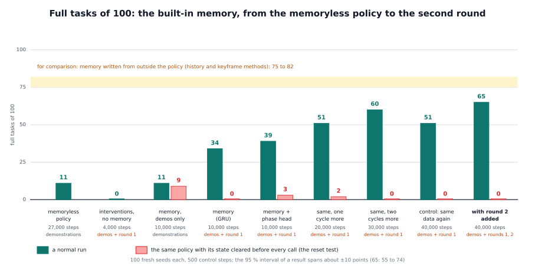

# The built-in memory: a state the policy keeps for itself

## The idea

**The problem.** In our reference task the robot picks up a red block, puts it back, and then picks up the blue one. When red
is back on the table, the scene looks almost as it did at the start. A block held just above the table looks the same
whether it is on its way up or on its way down ([the picture](detailed/memory_problem.svg)). A policy that decides from the
current pictures alone cannot tell where it is in the task. Ours completed 11 of 100 tasks.

The other methods in this framework fix this from outside the policy: a writer notes what is done, and the method puts it
into the prompt or into a picture. The built-in memory fixes it from inside. The policy keeps a small memory of its own, in
numbers, and learns from its training data what is worth keeping. Nobody writes the memory and nobody decides when.


How it works, in short:

- The policy, π₀.₅, has a **backbone** that reads the pictures and the prompt, and an **action expert** that turns what the
  backbone understood into the next movements. At every policy call the backbone already computes, on its way to the actions,
  a summary of what it sees: its numbers after block 12 (of 18), averaged over the prompt's words and over the pieces of each
  camera picture. That is 6,144 numbers.
- A small recurrent network, a **GRU** (gated recurrent unit), reads this summary once per call. A GRU keeps a **state**, here
  256 numbers, and updates it from its old value and the new input. This state is the memory. It is zero at the start of an
  episode and changes a little with every call.
- The state is turned into a signal for the action expert and added to its **conditioning**: the one signal that already
  tells the action expert how far it has come in making the actions (it makes them in ten small steps, starting from random
  noise). So every set of actions is computed with the episode's past in view.
- The signal starts at exactly zero. An untrained memory changes nothing, and training begins from the memoryless policy.
- The framework's part is small. The environment marks the start of each episode (`memory/new_episode`, `memory/episode`), the
  proxy passes the two markers on, and the policy server resets its state to zero at them. No writer is needed: the policy
  reads the plain instruction.

**Why it learns only from interventions.** A memory has to be needed before it is learned. In demonstrations by a scripted
expert the current picture already tells where the task stands in the moments that matter, so the memory never helps and
stays unused. In the robot's own runs there are scenes that look alike but need different actions, and
[learning from interventions](../learning_from_interventions/README.md) records the right action in exactly those scenes. A
window of the last frames in place of the recurrent state was tried and not adopted
([the frame window](../frame_window/README.md)).

**What it cannot do:**

- **It learns a memory only from data that need one,** which means intervention data: a simulator with a scripted expert, or a
  person who takes over on a real robot. The framework describes how to record them but ships no tool for it.
- **It is hard to look into.** We can read the task phase out of the state and we can test whether the policy acts on it, but
  we do not know in what form the rest is kept.
- **It belongs to one policy.** The reference implementation is for π₀.₅ on openpi. Another policy needs the five design
  decisions of the detailed page and its own training.
- **One server holds one episode at a time**: the state is a single array, so each environment needs its own policy server.
- **The evidence is one simulated task**, with one training run per setting.

How it works in the code, how the data are made and how to carry it to another VLA: [detailed/README.md](detailed/README.md).

## Prerequisites

- A policy with the memory and its server: the reference implementation for π₀.₅ on openpi in
  [integrations/openpi](../../../integrations/openpi/README.md), or another VLA built along the same five decisions.
- Training data that require memory: the demonstrations plus intervention episodes, each dataset with a **feature cache**, the
  file of the backbone's summaries for every recorded step (the format is in `sequences.py` of the integration; the framework
  has no script that computes it).
- An environment that marks its episodes: `memory/new_episode` at the first call of an episode and `memory/episode`, an id,
  as `vla_memory.env_keys.ControlKeys` sends them.
- One GPU. In our setup 10,000 training steps took about 6.5 hours on one RTX 3090.

## How to use it in the framework

1. **Train** the memory with the integration's launcher, in openpi's environment (its README gives the paths to set):

   ```
   python -m builtin_memory.train --exp-name <name> --init-checkpoint <checkpoint dir> \
       --dataset <demonstrations repo id> <its feature index> --dataset <interventions repo id> <its feature index> \
       [--phases 4] [--feature-stats <stats.npz>] [--steps 10000]
   ```

   It starts from the memoryless policy with the backbone frozen and trains 10,000 steps on the demonstrations and the
   intervention episodes. A further cycle of 10,000 steps continues from the last checkpoint.
2. **Serve** a checkpoint and put the proxy in front of it. The policy reads the plain instruction, so no writer is needed:

   ```
   python -m builtin_memory.serve --checkpoint <checkpoint dir> --port <policy port> --center-crop 0.95
   python -m vla_memory.proxy --writer off --task task.yaml --listen-port <port> --upstream-port <policy port> [--memory-reset every-call]
   ```

   `--task` names the task file; for the reference task it can be left out. The proxy forwards `memory/new_episode` and
   `memory/episode` unchanged, and the server resets its state at them. Every reply carries `memory`: the call within the
   episode, whether it was reset, the length of the state vector and the phase the phase head reads.
3. **The reset test.** `--memory-reset every-call` marks every call as a new episode, so the server clears the state before
   every call. If the policy really uses its memory, its success must fall. Ours fell from 65 of 100 to 0.

## Our findings

Reference task: pick up and put back a red and then a blue cube with a Franka arm in Isaac Sim. Every result is **full tasks
of 100**: how many of 100 fresh random starts (100 fresh seeds, never used for training or for choosing a checkpoint) the
robot finished within 500 control steps, with a policy call every 8 steps. The policies continue from the memoryless π₀.₅
policy with the backbone frozen; their steps count from there. The intervention episodes were recorded in the memoryless
policy's runs (round 1) and in the memory policy's runs (round 2):

| policy | memory | training data | steps | full tasks of 100 | memory cleared before every call |
|---|---|---|---|---|---|
| memoryless policy | none | demonstrations | 27,000 | 11 | |
| interventions without memory | none | demonstrations + round 1 | 4,000 | 0 | |
| memory, demonstrations only | GRU + phase head | demonstrations | 10,000 | 11 | 9 |
| memory | GRU | demonstrations + round 1 | 10,000 | 34 | 0 |
| memory with phase head | GRU + phase head | demonstrations + round 1 | 10,000 | 39 | 3 |
| the same, two more cycles | GRU + phase head | demonstrations + round 1 | 20,000 / 30,000 | 51 / 60 | 2 / 0 |
| the same, a fourth cycle (control) | GRU + phase head | demonstrations + round 1 | 40,000 | 51 | 0 |
| the same, with the second round | GRU + phase head | demonstrations + rounds 1 and 2 | 40,000 | 65 | 0 |



- **Memory and interventions need each other.** The memory trained on demonstrations stays at the memoryless policy's 11. The
  interventions without a memory sink the policy to 0. Together they reach 34 to 39 at 10,000 steps.
- **The gain lives in the state.** With the state cleared before every call, every memory policy trained on interventions
  falls to 0 to 3 of 100. The only exception is the one trained on demonstrations alone (11 and 9): its memory carried nothing.
- **The state holds the task phase.** In the best policy a linear probe, a simple classifier, reads the phase (pick up red,
  place red, pick up blue, place blue) from the state with a balanced accuracy of 0.99, and from the current call's summary
  alone with 0.78. Balanced accuracy counts each of the four phases equally, so guessing scores 0.25.
- **The policy acts on what the state holds.** We swapped the state at two moments that look almost the same. A state saying
  "nothing done yet", put in after red was placed back, sent the robot back to red in 70 % of the cases (never with its own
  state). A state saying "red done", put in before red was lifted, sent it to the blue block first in 41 % (1 % with its own).
  A state taken from another episode with the right history worked like the robot's own (59 and 53 full tasks against 57), so
  what the state says decides, not where it comes from. A planted history lasted a median 33 and 21 policy calls
  ([the picture](detailed/memory_audit.svg)).
- **More training and a second round help.** Two more cycles on the same data raised the policy with the phase head from
  39 to 51 and 60. A fourth cycle gave 51, not clearly different from 60. A second round of interventions recorded with
  the memory policy driving gave 65 against 51 for the control that trained the same number of steps on round 1 alone, a
  clear difference. The difference opens between red and blue: 90 against 76 episodes reached the blue block.
- **The memory costs almost nothing per call:** a median of 173 to 179 ms per policy call with it, 174 ms without it, on the
  same setup.
- **What did not work before.** A memory without training (TempoFit, which mixes the keys and values of earlier calls into the
  current one) acted as noise for our policy: the more layers it touched, the worse the robot moved. Choosing the action
  expert's starting noise changed the details of a movement, not the decision to lift or to let go. And none of five small
  memory networks trained offline on the demonstrations, to predict the expert's next actions from the frozen policy's
  summaries, did better than no memory, because in the demonstrations the current picture alone already tells the phases
  apart.
- **Other ways to give the policy a past.** A window of the last 8 to 16 calls' summaries in place of the recurrent state, with
  the same data and recipe, completed 6 to 12 of 100 ([the frame window](../frame_window/README.md)). Memory written from
  outside the policy still does better on this task (history method 75 to 82, keyframe method 75 to 79, depending on the writer); 27 of the best
  memory policy's 35 failures are failed grasps.
