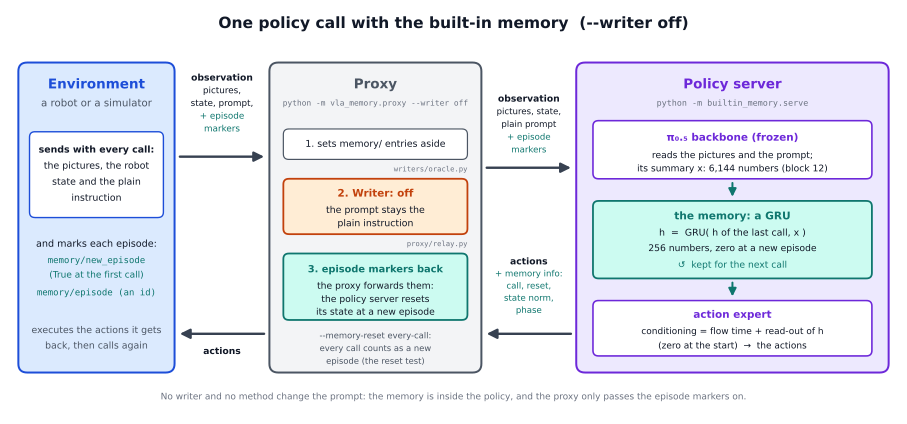
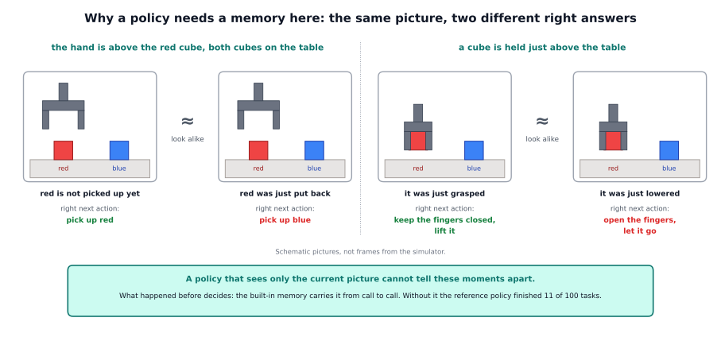
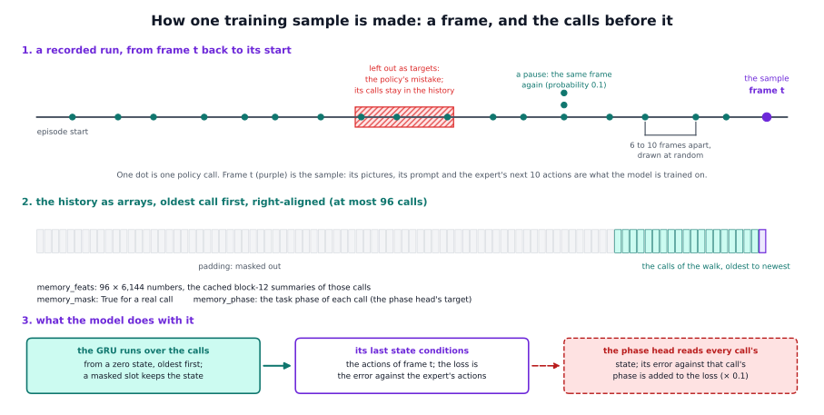
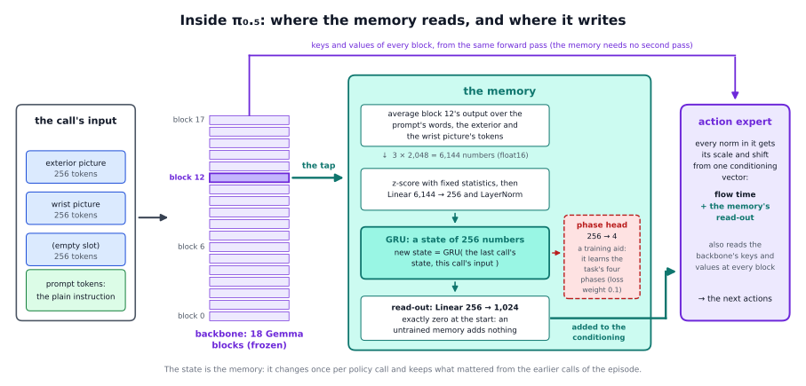
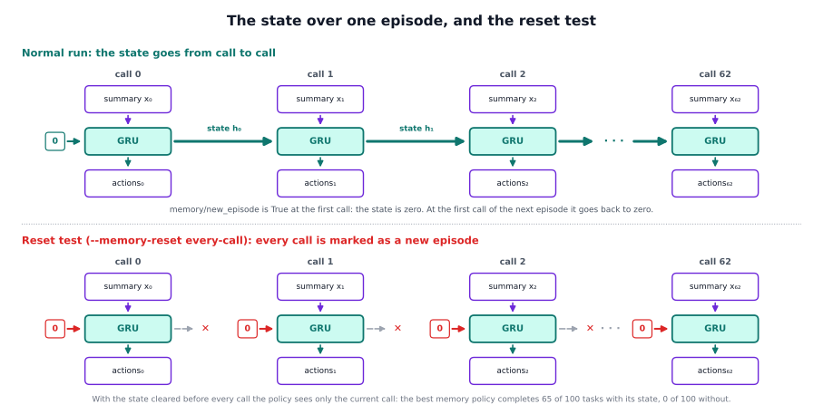

# The built-in memory in detail

The short page, [docs/methods/builtin_memory](../README.md), says what the built-in memory is and what we found. This page
explains why we built it this way, how the code works from the training launcher and the policy server to the proxy's
episode markers, how the data are made, and how to use it with another policy or task.

## 1. The problem and the premise

### The reference task needs a memory

In the reference task the robot picks up a red block, puts it back where it was, and then does the same with a blue block.
The policy decides from what it sees now: two camera pictures, the robot's state and the prompt. It has no memory of earlier
calls. Two kinds of moments look alike and need different actions:

- After red is back on the table, the scene looks almost like the start of the episode. At the start the next block is red;
  now it is blue.
- A block held just above the table can be on its way up (it was just grasped: lift it) or on its way down (it was just
  lowered: open the fingers).

The pictures are schematic. A policy without a memory completed 11 of 100 tasks.

### The premise: a memory inside the network, learned from data

The other methods in this framework write the memory outside the policy: a writer decides that a skill is done, and a method
turns that into words (the sub-goal and history methods) or into a picture (the keyframe method). They work well on this
task. But somebody has to decide what to write and when: a simulator's
tracker, rules on the gripper, a vision-language model, or a trained head. For a new task someone must say what counts as an
event.

The built-in memory tries the opposite. There is no writer and no definition of events. The policy has a small memory inside,
and its training decides what the memory keeps. Three design questions had to be answered:

1. **Where is the memory kept?** In a recurrent state of 256 numbers, updated once per policy call by a GRU (gated
   recurrent unit, a small standard recurrent network). A recurrent state keeps the same size however long the episode
   is, costs almost nothing per call, and can be trained on whole episodes. (A window of past frames is the other
   obvious choice. We tried it; see [the frame window](../../frame_window/README.md).)
2. **What does it read?** The policy's own summary of the call: the numbers of its language backbone after block 12, averaged
   over the prompt's words and over each camera's picture tokens. The policy has already computed them for its actions, so
   reading them costs no extra pass, and they already hold what the policy understood about the scene.
3. **Where does it write?** Into the action expert's conditioning, the signal that reaches every normalisation layer of the
   action expert (section 3 explains it). The memory's contribution starts at exactly zero, so an untrained memory changes
   nothing and training starts from the memoryless policy.

### What we tried first

Three earlier attempts shaped the design:

- **A memory without training.** TempoFit (section 2) keeps the keys and values of earlier policy calls and mixes them into
  the current call, with no training at all. For our policy it acted as noise: the more layers it touched, the worse the
  robot moved. So the memory has to be trained into the policy.
- **Steering through the starting noise.** The action expert starts from random noise, and a different noise gives a slightly
  different action chunk. Choosing the noise changed the details of a movement, not the decision to lift or to let go. So
  the memory has to reach the policy's decision.
- **A small memory trained offline on the demonstrations,** to predict the expert's next actions from the frozen policy's
  summaries. None of five memory networks did better than no memory, because in the demonstrations the current picture
  alone already tells the phases apart. That led to the lesson below.

### Why the data matter

The last test points at the central lesson of this method: **a memory is learned only when the data require it.**

- A scripted expert's demonstrations can be imitated from the current frame alone. After it puts red back, its arm is visibly
  somewhere else, and its grasps do not fail. Neither the action loss nor a learned memory ever gains from using the past.
- The robot's own runs reach the ambiguous scenes of the picture above: a hand hovering above red after the put-back, a cube
  held low after a failed or a successful grasp. The right action there depends on what happened before.
- [Learning from interventions](../../learning_from_interventions/README.md) records exactly this: the policy runs, and when
  it makes a mistake that a memory would have prevented, a scripted expert takes over and shows the right continuation. The
  data then hold look-alike scenes with different right actions. With a memory such data teach something. Without a memory
  they contradict each other.

## 2. Related work

- **MemBodied** (Pala et al., 2026, arXiv 2609.28256) keeps a fixed-size state in each layer of the action expert of π₀ and
  π₀.₅, read through one extra token and trained on sequences of calls. It is the closest in spirit. We use a GRU, read the
  policy's own summary and write into the conditioning. MemBodied found that a memory carried from one episode into the next
  hurts; here the state is reset at every episode marker.
- **SmoLSTM** (arXiv 2609.22854) keeps a matrix-LSTM state that is never reset inside an episode; reset at every step, it
  loses most of its success.
- **μVLA** (Cherepanov et al., 2026, arXiv 2606.12497) carries learnable memory tokens from step to step: a state in the input
  instead of a signal in the conditioning.
- **RoboMME** (Dai et al., 2026, arXiv 2603.04639) found that a recurrent memory on π₀.₅ stays weak without deeper
  integration: a recurrent state needs a good entry point and good training.
- **Present but Not Remembered** (arXiv 2607.03372) found that policies trained on demonstrations that are close to Markov
  ignore their past, because they can reconstruct it from the present.
- **Counterfactual Memory Audit** (arXiv 2609.27247) gives a policy two different histories at the same present state and
  checks whether its choice follows the history: the idea behind the state swap (section 6).
- **TempoFit** (Sun et al., 2026, arXiv 2603.07647) is a training-free key and value memory retrofitted onto π₀.₅; we tried
  it first (section 1).
- **NativeMEM** (Wang et al., 2026, arXiv 2607.06678) and **MEM** (Torne et al., 2026, arXiv 2603.03596) keep past frames,
  the family of the [frame window](../../frame_window/README.md).

## 3. How it works, step by step

### The pieces

The reference implementation is the folder `integrations/openpi/builtin_memory/`. It extends stock openpi (commit `215abfb`)
from the outside, by subclasses and copies of a few openpi functions; no openpi file is changed, and nothing in `vla_memory`
imports it. On the same observations and random numbers it gives the same actions, states and phase probabilities as the
implementation that produced the results below, identical to the last digit when both run the same GPU kernels.

| file | what it does |
|---|---|
| `train.py` | the training launcher: `main`, `train`, `run_steps` |
| `config.py` | the reference recipe: `model_config`, `RedBlueDataConfig`, `train_config`, `serving_config` |
| `data.py` | the training data: `HistoryDataConfig`, `create_data_loader`, `HistoryDataLoader`, `frame_keys` |
| `sequences.py` | the call histories of the training samples, from the feature cache: `HistorySpec`, `FeatureIndex`, `call_frames`, `HistoryDataset` |
| `training.py` | what the memory changes in the training: `frozen_backbone`, `MemoryAdamW`, `MemoryWeightLoader` |
| `model.py` | the model: `MemoryPi0Config`, `MemoryPi0` (the GRU, the read-out, the phase head, the loss, the sampling), `MemoryObservation` |
| `pooling.py` | the memory's input: `PoolingModule`, `PoolingBlock`, `pool_prefix` |
| `policy.py` | the stateful policy: `MemoryPolicy`, `create_policy`, `load_params` |
| `serve.py` | the policy server: `main` |
| `vla_memory/proxy/relay.py`, `proxy/cli.py` | the proxy: `Relay.episode_markers`, the option `--memory-reset` |
| `vla_memory/env_keys.py`, `writers/oracle.py` | the environment's markers (`ControlKeys`) and the writer `off` (`OffWriter`) |

### The training path, from the launcher to the loss

1. **The launcher** (`python -m builtin_memory.train`, `train.main`). It reads the command line (`build_parser`): the
   run's name, `--init-checkpoint` (the checkpoint to continue, with its weights and its normalisation statistics), one
   `--dataset <repo id> <feature index>` pair per dataset (the first gives the task), `--phases` (the number of phases
   that the phase head, an optional extra output of the memory, learns to name: 4 for the reference task, 0 for no
   head), `--feature-stats`, `--steps` and a few more.
2. **The recipe** (`config.train_config`) builds openpi's `TrainConfig`:
   - the model, `model_config(phases)`: a `MemoryPi0Config`, that is π₀.₅ with LoRA (small trainable add-on matrices) on both
     experts, ten actions per call, no state tokens, a memory state of 256, features from block 12, and a phase head of
     `phases` classes;
   - the data, `HistoryDataConfig`: the task's own data config (`RedBlueDataConfig`: the keys and pictures of the task and the 8
     action numbers back), the other datasets, their feature indexes and the history cap of 96 calls;
   - the weights, `MemoryWeightLoader`: it loads the init checkpoint, and everything the checkpoint lacks (the memory's
     parameters, the LoRA weights) keeps its fresh initial value. A new memory therefore starts with a read-out of exactly
     zero;
   - what is frozen, `frozen_backbone()`: the picture encoder, the language backbone with its LoRA weights, and the action
     expert's base weights, so that the cached summaries stay exact. What trains: the action expert's LoRA weights, the action
     and time projections, the memory and the phase head;
   - the optimiser, `MemoryAdamW`: openpi's AdamW with the gradient clipped to a norm of 1.0, and ten times the learning rate
     for every parameter whose name contains `memory_`;
   - the schedule: 200 warm-up steps, then a cosine decay from 1e-5 to 1e-6 over `--steps`, at batch 16.
3. **The loop** (`train.train`). It loads openpi's own `scripts/train.py` as a module (`openpi_trainer`), sets up the logging
   and the checkpoint folder, builds the data loader (below), makes the training state (`init_train_state`, which is where the
   weight loader runs), and runs `run_steps`: one optimiser step per batch, a log line every 100 steps, a checkpoint every
   1,000 steps and at the last step. The loop is a copy of openpi's `main()` with one change: openpi's data loader reads one
   dataset and turns every batch into its `Observation`, which has no place for a call history.
4. **The data loader** (`data.create_data_loader`). For every dataset it builds openpi's torch dataset
   (`create_torch_dataset`), concatenates them in the given order, applies the task's transforms (`transform_dataset`) and
   wraps the result in `HistoryDataset`. A sample is a frame with its pictures, prompt and the next 10 actions, plus its call
   history (`HistoryDataset.history`):
   - `call_frames` walks back from the frame: the gap to the next older call is drawn uniformly from 6 to 10 frames, because
     the run-time spacing is 8; after each call, with probability 0.1, the call is repeated 1 to 3 times on the same frame (a
     pause). The walk stops at the episode's first frame or after 96 calls;
   - the summaries of those calls are read from the feature cache (`FeatureIndex.features`, memory-mapped) and put
     right-aligned into three arrays: `memory_feats` (96 × 6,144, float16: a compact number format), `memory_mask` (96,
     true for a real call) and `memory_phase` (96, the phase label of each call, −1 where unknown).

   `HistoryDataLoader` hands each batch to the model as a `MemoryObservation`.
5. **The loss** (`MemoryPi0.compute_loss_and_metrics`):
   1. `memory_scan` runs the GRU over the history from a zero state, oldest call first; a masked slot keeps the state. It
      returns the last state and the state after every call.
   2. `memory_out(last state)` is the memory's conditioning for the action expert.
   3. With a phase head, `phase_loss` reads the phase from every call's state (`memory_head`) and takes its
      cross-entropy (the usual loss of a classifier: low when the true class gets a high probability) against the labels
      (calls with label −1 are skipped).
   4. `flow_loss` is the action loss. The action expert is trained by flow matching: it gets a noisy version of the expert's 10
      actions and must predict the direction back to the clean ones; the loss is the mean squared error. Its conditioning is
      the flow time plus the memory's conditioning (`embed_suffix`). Because the backbone is frozen, the prefix (pictures and
      prompt) is computed once without gradient and the action expert reads its keys and values, exactly as at run time
      (`_suffix_on_frozen_prefix`); this made a training step 2.7 times faster.
   5. The total loss is the action loss plus 0.1 times the phase cross-entropy.

### What happens inside the model at one call

π₀.₅ has two parts. A language **backbone** of 18 Gemma blocks reads the input: 256 tokens for each of three image slots (the
outside camera, the wrist camera and a third slot that is empty in the reference task), then the tokens of the prompt. A
**token** is the list of 2,048 numbers the network uses for one piece of input, such as a patch of a picture or a word piece.
Every block updates all the tokens; the running list of one token through the blocks is its residual stream. An **action
expert** of 18 blocks reads the backbone's keys and values at every block, the "prefix cache", and produces the next
movements. It does so by flow matching: starting from random noise, it takes 10 small steps towards the 10 actions of the call.

At every step the action expert's normalisation layers scale and shift their numbers by amounts that a small network
computes from one **conditioning** vector of 1,024 numbers. In π₀.₅ this vector carries the flow time, how far the denoising
has come. The built-in memory adds its own vector to it.

One policy call (`MemoryPi0.sample_actions_memory`), as the server runs it:

1. **The prefix pass.** `embed_prefix` makes the tokens of the pictures and the prompt, and the backbone runs over them. In
   this one pass `PoolingModule` (`pooling.py`) also returns what the memory needs. Its blocks (`PoolingBlock`) hand back, besides
   the usual keys and values, the pooled input they receive (`pool_prefix`): the mean over the valid prompt tokens, the mean
   over the outside picture's 256 tokens and the mean over the wrist picture's 256 tokens. `pooled[l]` is the input of block
   `l`, so `pooled[13]` is the output of block 12.
2. **The summary.** `features = pooled[memory_layer + 1]` (`memory_layer` is 12): 3 × 2,048 = 6,144 numbers in the order text,
   outside, wrist, rounded to float16, the precision of the cache. The rounding is the same in training and at run time.
3. **The GRU.** `memory_scan` takes the summary and the old state. It z-scores the summary with fixed statistics (mean and
   standard deviation of the demonstration frames, stored with the parameters and not trained), applies `memory_in` (a Linear
   layer from 6,144 to 256 numbers) and a LayerNorm, and then one step of a GRU. Two gates decide what happens: the reset gate `r`
   decides how much of the old state goes into a new candidate `n`, and the update gate `z` decides how much of the old state
   is kept, `new state = (1 − z) · n + z · old state`. Everything in the memory is computed in float32.
4. **The read-out.** `memory_out` is a Linear layer from 256 to 1,024 numbers whose weights start at exactly zero.
5. **The actions.** `_denoise` runs the 10 flow-matching steps. At every step `embed_suffix` adds the read-out to the
   conditioning, so the memory modulates every norm of the action expert; the same read-out is used for all 10 steps of the
   call. The result is the action chunk.
6. **The new state** goes back to the server and is kept for the next call. If the model has a phase head, `phase_logits` is
   `memory_head(state)`; it is not used for the actions, only reported.

The memory has about 2.2 million numbers to learn (1,573,120 in `memory_in`, 394,752 in the two gate layers, 263,168 in the
read-out, 512 in the LayerNorm, and 1,028 in the phase head). A state is 256 numbers, 1 KB.

### The server

`python -m builtin_memory.serve --checkpoint ... --port ...` runs `serve.main`:

1. `serving_config(checkpoint)` builds the config the checkpoint is served with. It reads from the checkpoint the asset id of
   its normalisation statistics (`checkpoint_asset_id`) and whether it has a phase head (`checkpoint_phases`, from the shape
   of `memory_head`).
2. `create_policy` builds the policy as openpi's `create_trained_policy` does, with two differences: `load_params` restores
   the memory's parameters in float32 (their training precision) and every other parameter in bfloat16, and the input
   transforms end with an optional centre crop of the outside picture (`--center-crop 0.95`, the reference policies' setting).
   The result is a `MemoryPolicy`.
3. `WebsocketPolicyServer(policy, host, port, metadata=policy.metadata).serve_forever()`. The metadata tells the proxy the
   state's size and whether the state is cleared before every call.

At every call `MemoryPolicy.infer(obs)`:

1. asks `is_new_episode(obs)`: true at the very first call, when `memory/new_episode` is true, or when `memory/episode` has
   changed. Then `start_episode` sets the state to zeros (1 × 256) and the call counter to 0;
2. takes the state going in: zeros if the server was started with `--reset-every-call`, else the kept state;
3. removes every key that starts with `memory/` and runs the input transforms (normalisation, tokenising the prompt, the
   centre crop), as openpi's `Policy.infer` does;
4. calls the jitted `sample_actions_memory` (above), which returns the actions and the new state;
5. keeps the new state, unnormalises the actions, and adds `reply["memory"]` to the reply: `episode`, `call` (0-based),
   `reset` (this call started the episode), `reset_every_call`, `state_norm` (the length of the state vector) and, with a phase
   head, `phase` and `phase_probs`.

### The proxy's episode markers

The framework's part of the method is the episode contract.

- **The environment** marks its episodes with `vla_memory.env_keys.ControlKeys`: `start_episode(episode_id)` and then, at every
  policy call, `call(...)` or `observation(...)`, which add `memory/new_episode` (true at the first call after
  `start_episode`) and `memory/episode` (the id).
- **The proxy** (`vla_memory/proxy/relay.py`) takes every `memory/` entry out of the observation (`split_control_keys`). Its
  `Relay.infer` then asks the writer `off` (`OffWriter`, which sets `drives_prompt = False`), so `_decide_prompt` leaves the
  environment's instruction as it is. Then `observation.update(self.episode_markers(control_keys))` puts the two episode
  markers back, exactly as the environment sent them. They are the only `memory/` entries that reach the policy.
- **The reset test.** With `--memory-reset every-call` (`add_policy_memory_options` in `proxy/cli.py`, `MEMORY_RESETS` in
  `relay.py`) `episode_markers` sets `memory/new_episode` to true at every call. The proxy's own notion of an episode stays
  the environment's; only the policy is told to forget.
- **The policy** (`MemoryPolicy.is_new_episode`) resets at these markers, as above. The server's own `--reset-every-call` has
  the same effect; use one of the two.

### One episode, step by step

| call | what arrives | what the server does | the state after the call |
|---|---|---|---|
| the first call of an episode | `memory/new_episode` true, `memory/episode` "seed1001" | `start_episode`: the state is zero, the call counter 0; summary x₀, state h₀ = GRU(0, x₀) | h₀ |
| the next calls | `memory/new_episode` false, the same id | the state of the last call goes in: h₁ = GRU(h₀, x₁), and so on | h₁, h₂, ... |
| the first call of the next episode | `memory/new_episode` true (or a new id) | the old state is thrown away: reset | h₀ of the new episode |
| every call in the reset test | `memory/new_episode` true at every call | the state is zero before every call: h = GRU(0, x) | one call's worth only |

The reply's `memory` entry goes through the proxy to the environment. The episode ends at the environment's side; the server
needs no message for that, the next episode's first call resets it.

## 4. How its data are made

The memory trains on two kinds of episodes, and each dataset comes with a **feature cache**.

**The demonstrations.** A scripted expert performed the reference task 250 times in Isaac Sim. 200 episodes (63,644 frames,
about 320 per episode) train the policy and 50 check it. Every frame holds the two camera pictures, the robot's joint state,
the action, and the waypoint the expert was moving to, its phase. The prompt of every frame is the plain instruction, in one of
five wordings of the same sentence. The phase labels of the memory come from the waypoints: pick up red is waypoints 0 to 3,
place red 4 to 6, pick up blue 7 to 11, place blue 12 to 14.

**The intervention episodes.** The policy runs in the simulator and a scripted expert takes over at four kinds of mistakes
(the page on [learning from interventions](../../learning_from_interventions/README.md) describes the procedure). Round 1 was
recorded with the memoryless policy driving: 300 episodes plus 10 trial episodes, of which 127,378 frames were kept, in 856
stretches. Round 2 was recorded with the memory policy driving: 300 episodes, 103,962 kept frames in 520 stretches. In the kept
frames both the policy's actions and the expert's are targets; the frames of the mistakes are left out.

**The feature cache.** The memory reads one summary per call. The backbone is frozen, so the summary of a recorded step never
changes during training: it is computed once. The frozen memoryless policy runs its prefix pass over the step's pictures (centre
cropped as at run time) and its plain instruction, and the same pooling as in `pooling.py` gives the means over the text, the
outside picture and the wrist picture after block 12, rounded to float16. That is one row of 6,144 numbers (12 KB) per recorded
step. The cache of a dataset is an array file with these rows and an index file (`.npz`, described at the top of
`sequences.py`) with, for every episode, where its rows start, how many recorded steps it has and its episode number; the phase
label of every step (−1 where unknown); optionally `train_mask`, the steps that may be targets; and optionally `frame_step`,
which maps the frames of a training stretch to the recorded steps of their run.

- **Every recorded step gets a row**, also the steps left out of the training and the steps in which the expert acted. A
  sample's history therefore runs over the whole run: the memory sees the mistake happen, the policy does not imitate it.
- **The frame filter.** `train_mask` is false for the frames left out. They are never targets, but they stay in the histories
  of later samples.
- **The phase labels of the intervention episodes** are the simulator's tracker's phase for each step; "done" counts as place
  blue. One difference to the demonstrations: the tracker switches from "place" to "pick up" as soon as the cube rests and the
  gripper is open (for 3 steps), while the demonstrations' labels switch after the hand has moved away, a few frames later.
- **The mix.** All kept frames of all datasets, uniformly: 63,644 demonstration frames and 127,378 of round 1 (191,022 in the
  first training), later with the 103,962 of round 2. No re-weighting.

**Two differences between training and run time**, accepted and not modelled:

- In training the backbone sees the current frame with openpi's usual image augmentation, while the memory's summaries come
  from the cache, computed on clean pictures.
- The cache was computed in batches of 32 and the server runs batches of one. The numbers differ by rounding noise: a mean
  difference of 0.011 against a mean feature size of 2.5, up to 1.5 for a few large text numbers.

## 5. Limitations

- **It learns only from data that need a memory.** Trained on the demonstrations alone, it stays unused.
- **It needs intervention data.** In simulation that means privileged state and a scripted expert; on a real robot, a person
  who takes over. The framework describes the procedure and ships no tool for it.
- **One task, one simulator, one policy.** It was built and tested on the reference task in simulation, with one training
  run per setting.
- **A black box.** The phase can be read out of the state, but we do not know in what form the rest of the 256 numbers is
  kept.
- **Long episodes are untested.** An episode of the reference task has at most 63 calls. How well the state keeps a fact
  over much longer episodes is not known.
- **Episodes must be marked.** The state is reset only at `memory/new_episode` or a new `memory/episode`. Without the markers it
  carries over from one episode into the next, which MemBodied (section 2) found to hurt. One server holds one episode at a
  time, so each environment needs its own policy server.
- **Training and run time differ a little:** the image augmentation, and the batch size of the cache (section 4).
- **The labels differ a little in timing:** the tracker's phase switches earlier than the demonstrations' (section 4).
- **It belongs to one policy.** The summaries are those of one checkpoint's backbone. Another model, another fine-tune or a
  backbone that is trained further needs new caches and a new training.
- **The integration is red/blue-only in its data configuration** (`RedBlueDataConfig`, `--phases 4`): another task brings its own.
- **Grasping is not helped.** The memory tells the policy what has happened, not how to grasp.
- **Compute.** A training cycle of 10,000 steps takes about 6.5 hours on one GPU, and a good policy needs several cycles and
  rounds of intervention data.

## 6. Using it with another policy or task

For the same kind of policy (a VLA with a language backbone and an action head that you can train), nothing in the proxy
changes; the environment only has to send the episode markers. The steps:

1. **Train the memoryless policy** on demonstrations of your task with the VLA's own training code. It is the starting point and
   the source of the summaries.
2. **Record intervention episodes** with the memoryless policy driving (the page on
   [learning from interventions](../../learning_from_interventions/README.md)), keeping the pictures of every step.
3. **Make the feature caches** of every dataset: run the frozen policy's forward pass over every recorded step and pool as
   `pooling.py` does, write the rows and the index (`sequences.py`), and compute the mean and standard deviation of the
   demonstration frames' 6,144 numbers (`--feature-stats`).
4. **Write your task's data config.** `config.RedBlueDataConfig` shows what it must give: the keys and pictures of your
   robot and its action numbers. Use it in `train_config` in place of the reference's. `--phases` is the number of phases of
   your task, or 0 for no phase head.
5. **Train** with `builtin_memory.train`, one cycle after the other from the last checkpoint, and choose the checkpoint on
   development seeds. The gaps between the calls of a history (6 to 10 frames, for a policy called every 8 steps) are set in
   `HistorySpec` in `sequences.py`; for another call spacing change them there.
6. **Serve and test.** Serve with `builtin_memory.serve`, mark the episodes in your environment with `ControlKeys`, and put the
   proxy with `--writer off` in front. Three checks tell whether the policy uses its memory: the reset test
   (`--memory-reset every-call` clears the state before every call; the success must fall), a probe (a small classifier
   that reads the phase out of the state) and a state swap (give the policy the state of another episode at the same scene
   and see whether its choice follows the state).
7. **Record round 2** with the memory policy driving. The policy server keeps and updates its state during the expert's
   segments.

For a VLA that is not π₀.₅ the five decisions of the short page carry over, and what you rewrite is the part of the integration
that touches the model: `pooling.py` (where the summary is taken from the forward pass), `model.py` (where the read-out enters
the action head), `policy.py` (the per-episode state) and `train.py`. The sequence histories (`sequences.py`), the markers and
the proxy stay as they are.
