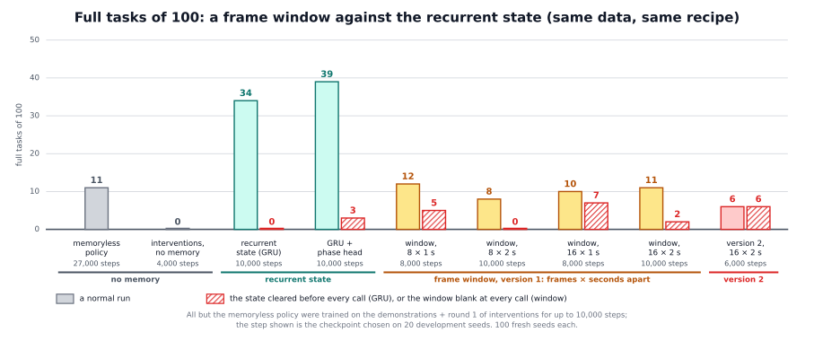

# The frame window: tried and not adopted

## The idea

**Status: evaluated in two versions, neither worked. The code is not in the framework.** This page records what we tried and
what the measurements showed, so that the attempt is not repeated without need.

**The problem.** In our reference task the robot picks up a red block, puts it back, and then picks up the blue one. When red
is back on the table the scene looks almost like the start, so a policy that sees only the current pictures cannot tell what is
already done. It completed 11 of 100 tasks. The most obvious way to give a policy a past is the one that works for a person
watching a video: show it its last few frames. Any claim about a memory needs this comparison ("why not simply give the policy
its last frames?"), so we built it.

**What we built.** A *frame window*: the last X policy calls at a spacing of Y seconds. Each past call is not kept as two
pictures but as the summary the policy itself computes for it: the numbers of its language backbone after block 12, averaged
over the prompt's words and over each camera's picture tokens, 6,144 numbers. A small module pools the X summaries into one
vector by attention (a learned weighting of the slots) and adds it to the action expert's conditioning signal. Everything
else is identical to the recurrent memory of the [built-in memory](../builtin_memory/README.md): the same summaries, the same
data, the same entry point into the action expert, the same frozen backbone, the same training. So any difference in the
result comes from the window against the recurrent state, and from nothing else.


**What happened.** Both versions completed far fewer tasks than the recurrent state with the same data and steps. The policy
did use its window, but the attention never learned to pick the frames that matter. When a second version did select
somewhat and carried the task phase in its output, the action expert still did not act on it.

**What it cannot do:**

- **It does not replace a recurrent state on this task.**
- **It does not find the decisive frame by itself.** In the first version the attention was almost flat, so the window acted
  as a plain average of the last X frames, in which the moment that matters is one frame of 8 or 16.
- **A longer or denser window does not help.** 8, 16 or 32 seconds of history, at 1 or 2 seconds apart, gave the same.
- **Selecting and encoding the phase were not enough** in the second version (see "Our findings").
- **The reason is a hypothesis, not a measurement:** how the signal reaches the actions. The recurrent state is updated once
  per call and trained through the whole episode, so its read-out stays consistent from call to call. The window's read-out
  is recomputed at every call from whichever frames fall into its slots.
- **Its code is not in the framework**, so the results cannot be repeated from this repository.

How both versions worked, and how to rebuild a window on the built-in memory's code: [detailed/README.md](detailed/README.md).

## Prerequisites

Nothing in the framework runs it. To repeat the experiment you would need what the built-in memory needs: π₀.₅ on openpi with
the [built-in memory's integration](../../../integrations/openpi/README.md), training data that require a memory (the
demonstrations and intervention episodes, each with a feature cache of the backbone's summaries), and one GPU.

## How to use it in the framework

You cannot run it: its code was left out of the framework as a negative result. If you want to try it again, the built-in
memory's integration is the base, because the window and the recurrent state differ in one place only:

- `pooling.py` already gives the summary of every call from the same forward pass that computes the actions.
- `sequences.py` already builds, for a training frame, the calls before it; the window picks its slots from that history.
- In `model.py` the window module replaces the GRU step (`memory_scan`); its read-out enters the action expert's conditioning
  at the same place.
- The policy server keeps every call's summary of the episode with its call number, since the window is picked from them at
  every call (a call every 8 control steps, 15 control steps a second). It resets at the episode markers as the built-in
  memory does.
- The proxy side is the built-in memory's: it forwards the episode markers, and `--writer off` leaves the instruction alone:

  ```
  python -m vla_memory.proxy --writer off --task task.yaml --listen-port <port> --upstream-port <policy port>
  ```

  `--task` names the task file; for the reference task it can be left out.

The test of whether a window is used is the window version of the reset test: empty the window at every call and see
whether the success falls.

## Our findings

Reference task: pick up and put back a red and then a blue cube with a Franka arm in Isaac Sim. Every result is **full tasks of
100**: how many of 100 fresh random starts (100 fresh seeds) the robot finished within 500 control steps. All policies continue
from the memoryless π₀.₅ policy with the backbone frozen and train 10,000 steps on the demonstrations and the first round of
intervention episodes. A window is "blank" when it is empty at every call:

| policy | full tasks of 100 | with the window blank (or the state cleared) |
|---|---|---|
| memoryless policy (reference) | 11 | |
| interventions without any memory (reference) | 0 | |
| recurrent memory, GRU (reference, same data and recipe) | 34 | 0 |
| recurrent memory with phase head (reference) | 39 | 3 |
| window, version 1: 8 frames × 1 s / 8 × 2 s / 16 × 1 s / 16 × 2 s | 12 / 8 / 10 / 11 | 5 / 0 / 7 / 2 |
| window, version 2: 16 × 2 s, query from the current frame, phase head | 6 | 6 |



- **Version 1 was used, but it did not help enough.** Blanking the window lowered the sequence score (the average number
  of milestones reached, 0 to 7) in all four settings, by far more than chance would explain. All four settings clearly
  beat the policy trained on interventions without a memory, but stayed at the memoryless policy's level and far below
  the recurrent memory: for the 16 × 2 s window 11 against 34, where, of the seeds that only one of the two completed, 5
  went to the window and 28 to the recurrent memory. Window length and spacing made no difference.
- **The attention was flat.** Its entropy, a measure of how evenly it spreads over the slots, was 98 to 99.6 % of the maximum
  that an even spread would give, and flat over the slots' age. At the moment the policy has to decide that red is done, the
  frames showing red held aloft were in the window in 93 to 100 % of the calls and received their equal share of the attention
  (0.99 to 1.12 times), in the episodes that then went for blue and in those that went back to red alike
  ([the picture](detailed/window_attention.svg)).
- **Version 2 selected somewhat, and it did not matter.** Its attention moved away from flat (entropy 0.83 of the
  maximum), but gave the decisive frames only 1.6 times their equal share, regardless of the outcome. Its phase head
  learned the task phase from the pooled window (accuracy 0.99 in training). The policy completed 6 tasks with the
  window and 6 without it (nothing separates the two): the action expert did not use the signal.
- **Both versions grasped at the wrong place more often** than the recurrent memory: the gripper closed with no cube within
  6 cm in 21 to 40 episodes, against 6 to 11 for the recurrent memory. With the window blank this hardly happened, so the
  window input shifted where the arm went down. Both versions lifted red more often than the memoryless policy (37 to 61 of
  100 against 31) without finishing more tasks. The policy call took the same time (about 175 ms).
- **Memory written from outside the policy did not need any of this.** A writer chooses one moment and the policy reads
  it: 75 to 82 of 100 with the history and keyframe methods, whichever the writer. Choosing the moment is what the window
  never learned, which fits UniMem's finding that keyframes chosen at events beat uniformly spaced frames.
