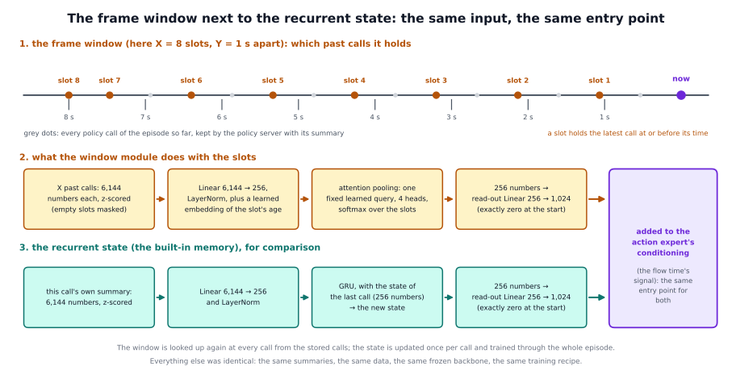

# The frame window in detail: what we tried and why it went wrong

The short page, [docs/methods/frame_window](../README.md), says what the frame window is and that it did not work. This
page explains why we tried it, how both versions worked, why they went wrong, and what we learned from it. The window's code
is not in the framework, because it is a negative result; this page describes the mechanism so that it can be understood
and, if someone wants, rebuilt.

## 1. The question

The task needs a memory (the page on the [built-in memory](../../builtin_memory/README.md) explains why): after red is put
back the scene looks like the start, and a held cube looks the same going up or down. The memoryless policy completed 11 of 100
tasks.

The most direct way to give a policy a past is to show it its last frames. A person would solve the task that way, and it is the
baseline that every memory claim needs: "why not simply give the policy its last frames?" We wanted a comparison that is as
clean as possible, so the window was built to differ from the recurrent memory in one place only. It reads the same summaries
of the policy's own backbone, learns from the same data, writes into the same place of the action expert, with the same frozen
backbone and the same training recipe. If the two policies differ, the difference is the window against the recurrent state.

## 2. Related work

- **RoboMME** (Dai et al., 2026, arXiv 2603.04639) reports a frame window working on π₀.₅: 2 to 8 past frames, each
  compressed to one token and fed through the action expert's modulation, with a regulariser that predicts past tokens against
  copycat behaviour. Our window is fed the same way but has no such regulariser.
- **NativeMEM** (Wang et al., 2026, arXiv 2607.06678) compresses every past frame of π₀.₅ to one token with the policy's own
  vision encoder and appends it to the input: another window that worked, with a different entry point.
- **MEM** (Torne et al., 2026, arXiv 2603.03596) keeps a video memory of frames about one second apart, close to our spacing,
  plus a language memory. **SimpleMemVLA** (Yin et al., 2026, arXiv 2609.05533) shows how long windows can be: the last 15 to
  126 seconds.
- **UniMem** (arXiv 2608.22869) and **KEMO** (arXiv 2606.23589) found that keyframes chosen at events beat uniformly spaced
  frames. Our window is uniform; the [keyframe policy](../../keyframe/README.md) picks its moment by an event.
- **SmoLSTM** (arXiv 2609.22854) argues that a recurrent state beats a wider observation window, because the window's length
  becomes a setting to tune and its cost grows with it. We tried exactly this comparison.
- **The copycat problem** (Wen et al., 2020, arXiv 2010.14876): a policy that sees its past can learn to copy its own earlier
  actions instead of looking at the scene.
- **Present but Not Remembered** (arXiv 2607.03372): policies trained on demonstrations that are close to Markov ignore their
  past. That is why the window is trained on the intervention data, as the recurrent memory is.

## 3. How it worked, version 1

### What the window holds

The window has X **slots** and a spacing of Y seconds. The simulator and the demonstrations run at 15 control steps a second, so
Y seconds are 15 × Y control steps. At a policy call, slot k (k from 1 to X) holds **the most recent earlier call at or before
k × Y seconds ago**:

- if k × Y seconds ago lies before the start of the episode, the slot is empty (masked);
- the current call is never in its own window: the backbone sees the current frame anyway;
- in training the same rule is applied to the sample's call history (the walk of the built-in memory page, with the same random
  draws), so the training windows are those of a policy that is called every 6 to 10 steps; with the call cap raised to 128 so
  that 32 seconds fit.

Four settings were trained:

| X (slots) | Y (seconds apart) | the history covered |
|---|---|---|
| 8 | 1 | 8 s |
| 8 | 2 | 16 s |
| 16 | 1 | 16 s |
| 16 | 2 | 32 s |

In the demonstrations the events fall at about 5.6 s (red picked up), 10 s (red placed) and 16.8 s (blue picked up); the robot's
own runs take longer, up to 40 s with interventions. 8 seconds reach from the moment before going for blue back to the red
placement; 32 seconds cover almost a whole episode.

### What the module does with the slots

1. **Each slot's summary:** the same 6,144 numbers as the recurrent memory reads (the backbone's block-12 means over the prompt,
   the outside picture and the wrist picture), z-scored with the same fixed statistics (each number minus its mean, divided
   by its spread).
2. **Embedding:** a Linear layer from 6,144 to 256 numbers, a LayerNorm, and a learned **age embedding** (256 numbers per slot,
   so that the module knows how old a slot is).
3. **Attention pooling.** A single learned **query** (256 numbers, initialised small) asks every slot a question through 4
   heads of 64 numbers each. Keys and values are Linear layers of the slots' embeddings; the score of a slot is the query times
   its key (divided by 8); a softmax over the slots turns the scores into weights that add up to 1. Empty slots get weight 0.
   The four heads' weighted sums are put side by side: 256 numbers. The query does not depend on the current call.
4. **Read-out:** a Linear layer from 256 to 1,024 numbers, starting at exactly zero, added to the action expert's conditioning
   as the recurrent state's read-out is. With no past frame at all the module adds exactly 0.

The module has about 2.0 million numbers to learn (1.57 million of them in the Linear layer of step 2).

### Training and run time

- **Training:** as the recurrent memory with the intervention data: 10,000 steps from the memoryless policy at batch 16, the
  backbone frozen, the same data (demonstrations and round 1 of interventions, uniformly), warm-up 200 steps, cosine decay
  1e-5 to 1e-6, ten times that for the module, a checkpoint every 1,000 steps and the same choice of checkpoint on development
  seeds.
- **Run time:** the policy server keeps, for the episode, every call's summary with its number, builds the window from them at
  every call (the same rule as in training) and resets at the episode markers. The summaries come from the same forward pass as
  the actions.
- **The blank window**, the window's version of the reset test: the window is emptied at every call, and the module then adds
  exactly 0. If the policy uses its window, it must get worse.

## 4. Why version 1 went wrong: the attention never learned to select

The policy did use its window: with the window blank it got worse. But it did not finish the task more often than the
memoryless policy, and far less often than the recurrent memory. After putting red back it often went back to red, and the
length and spacing of the window made no difference.

The reason showed at the **decision**, the policy calls just after red was put back, where the policy must see that red is
done:

- **The information was in the window.** The decisive frames, the ones that show red held aloft, were in the window at almost
  every call of the decision, also in the episodes that then went back to red.
- **The module did not look at them.** The attention was spread almost evenly over the slots, whatever their age, and the
  decisive frames got no more than their equal share, the same whether the robot then went for blue or back to red. The
  attention pooling acted as a plain average of the last X frames, in which the decisive moment is one frame in 8 or 16. This
  explains why length and spacing made no difference.
- **A probable cause, not tested:** the query is one fixed vector that does not depend on the current call, and the output
  layer starts at zero, so early in training no gradient reaches the query. The plain average already lowers the loss (it
  tells the policy whether a held cube is going up or down), and training stays there.
- **The window also moved the arm.** With the window, the gripper often closed at table height far from both cubes, which
  hardly happened with the window blank: the window input shifted where the arm went down.

The recurrent memory works differently. Its state is updated call by call, and it can hold "red is done" once it has seen it.
The window has to find the moment again at every call, and its pooling never learned to.

## 5. Version 2: a query from the current frame, and a phase head

Version 1's reading suggested two changes, made together for the 16 × 2 s setting (the best of the four on the development
seeds, the longest history, and the most even attention):

1. **The query is computed from the current call.** The current call's own summary goes through the module's input layer, the
   LayerNorm and a new Linear layer (256 to 256) and gives the query of the four heads. The module now asks which past frames
   matter for what the policy sees now. The fixed query is gone.
2. **A phase head on the pooled window vector.** A Linear layer from 256 to 4 numbers predicts the current call's phase (pick
   up red, place red, pick up blue, place blue); its cross-entropy, weighted 0.1, is added to the loss, as in the recurrent memory
   with the phase head. It gives the selection a training signal from the first step.

Everything else was unchanged. The two changes did what they were built for inside the module, and neither reached the
actions:

- **The attention moved away from flat**, leaning towards the newest slots. But it still did not select the decisive frames:
  it gave them about the same weight whether the robot then went for blue or back to red.
- **The phase head learned the phase** from the pooled window vector. So the phase was in the module's output.
- **The action expert did not use it.** The policy did as well with the window blank as with it, and no better than version
  1. The closings far from any cube remained.

## 6. What we learned

- **On this task a frame window is not a substitute for a recurrent state**, even when the right frames are in it, even when they
  are selected, and even when the window's output encodes the task phase. Two versions with the same features, data, entry point
  and training as the recurrent memory stayed far below it.
- **The difference is not where the information is but how it reaches the actions.** This is a hypothesis, not a measured cause.
  The recurrent state is updated once per call and trained through the whole episode, and its read-out stays consistent from
  call to call. The window's read-out is recomputed from scratch at every call from whichever frames fall into its slots, and
  the policy did not learn to rely on a signal that changes in that way. A direct test would train the window's read-out with the
  recurrent memory's objective, or feed the recurrent state through the window's read-out. We did not run it.
- **"Present but not remembered" had a second form here:** the input was consulted by the memory module (the attention moved, the
  phase head learned) and still not used by the controller.
- **Memory written from outside did not need any of this.** A writer chooses one moment and the policy reads it, as in the
  history and keyframe methods. Choosing the moment is what the window never learned. This fits UniMem's finding that events
  beat uniformly spaced frames (section 2).
- **Not tried:** a past-token-prediction regulariser, as RoboMME uses; frames chosen at events instead of at regular spacing;
  max pooling over the window; differences between consecutive summaries instead of the summaries themselves.

## 7. Limitations

- **One task, one policy, one data mix, one training per setting.**
- **Only 10,000 steps.** The recurrent memory improved with more training cycles; the window was not given any. At equal steps
  the comparison is fair, but we do not know whether more cycles would have helped the window.
- **Version 2 changed two things at once.** If it had worked, a follow-up without the phase head would have told them apart.
- **The cause is a hypothesis.** We saw that the attention did not select and that the action expert ignored a signal that the
  module carried; why it ignored it we did not test.
- **The window is uniformly spaced and fully learned.** Frames chosen by events, or a window with a regulariser as in RoboMME,
  are different designs that we did not test. Frame windows that worked in other papers were on other benchmarks with other
  designs.
- **The code is not in the framework**, so the window cannot be rebuilt from this repository alone.

## 8. Trying a window with another policy or task

1. Take the built-in memory's recipe for the other policy (the five decisions of its page): the summaries from a middle block,
   the entry point into the action head, a zero-initialised read-out, training on intervention data, the learning rate of the
   new module.
2. Replace the recurrent cell by the window: the server keeps every call's summary with its number, and picks the slots by the
   rule of section 3 at every call, in training and at run time alike. A rule that differs between the two would show the
   policy windows it was not trained on.
3. Test it the way we did: the window blank at every call (must hurt), the attention at the decision moment (does it select?),
   and the comparison against the recurrent memory with the same data and steps.
4. If you want it to work, start from what we did not try (section 6), and train the window's read-out with the recurrent memory's
   objective.
