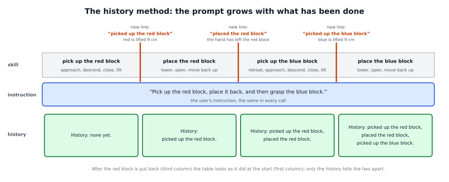
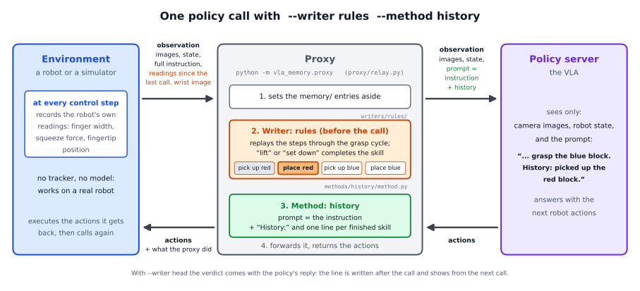
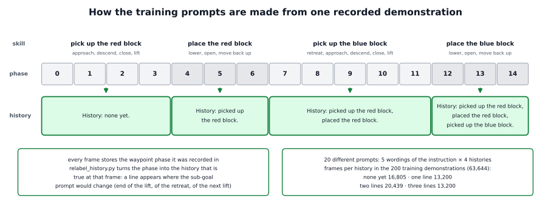

# The history method in detail

This page explains how the history method works: what the policy sees, how the proxy builds the prompt at every call, when a
new line reaches the policy, how the training data are made, and how to use the method with your own policy and task. What
the method is for and what we found are on the short page, [docs/methods/history](../README.md).



## The pieces

| file | what it does |
|---|---|
| `vla_memory/methods/history/prompt.py` | `HistoryPrompt`, the renderer: turns an instruction and a list of finished skills into the prompt |
| `vla_memory/methods/history/method.py` | `HistoryMethod`, the method: at every call it asks the writer for the finished skills, applies `--delay-calls`, cuts the list to the most lines it may show, and hands the list to the renderer |
| `vla_memory/methods/base.py` | `most_shown`: the most lines a method may show: `max_lines`, and never the last skill of the episode's plan |
| `vla_memory/writers/` | the writers. Each keeps the plan and a pointer into it; `completed()` returns the skills before the pointer |
| `vla_memory/proxy/relay.py` | `Relay.infer`: what happens at every policy call |
| `vla_memory/task.py` | `TaskSpec`: the task file; `parse_skill` splits a skill into its verb and its object |
| `training/relabel_history.py` | makes the training prompts (section 4) |

The parts that every writer and method share (the start-up, the server, the connection to the policy) are explained step by
step in the [oracle walkthrough](../../../writers/oracle/detailed/README.md).

## 1. What the policy sees

The prompt has three parts: the instruction as the environment sent it, the words " History: ", and the history text. In the
reference task there are four skills, so the policy sees one of four prompts. Here they are with the first of the five
trained wordings of the instruction:

| skills finished | the prompt |
|---|---|
| none | Pick up the red block with your arm, place it back, and then grasp the blue block. History: none yet. |
| pick up red | ... History: picked up the red block. |
| pick up red, place red | ... History: picked up the red block, placed the red block. |
| pick up red, place red, pick up blue | ... History: picked up the red block, placed the red block, picked up the blue block. |

- **The instruction is never changed.** The history is added at its end and adds 5 to 19 tokens (word pieces).
- **There is no fourth line.** When the blue block is set down the task is over. The demonstrations end during that last
  skill, so the training data never hold a line for the last skill of a plan, and the method never shows one (section 2,
  "The details").
- **The words must be exactly the trained ones.** A different wording at run time, even a missing comma, is a prompt the
  policy has never seen. That is why the training script and the method make the text with the same code (section 2).

The words come from the `history` section of the task file:

```yaml
history:
  prefix: " History: "
  none: "none yet"
  events: {"pick up": "picked up the {object} block", "place": "placed the {object} block"}
  joiner: ", "
  suffix: "."
  max_lines: 3
```

| key | what it is | default |
|---|---|---|
| `prefix` | the text between the instruction and the history, spaces included | " History: " |
| `none` | the history before any skill is finished | "none yet" |
| `events` | one past-tense phrase per verb; `{object}` is replaced by the skill's object | none: a verb without a phrase keeps the skill's own words |
| `joiner` | the text between two phrases | ", " |
| `suffix` | the text after the last phrase | "." |
| `max_lines` | the most lines shown: the longest history in the training data | none: every skill but the plan's last |

Set `max_lines` to the longest history of your training data. With or without it, the method never shows a line for the last
skill of the episode's plan, and neither does the training script. The same section also holds settings that the method does
not read: `rules`, `object_from`, `held_region` and `held_min_share` belong to the
[rules writer](../../../writers/rules/README.md).

## 2. How the proxy builds the prompt



This section follows one run of

```
python -m vla_memory.proxy --writer rules --method history --task vla_memory/tasks/red_blue_blocks.yaml \
    --listen-port 8001 --upstream-port 8000
```

### The renderer: from finished skills to text

`HistoryPrompt.render(instruction, completed)` works in three steps. Take the finished skills `["pick up the red block",
"place the red block"]`:

1. **One phrase per skill** (`event`). `task.parse_skill("pick up the red block")` gives the verb "pick up" and the object
   "red". The verb's phrase "picked up the {object} block" is filled in: "picked up the red block". The second skill gives
   "placed the red block".
2. **The history text** (`history_text`). The phrases are joined with ", " and closed with ".": "picked up the red block,
   placed the red block." An empty list gives "none yet.".
3. **The prompt.** The instruction without spaces at its ends, then the prefix, then the history text.

The renderer knows nothing about writers or calls. The same class makes the training prompts (`relabel_history.py` calls its
`render`), the head writer's training rows (`training/fit_event_head.py`), the keyframe method's labels and the example in
the rules writer's authoring prompt. So the text the policy was trained on and the text it
gets at run time come from the same lines of code.

### Start-up

1. `resolve_method("history")` finds `vla_memory.methods.history.method:HistoryMethod` in the list of methods (`METHODS`) and
   imports it. `HistoryMethod.add_arguments` adds two options: `--max-lines` and `--delay-calls`.
2. The task file is loaded (`TaskSpec.load_or_default`); without `--task` this is the reference task.
3. `HistoryMethod.build` makes the method. Its `__init__` builds the renderer from the task file's `history` section, takes
   `max_lines` from `--max-lines` or else from the task file, takes `delay_calls` from `--delay-calls` (default 0), and starts
   an empty queue for the delay.

### One policy call

The environment sends an observation: the camera pictures, the robot state, the full instruction as `prompt`, and the
`memory/` entries the writer needs. For the rules writer these are the gripper readings of every control step since the last
call (a control step is one tick of the robot's controller, 15 per second) and the wrist picture. The method itself only reads
the instruction. `Relay.infer` then:

1. sets the `memory/` entries aside (`split_control_keys`);
2. at a new episode, calls `HistoryMethod.start_episode`, which empties the delay queue, and the writer's `start_episode`,
   which starts the plan again with nothing finished;
3. lets the writer decide (`writer.before_call`). The oracle, rules and VLM writers move their pointer here, so a skill
   finished since the last call already counts for this call;
4. asks the method for the prompt (`HistoryMethod.prompt(instruction, writer)`):
   - if the writer hands on a text of its own (`writer.passthrough`, below), that text is the prompt;
   - otherwise `render` takes the writer's finished skills (`writer.completed()`), applies the delay (only with
     `--delay-calls`), cuts the list to the most lines it may show (`most_shown(max_lines, writer)`, below), and calls the
     renderer;
5. puts the prompt into the observation in place of the instruction, and into the call's log record;
6. sends the observation to the policy server (`_forward`) and waits for the actions;
7. lets the writer read the reply (`writer.after_call`); only the head writer decides here;
8. sends the actions back to the environment, with the log record.

### The details

- **The finished skills.** `writer.completed()` returns the skills of the plan before the writer's pointer, in plan order;
  once the writer has marked the whole plan as done, all of them. A writer only moves its pointer forward. So a line, once in
  the history, stays until the episode ends, and no skill is listed twice: if a block slips out of the hand and is grasped
  again, "picked up" still appears once.
- **How many lines are shown.** `most_shown(max_lines, writer)` (`methods/base.py`) gives the most lines: `max_lines`, but
  never more than the number of skills in the episode's plan minus one, because the last skill of a plan has no line in the
  training data. In the reference task (four skills, `max_lines` 3) this hides "place the blue block". In an episode with
  fewer objects, and so a shorter plan, it hides that plan's last skill.
- **The cut keeps the first lines,** not the newest, because the training data never hold a history whose first lines were
  dropped.
- **`--max-lines N`** replaces the task file's value. With 1 the history never grows past its first line, like a writer that
  misses every line after the first. A value above the plan's length minus one changes nothing.
- **`--delay-calls N`** shows the history of N calls ago. The method keeps the lists of the last N + 1 calls in a queue
  (`_delayed`) and shows the oldest. With N = 2: calls 1, 2 and 3 show the list of call 1, call 4 shows the list of call 2,
  and so on. This imitates a writer that is late by a fixed number of calls. Normal runs use 0.
- **Passthrough (oracle writer only).** When the simulator sends a text that is not one of the task's skills, the oracle
  writer keeps its pointer and hands the text on, and the method sends that text as the prompt, without a history. A
  simulator can use this to send a complete prompt of its own.
- **`--writer off`.** The relay never asks the method, and the policy gets the instruction unchanged. This is how the
  memoryless policy runs behind the proxy.
- **Episodes.** A new episode starts at the first call, when the environment sets `memory/new_episode`, or when
  `memory/episode` changes. The history then starts again at "none yet". Nothing is carried from one episode to the next.

## 3. When a new line reaches the policy

The method shows what the writer has decided by the moment of the call. When that is depends on the writer:

| writer | decides | the new line first appears in the prompt of |
|---|---|---|
| `oracle` | before the call, from the skill the simulator reports (`memory/oracle_prompt`) | the same call |
| `rules` | before the call, from the gripper readings of every control step since the last call | the same call |
| `vlm` | before the call, after asking the vision-language model; the robot waits for the answer | the same call |
| `head` | after the call, from the event head's verdict in the policy's reply; it needs two "done" verdicts in a row | a later call, at least one call later |

A policy call comes every 8 control steps, so "the same call" means at most 8 control steps (0.53 s) after the event. No
writer can show a line sooner.

**A whole episode with the rules writer:**

| from the first call after | `writer.completed()` | the end of the prompt |
|---|---|---|
| the start of the episode | nothing | "History: none yet." |
| the red block is 9 cm up | pick up red | "History: picked up the red block." |
| the hand has let go of the set-down red block and moved 6 cm up (or 8 cm away) from where it let go | pick up red, place red | "History: picked up the red block, placed the red block." |
| the blue block is 9 cm up | the first three skills | "History: picked up the red block, placed the red block, picked up the blue block." |
| the blue block is set down | all four, cut to the first three | unchanged |

These are the moments at which the prompts of the demonstrations change (section 4), so the history switches at the same
points of the movement as the history the policy was trained on.

**What timing the policy needs.** The policy takes every line as true. A line written too early, such as "picked up" at the
grasp before the lift, makes it go on as if the step were done. A line that never comes leaves it with a history that does
not match the scene. A line that comes a call or two late only means that the policy sees the old history a little longer,
as it did in training just before each switch. So a writer must never be early and never miss a line; being a little late is
fine.

## 4. How the training data are made



**The recordings.** One `.npz` file per demonstration, with the camera pictures, the joint state, the actions and, for every
frame, the waypoint phase the scripted expert was in (0 to 14 in the reference task).

**Step 1: the plain dataset.** `training/convert_to_lerobot.py --action-space absolute` writes the recordings as a LeRobot
dataset (the data format the training code reads). Every frame's prompt is the plain instruction of its episode, one of the
task file's `instruction_examples`.

**Step 2: the history prompts.**

```
python training/relabel_history.py --src <converted dataset> --dst <history dataset> --raw-dir <recordings> \
    [--start N] [--task task.yaml] [--dry-run]
```

For every episode the script (`relabel_episode`):

1. checks that the dataset's joint state equals the recording's, so that a history is never attached to another episode's
   frames (`states_match`);
2. reads the plan and the plan position of every frame: from the waypoint phase and the task file's table
   (`demo_phases.phase_to_skill`), or, for a task whose plan varies, from the recording's own `plan` and `skill_index`
   (`episode_plan`, `episode_positions`);
3. gives each frame as many history lines as there are skills before its position, at most `history.max_lines`, and checks
   that the episode goes through the histories in order (`episode_histories`);
4. renders the prompts with the same `HistoryPrompt` the proxy uses, and writes the new `task_index` column.

Only the prompts change. The pictures, the state and the actions are copied unchanged, so the normalisation statistics of the
data (the means and spreads that scale the numbers going into the network) stay the same. At the end the script rewrites the
dataset's `meta/` files and checks them (`verify_output`). `--start N` is the number of the first recording behind the
dataset; `--dry-run` checks every episode and writes nothing.

In the reference task the phases give four histories: phases 0-3 "none yet", 4-6 "picked up the red block", 7-11 "picked up
the red block, placed the red block", 12-14 "picked up the red block, placed the red block, picked up the blue block". A line
appears exactly where the sub-goal method's prompt would change. With five wordings of the instruction there are 20 different
prompts.

**Step 3: training.** The policy is fine-tuned on this dataset with its own training code. The reference policy is pi0.5,
fine-tuned from `pi05_base` with LoRA (small added matrices are trained, the original weights stay frozen), with the same
recipe as the memoryless and the sub-goal policies ([training/README.md](../../../../training/README.md)). It reads the two
camera pictures and the prompt, and predicts absolute joint targets.

## 5. Using it with your own policy and task

1. **Record demonstrations** that note, at every frame, which skill is active: a phase table in the task file
   (`demo_phases.phase_to_skill`), or the plan and the plan position of every frame (`plan`, `skill_index`).
2. **Write the task file's `history` section:** `prefix`, `none`, one past-tense phrase per verb in `events` (with
   `{object}`), `joiner`, `suffix`, and `max_lines`, the number of lines in the longest history of your training data.
3. **Make the training data and train** (section 4): `convert_to_lerobot.py`, then `relabel_history.py --task
   your_task.yaml`, then your policy's own training code. Any VLA that reads a text prompt works; the method only changes
   the prompt.
4. **Choose a writer and check its timing** on recorded runs before you trust it: never early, never missing, at most about a
   second late. The rules writer has a validator for this: `python -m vla_memory.writers.rules.validate --episodes
   'exported/*.npz' --task your_task.yaml`.
5. **Run** the proxy with `--method history` and `--log FILE`. To test how much timing error your policy tolerates, add
   `--delay-calls N` (late lines) or `--max-lines N` (missing lines).

## 6. Checking a run

With `--log FILE` the proxy writes one JSON record per policy call. The fields that matter for the history method:

| field | what it holds |
|---|---|
| `episode`, `step` | the episode and the control step of the call |
| `prompt` | the exact prompt the policy received |
| `advanced` | true at the call whose prompt is the first to show a new line |
| `skill_index` | the writer's pointer, the number of finished skills |
| `completed` | the skills finished at this call (rules writer) |
| `identified` | at a pick, the colour of the block in the hand and whether the plan was reordered (rules writer) |

Two calls of one episode with the rules writer, shortened:

```
{"episode": "seed0", "step": 24, "mode": "rules", "advanced": false, "skill_index": 0, "completed": null, "prompt": "Pick up the red block with your arm, place it back, and then grasp the blue block. History: none yet.", ...}
{"episode": "seed0", "step": 32, "mode": "rules", "advanced": true, "skill_index": 1, "completed": ["pick up the red block"], "identified": {"held": "red", "expected": "red", "reordered": false}, "prompt": "Pick up the red block with your arm, place it back, and then grasp the blue block. History: picked up the red block.", ...}
```

## 7. Limits to keep in mind

- **A wrong line stays.** The writers never take a line back, so a placed block that is moved afterwards still counts as
  placed.
- **Only the first lines are shown.** A long task needs `max_lines` high enough and training data that contain the longest
  history, and the prompt grows by a line for every skill.
- **Words and order are fixed.** The policy learns the order of skills and the wording of its training data. A different
  order or new words need new training data.
- **No pictures, no positions.** The history lists finished skills only. The [keyframe method](../../keyframe/README.md)
  gives a picture instead.

## Where the idea comes from

- **UniMem** (Osterberg, Wang and Schwager, 2026, arXiv 2608.22869) is where the idea comes from: events are appended to the
  instruction as text ("History: grabbed spoon, ..."), detected by a small event head that is trained together with the
  policy. Here the writer can be exchanged, and the policy is trained on demonstrations alone.
- **RoboMME** (Dai et al., 2026, arXiv 2603.04639) tested earlier sub-goals as text with different writers and found that the
  writer, not the form of the memory, limits the result.
- **AGM** (Gao et al., 2026, arXiv 2608.29537) writes progress only on events it has checked on the gripper; the rules
  writer follows the same design.
