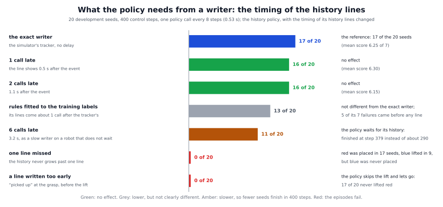

# The history method in detail: the reasoning, the code and the experiments

The short page, [docs/methods/history](../README.md), says what the history method does. This page explains why it works,
how the code builds the prompt at every call, how the policy and its training data are made, what every experiment showed,
what each number and term means, and where the method stops.


## 1. The problem and the idea

**The problem.** A VLA policy chooses its next movement from what it sees now: the camera pictures and the prompt. It does
not remember earlier calls. Our reference task shows what that costs. The robot picks up the red block and puts it back, then
does the same with the blue block. When the red block is back on the table, the scene looks almost exactly as it did at the
start. A policy trained on the plain instruction cannot tell the two moments apart. It completed 11 of 100 tasks. In the 31
episodes in which it had put the red block back, it went on to the blue block 17 times and grasped the red block again 13
times.

**The idea.** Tell the policy what has been done, in words. The instruction stays the full sentence, and one line is added
for every finished skill:

```
Pick up the red block, place it back, and then grasp the blue block. History: picked up the red block, placed the red block.
```

At the start and after the red block is put back, the pictures are alike, but the prompts are not: "History: none yet."
against "History: picked up the red block, placed the red block." The policy needs no new part. It reads text, as it always
does.

**Why text.**

- *It is small.* What this task needs to remember is which skills are finished. The history adds 5, 8, 13 or 19 tokens
  (pieces of words) to a prompt; the longest history, three lines, is 19.
- *It needs no new training code.* The demonstrations are relabelled frame by frame and the policy is fine-tuned as before
  (section 4).
- *A person can read it.* The proxy's log holds the exact prompt of every call.
- *The writer can be exchanged.* The method only turns the writer's list of finished skills into text. The simulator's ground
  truth, rules on the gripper, a vision-language model and the policy's own head all drive it.

**Why the policy learns to read it.** In the demonstrations, the history is the only input that tells two similar-looking
frames apart. So the training loss rewards the policy for reading it. That the trained policy does read it, we know from the
timing study (section 5.4): when the lines are wrong, it does the wrong thing.

**What the method does not do.** It does not decide when a skill is done. That is the writer's job. It keeps nothing inside
the policy, and it does not help the policy grasp.

## 2. Related work

The works below are the closest to this method. The numbers are arXiv ids.

- **UniMem** (Osterberg, Wang and Schwager, 2026, arXiv 2608.22869) is the source of the method. It appends event labels, as
  natural-language text, to the instruction ("History: grabbed spoon, ..."). A small multilayer perceptron (a simple neural
  network) on the policy's last-layer representation, the event head, detects the events; it is trained together with the
  policy. UniMem reports 93.4 % against 68.2 % for a variant with frames at fixed intervals in simulation, and 80.0 % against
  43.5 % for MemER on hardware. It also finds that text alone is enough for sequential tasks (UpDown3Times: 93 with text
  only, against 16 for pi0.5 with fixed-interval frames) and not enough where positions matter (TableClean: 0 with text only,
  80 with text and keyframes). We differ in two things: the writer here can be exchanged, and the policy is trained on
  demonstrations alone, with the lines taken from the recorded phases. The [head writer](../../../writers/head/README.md)
  later puts UniMem's idea of an event head onto the frozen policy.
- **MEM** (Torne et al., Physical Intelligence, 2026, arXiv 2603.03596) lets the policy itself keep a short text of what it
  has done ("I placed a plate in the cabinet, ...") and update it. The paper notes that simply joining the subtask strings
  shifted the prompts between training and use when a subtask repeats after a failure. Our writers write the line of a skill
  once and never take it back.
- **RoboMME** (Dai et al., 2026, arXiv 2603.04639) tests previous subgoals as text, written by a model or by an oracle.
  Without memory pi0.5 scored 17.9, with an oracle as the writer 49.6, with a fine-tuned 4-billion-parameter model 29.0 and
  with a prompted Gemini 11.6. So the writer, not the form of the memory, limits the result. Our four writers were much
  closer to each other (77 to 82). We did not test why; a likely reason is that all four stay close to the ground truth's
  timing (section 5.2).
- **AGM** (Gao et al., 2026, arXiv 2608.29537) writes progress only on events it has verified: a state machine on the gripper
  width, a check that the hand has lifted, and a plan pointer that moves on only after a verified event. Writing without that
  check scored 32 %, writing with it 100 %. Our rules writer follows this design.
- **SADP** (Hu and Horii, 2026, arXiv 2605.16871) scores the switches of its subgoals against annotated boundaries: exact in
  79.4 % of the cases, early in 4.0 %, missed in 16.6 %. We count the lines of a writer the same way: exact, early, late,
  missed.
- **Present but Not Remembered** (arXiv 2607.03372) found that frozen VLAs often do not consult past inputs, because a policy
  trained on near-Markov demonstrations has no reason to use a past it can rebuild from the current frame. The history
  method avoids this by construction: the policy is trained on prompts whose history holds what the frame lacks.

The writers in the literature fall into five groups. Ours cover four of them:

| who writes the history | papers | our writer |
|---|---|---|
| the policy itself | UniMem (2608.22869): an event head; TaskAnchor (2609.23580): a progress head; MEM (2603.03596): the model updates its own text; SparkVLA (2608.16172): a stop selector | `head` |
| a separate vision-language model | RoboMME (2603.04639), MemER (2510.20328), VP-VLA (2603.22003), VoLo (2606.07723) | `vlm` |
| a small model distilled from a large one | StageGuard (2609.20791), Critic in the Loop (2603.05185) | none |
| rules on the gripper and the hand, online | KEMO (2606.23589): keyframes from joint motion; Inner Monologue (2207.05608): success detectors on object poses; almost every paper uses such rules for its training labels | `rules` |
| the simulator's ground truth | LoHoVLA (2506.00411), WeaveLA (2606.17463), the oracle rows of RoboMME | `oracle` |

## 3. How it works in the framework

This section follows one run of

```
python -m vla_memory.proxy --writer rules --method history --task vla_memory/tasks/red_blue_blocks.yaml \
    --listen-port 8001 --upstream-port 8000
```

from the command line to the policy call, and names the function that does each step. `--task` names the task file; for the
reference task it can be left out. The parts every writer shares (the server, the relay, the connection to the policy) are
explained step by step in the [oracle walkthrough](../../../writers/oracle/detailed/README.md). The method itself is small:
two files, 116 lines in all.


### The pieces

| file | what it does |
|---|---|
| `vla_memory/methods/history/prompt.py` | `HistoryPrompt`: turns the instruction and a list of finished skills into the prompt, from the task file's `history` section; the same renderer makes the training prompts |
| `vla_memory/methods/history/method.py` | `HistoryMethod`: the method; adds `--max-lines` and `--delay-calls` |
| `vla_memory/methods/base.py` | what every method can do (`Method`), the list of methods (`METHODS`), `resolve_method` |
| `vla_memory/task.py` | `TaskSpec`: reads the task file, the skills and their words (`skill`, `parse_skill`) |
| `vla_memory/writers/` | the writers; each one keeps the plan and the number of finished skills (`completed()`) |
| `vla_memory/proxy/relay.py` | `Relay.infer`: what happens at every policy call |
| `training/relabel_history.py` | makes the training prompts of the policy (section 4) |

### Start-up

1. **The command line is read twice** (`parse_command_line`). The first pass only looks for `--writer`, `--method` and
   `--with`. `resolve_method("history")` finds `"vla_memory.methods.history.method:HistoryMethod"` in `METHODS` and imports
   it only now. The second pass reads everything, including the options the method adds (`HistoryMethod.add_arguments`):
   `--max-lines` and `--delay-calls`.
2. **The options are checked** (`check_arguments`) and **the task file is loaded** (`TaskSpec.load_or_default`). Its
   `history` section is kept as a dictionary.
3. **The parts are built** (`build_components`). The writer comes first (`RulesWriter.build`). Then
   `HistoryMethod.build(args, task)` calls `HistoryMethod.__init__`, which:
   - builds `HistoryPrompt(task)`. It reads from the task file the prefix `" History: "`, the words for an empty history
     (`"none yet"`), one phrase per verb (`"picked up the {object} block"`, `"placed the {object} block"`), the joiner `", "`
     and the ending `"."`. A part that is missing falls back to these defaults;
   - takes `max_lines` from `--max-lines`, else from `history.max_lines` (3 in the reference task): the longest history in
     the training data;
   - takes `delay_calls` from `--delay-calls` (0: no delay) and starts an empty queue, `_shown`, for it.
4. **The relay is built and the proxy serves** (`Relay(...)`, `serve`). The history method adds nothing to what the proxy
   tells the environment when it connects (`Method.metadata()` is empty).

### What the environment sends

The method needs nothing of its own from the environment: it only reads the full instruction in the observation's `prompt`.
What the observation must hold is what the chosen writer reads: for the rules writer the gripper readings of every control
step (`memory/proprio_steps`) and the wrist picture, for the oracle the simulator's current skill (`memory/oracle_prompt`),
for the VLM writer both pictures. `vla_memory/env_keys.py` (`ControlKeys`) builds these entries.

### One policy call

`Relay.infer` handles the call. These are its steps, with the part of the history method marked:

1. **Sort the entries** (`split_control_keys`): the `memory/` entries are set aside, the rest stays in the observation. The
   instruction is the observation's `prompt`.
2. **A new episode?** (`_is_new_episode`, `_begin_episode`). If so, `HistoryMethod.start_episode` forgets the histories kept
   for `--delay-calls`, and the writer starts its plan again.
3. **The writer decides, before the call** (`writer.before_call`). The oracle, rules and VLM writers move their pointer here;
   the number of finished skills is then known for this call. The head writer only notes whether a line written after the
   last reply is shown now.
4. **The method sets the prompt** (`Relay._decide_prompt`, which calls `HistoryMethod.prompt(instruction, writer)`):
   1. If the oracle forwarded a text that is not one of the task's skills (`writer.passthrough`), that text is the prompt.
   2. Otherwise `render(instruction, writer.completed())`. `completed()` is the plan's skills before the writer's pointer;
      after the last skill it is the whole plan.
   3. With `--delay-calls N`, `_delayed` keeps the lists of the last calls and returns the one from N calls ago.
   4. The list is cut to `max_lines` skills, the first ones.
   5. `HistoryPrompt.render` builds the text: `instruction.strip() + prefix + history_text(...)`. `history_text` is
      `"none yet" + "."` for an empty list, else the phrases of the skills joined by `", "` and ended with `"."`.
      `event(skill)` finds the phrase: `task.parse_skill(skill)` gives the verb and the object, and the phrase of the verb is
      filled with the object. A verb without a phrase falls back to the skill's own words.
   6. The observation's `prompt` is replaced by the result. With `--writer off` the relay never asks the method: the policy
      gets the instruction unchanged.
5. **`method.before_policy`** adds nothing for this method (a method that sends a picture adds it here). The proxy notes the
   prompt in its log record (`prompt`).
6. **The call** (`_forward`): `transport.infer` sends the observation to the policy server and waits for the actions.
7. **After the call** (`writer.after_call`). The head writer reads the event head's verdict from the reply here.
8. **The reply goes back** with the log record (`planner`).

The same renderer, `HistoryPrompt`, serves the training script, the event head's training rows and the keyframe method's
labels, so the strings the policy was trained on and the strings it gets at run time cannot drift apart.

### When a line reaches the policy

| writer | decides | the line is in the prompt |
|---|---|---|
| `oracle` | before the call, from the simulator's `memory/oracle_prompt` | of the same call |
| `rules` | before the call, from the readings of every control step since the last call | of the same call |
| `vlm` | before the call, after asking the model (the robot waits) | of the same call |
| `head` | after the call, from the event head's verdict in the reply; two "done" verdicts in a row | of a later call: at least one call later |

A call comes every 8 control steps, so "the same call" is the first call after the event, up to 8 control steps (0.53 s)
after it. That is the earliest any writer can show a line.

### A whole episode of the reference task

| calls | what the writer has done | `writer.completed()` | the end of the policy's prompt |
|---|---|---|---|
| the first call | a new episode starts | nothing | "History: none yet." |
| until the red block is 9 cm up | nothing | nothing | "History: none yet." |
| from the first call after the lift | completed "pick up the red block" | pick up red | "History: picked up the red block." |
| from the first call after the hand has opened low down and moved 6 cm up (or 8 cm away) from the place where it let go | completed "place the red block" | pick up red, place red | "History: picked up the red block, placed the red block." |
| from the first call after the blue block is 9 cm up | completed "pick up the blue block" | the first three | "History: picked up the red block, placed the red block, picked up the blue block." |
| after the blue block is set down | completed "place the blue block" | all four, cut to the first three | unchanged: the last skill has no line |

The lines appear where the demonstrations' labels change (section 4), so the history in the prompt and the history in the
training data switch at the same moments. A skill's line is written once. If a block slips out of the hand and is grasped
again, "picked up" is not written twice, and a line is never taken back.

### Checking a run

With `--log FILE` every line of the log is one call. `prompt` is the prompt the policy received. `advanced` is true at the
call whose prompt is the first to show a new line (the rules writer also logs `completed`, the head writer `event_head`).

## 4. How the policy and its data are made


**The demonstrations.** A scripted expert performed the reference task 250 times in Isaac Sim: 200 episodes for training
(63,644 frames) and 50 for checking (15,907 frames). Each recording holds, for every frame, the camera pictures, the joint
state, the actions and the waypoint phase the expert was in (0 to 14).

**Step 1: the plain dataset.** `training/convert_to_lerobot.py --action-space absolute` writes the recordings as a LeRobot
dataset (the data format the training code reads). Every frame's prompt is the plain instruction; each episode has one of
five wordings of it (`instruction_examples` in the task file; 44, 44, 38, 37 and 37 episodes).

**Step 2: the history prompts** (`training/relabel_history.py`). Every frame's prompt becomes the instruction followed by the
history that is true at that frame. For each episode the script:

1. checks that the dataset's joint state equals the recording's, exactly, so that a history is never attached to another
   episode's frames (`states_match`);
2. reads the plan and the position in it of every frame: from the waypoint phase and the task file's table
   (`demo_phases.phase_to_skill`), or, for a task whose plan varies, from the recording's own `plan` and `skill_index`
   (`episode_plan`, `episode_positions`);
3. gives each frame as many history lines as there are skills before its position, at most `history.max_lines`, and checks
   that the episode goes through the history states in order (`episode_histories`);
4. renders the prompts with the same `HistoryPrompt` the proxy uses and writes the new `task_index` column.

Only the prompts change. The pictures, the state and the actions are copied unchanged, so the normalisation statistics of the
data (the means and spreads that scale the numbers going into the network) stay the same. The script rewrites the dataset's
metadata and checks it again at the end.

In the reference task the phases give four histories: phases 0-3 "none yet", 4-6 "picked up the red block", 7-11 "picked up
the red block, placed the red block", 12-14 "picked up the red block, placed the red block, picked up the blue block". A line
appears where the sub-goal prompt would change. In all, there are 20 different prompts (5 wordings times 4 histories). In the
200 training episodes, the frames split like this:

| history | frames |
|---|---|
| none yet | 16,805 |
| one line | 13,200 |
| two lines | 20,439 |
| three lines | 13,200 |

**Step 3: training.** pi0.5 was fine-tuned from `pi05_base` with LoRA (small added matrices are trained, the original weights
stay frozen) on this dataset, with the same recipe as the memoryless
and the sub-goal policies: 30,000 steps at batch size 16, the learning rate falling from 2.5e-5 to 2.5e-6 on a cosine curve
after 1,000 warm-up steps, about 38 hours on one RTX 3090 (`training/README.md` has the details of the recipe). The policy
predicts absolute joint targets. It reads the two camera pictures and the prompt; the reference recipe gives it no joint
angles. At run time the outside picture is centre-cropped to 95 %.

**Step 4: choosing a checkpoint.** A checkpoint was saved every 1,000 steps. Every one was tried on the same 20 development
seeds with the simulator's ground truth as the writer, and the one with the best mean sequence score was taken: checkpoint
28,000 (17 of 20 full tasks, a mean of 6.25 milestones of 7). Parts of the curve, against the sub-goal policy's:

| training steps | 5,000 | 10,000 | 15,000 | 16,000 | 20,000 | 25,000 | 28,000 | 29,999 |
|---|---|---|---|---|---|---|---|---|
| history policy: full tasks of 20 | 0 | 2 | 6 | 13 | 10 | 16 | **17** | 14 |
| sub-goal policy: full tasks of 20 | 4 | 11 | 15 | 20 | 20 | 18 | 19 | 18 |

The history policy reaches good scores later and less steadily than the sub-goal policy; a single checkpoint moves by several
seeds from one screen to the next. We did not test why.

## 5. The experiments, in order

The numbers come from two kinds of runs. The **development seeds** 1-20 (400 control steps) served for choosing and
screening. The **fresh seeds** 1001-1100 (500 control steps) were used only for the final numbers. Every run uses the same
100 fresh seeds, so two runs can be compared seed by seed. A policy call comes every 8 control steps.

### 5.1 The memoryless policy, and the history policy with the ground truth

| policy | full tasks of 100 | lifted red | after red was put back, went on to blue |
|---|---|---|---|
| memoryless: the plain instruction | 11 | 31 | 17 of 31 |
| history policy, the simulator's ground truth as the writer | 82 | 87 | 84 of 87 |

Seed by seed, 71 seeds were completed only with the history and none only without it (the sign test gives p of about 8e-22:
if the two were equally good, a split this uneven would practically never happen). The history removes the error that sinks
the memoryless policy: grasping red again after it was put back, which happened in 13 of its 31 episodes, happened in none of
the 87 episodes of the history policy with the ground truth.

### 5.2 Four writers on 100 fresh seeds

Same policy, same seeds, only the writer differs. "Early or false lines" counts lines that were written earlier than the
ground truth's or that the ground truth never wrote.

| writer | full tasks of 100 | lifted red | after red: went on to blue | early or false lines | history equal to the ground truth's |
|---|---|---|---|---|---|
| `oracle` | 82 | 87 | 84 of 87 | | the reference |
| `rules` | 79 | 87 | 84 of 87 | 1 of 252 | 6,297 of 6,300 calls (99.95 %) |
| `vlm` | 77 | 88 | 84 of 88 | 19 of 267 | 94.6 % of the calls |
| `head` | 78 | 88 | | 1 early, none false, of 253 | 236 of 253 lines exactly one call later |

The VLM writer ran with a store of 20 recorded episodes, the memory-vote gate and an answer with the object states but no
reason (`--memory`, `--no-verdict-only --brief`), and asked 30.5 questions per episode. It used an earlier wording of the
wrist camera's description than the one in the packaged task file. All 100 episodes of every run used one wording of the
instruction, the first of the five the policy was trained on. The head writer is described on [its own
page](../../../writers/head/README.md).

Which writer completed more? The seeds that exactly one of two writers completed:

| pair | only the first | only the second | p |
|---|---|---|---|
| ground truth / rules | 14 | 11 | 0.69 |
| ground truth / VLM | 16 | 11 | 0.44 |
| ground truth / head | 14 | 10 | 0.54 |
| rules / VLM | 14 | 12 | 0.85 |
| rules / head | 11 | 10 | 1.00 |
| VLM / head | 14 | 15 | 1.00 |

Every p is large: no writer is shown to be better than another. **How to read p.** Seeds that both writers completed, or both
failed, say nothing about which is better. Only the seeds that exactly one of them completed count. If the two writers were
equally good, each of these seeds would be like a fair coin toss. The p of the sign test is the chance of a split at least as
uneven as the one seen, with that many fair coin tosses (two-sided: an uneven split in either direction counts). For 14
against 11, that chance is 0.69: such a split is the usual outcome of a coin. A difference is usually called significant only
when p is below 0.05. With 100 seeds, a difference of a few episodes cannot be told from chance.

**How late the lines come.** For the rules writer and the VLM writer, the table gives the number of lines written, of the
lines the ground truth has, how many came within one policy call (8 control steps) of the scoring milestone, and when they
came, in control steps after the milestone. The milestones are the cube 9 cm up (red, then blue) and, for "placed red", the
hand 12 cm away from the red cube, a point that the writers' own rule (the hand 6 cm up or 8 cm away from where it let go)
reaches a little later.

| line | writer | written, of the ground truth's | within one call | median steps after the milestone (90th percentile) | false lines |
|---|---|---|---|---|---|
| picked up red | rules | 87 of 87 | 86 | 4.0 (7.4) | 0 |
| picked up red | VLM | 88 of 88 | 83 | 5.0 (8.0) | 6 |
| placed red | rules | 86 of 86 | 19 | 10.0 (12.0) | 0 |
| placed red | VLM | 88 of 88 | 17 | 11.0 (20.3) | 5 |
| picked up blue | rules | 79 of 79 | 78 | 5.0 (8.0) | 0 |
| picked up blue | VLM | 78 of 79 | 78 | 4.0 (7.0) | 2 |

A line is **false** when the ground truth never reached its milestone in that episode. The rules writer's lift lines come
within one call of the lift in 86 of 87 and 78 of 79 cases, and its "placed red" lines a call or so after the retreat
milestone, as its rule asks. The VLM writer is as exact in most episodes, but wrote 13 false lines and missed one line, and
its worst lines came 137 and 223 control steps late.

Even when two runs have the same history on 99.95 % of their calls, their failed seeds overlap only in part (7 of 21 and 18
in the rules and tracker runs): which episode fails is mostly the policy's own luck at the grasp. Of the 18 failed episodes
with the ground truth, 13 never lifted the red block, 4 reached the blue block and never lifted it, and 1 put the red block
back and never reached the blue one; with the rules writer 13 never lifted red, with the VLM writer 12.

### 5.3 What the history policy still gets wrong

- **The grasp.** The sub-goal policy, which gets only the current skill, lifted the red cube in 95 of 100 episodes and
  completed 92 with the ground truth; the history policy lifted it in 87 and completed 82 (seeds only the sub-goal policy
  completed: 17, only the history policy: 7; p = 0.064, just short of the usual line). A likely reason, not tested: a prompt
  with one short skill is less ambiguous than the long instruction with its history.
- **The grasp attempts.** The history policy tried 409 grasps in 100 episodes and lifted the cube in 172 of them (0.42 lifts
  per attempt, 2.4 failed attempts per episode). The sub-goal policy tried 277 and lifted in 187 (0.68, 0.9). An attempt is a
  close of the gripper that starts within 6 cm of a cube.
- **The memory itself works:** after red was put back, the history policy went on to blue in 84 of 87 episodes, the sub-goal
  policy in 95 of 95.

### 5.4 What the policy needs from a writer: the timing study



The question: how exact must a writer be? We took the ground-truth lines and changed their timing, on the 20 development
seeds. The exact writer, the simulator's tracker, completed 17 of 20. The last column compares each variant with the exact
writer seed by seed, on the sequence score (the number of milestones reached): on how many seeds the variant scored higher,
the same or lower, and the p of the sign test (explained in section 5.2).

| variant | how it was made | full tasks of 20 | mean score of 7 | against the exact writer: higher / same / lower, p | what happened |
|---|---|---|---|---|---|
| exact | the tracker, no delay | 17 | 6.25 | | the reference |
| 1 call late | `--delay-calls 1`: every line shows one call (0.5 s) after the event | 16 | 6.30 | 1 / 17 / 2, p = 1.00 | no effect |
| 2 calls late | `--delay-calls 2` (1.1 s) | 16 | 6.15 | 2 / 15 / 3, p = 1.00 | no effect |
| 6 calls late | `--delay-calls 6` (3.2 s, as a slow model on a robot that does not wait) | 11 | 5.95 | 2 / 11 / 7, p = 0.18 | the policy waits for its history: the successful episodes finish at step 379 instead of about 290, and 5 ran out of their 400 steps holding the blue cube |
| one line missed | `--max-lines 1`: the history never grows past one line | 0 | 4.85 | 2 / 1 / 17, p < 0.001 | red was placed in 17 episodes and blue lifted in 9, but blue was never placed |
| written too early | rules that write "picked up" when the gripper closes on the block, three calls before the lift on the policy's own runs | 0 | 1.30 | 1 / 1 / 18, p < 0.001 | the policy skips the lift and lets go: 17 of 20 never lifted red |
| fitted to the training labels | rules that write "picked up" at the top of the lift (9 cm up, the hand almost still) and "placed" 10 cm up or away from where the hand let go; about one call after the tracker | 13 | 5.30 | 1 / 13 / 6, p = 0.12 | not different from the exact writer; 5 of its 7 failures came before any line (failed grasps) |

What this says:

- **Never early, never missed.** The policy treats a line as true. With "picked up" in its prompt at the grasp, it skipped
  the lift and let go. With the history stuck at one line, it lifted the blue block but never placed it. Both gave 0 full
  tasks in 20.
- **A little late is free.** One or two calls (up to about a second) changed nothing.
- **Very late costs time.** Six calls made the policy wait for its line, and fewer episodes finished within 400 steps. With a
  longer step budget more of them might finish; we did not test that.
- **For a slow writer on a real robot,** a model that needs about 3 s for an answer, with a robot that keeps moving, is about
  the "6 calls late" case. Of the VLM writer's 267 lines, 19 were early or false (the rules writer: 1 of 252), the harmful
  kind.

### 5.5 The rules writer on the development seeds

The rules writer reads the robot's own gripper signals (see [its page](../../../writers/rules/README.md)). It was developed
and checked with the history policy on the 20 development seeds:

| writer | how it decides | full tasks of 20 | mean score of 7 | history equal to the ground truth's |
|---|---|---|---|---|
| the simulator's tracker | ground truth | 17 | 6.25 | the reference |
| rules, first thresholds | lift 5 cm, set-down within 3 cm, retreat 3 cm; one reading per policy call | 14 | 6.05 | 94.0 % of the calls |
| rules, the tracker's thresholds | lift 9 cm, set-down within 8 cm, retreat 6 cm up or 8 cm away; every control step | 17 | 6.10 | 100.0 % |
| the same, through the framework's proxy | | 16 | 6.20 | 99.6 % |
| the framework's oracle writer | the simulator's current skill | 16 | 6.10 | 100.0 % |
| the same rules with the colour check | names the held block by its colour | 13 | 5.25 | 99.9 % |
| rules written by the planning model | from the task's completion criteria | 15 | 6.15 | 96.7 % |

- **The thresholds should be those of the training labels.** The first set was chosen to match the scoring milestones. It
  wrote "placed the red block" one call early in 12 of 17 episodes, missed one place after a drop of 4.5 cm, and was 41 steps
  late after a block slipped out during the lift (14 against 17 full tasks is not a significant difference on 20 seeds; the
  timing study above shows why early lines matter). The second set uses the thresholds of the simulator's tracker, which
  switch close to where the training labels change. Its history equalled the ground truth's in all 1,000 calls, every switch
  fell in the same call, and no line was missing or false. Its three failures never lifted the red block, with "History: none
  yet." in the prompt: failed grasps before any line, not a writer error. On the 100 fresh seeds this writer completed 79
  (section 5.2).
- **The tracker only approximates the labels.** Measured on the demonstrations, the tracker's rules, and so the second set,
  switch 5 to 7 control steps before the training labels (the first set 8 to 9): within one call, but not exactly.
- **The framework's proxy gives the same result.** Through it, the rules writer completed 16 of 20 and the oracle writer 16
  of 20, against 17 of 20 for the original setup; the differences are within noise.
- **The colour check** names the block in the hand, so that a line says "blue" when the robot picks up blue first. It named
  28 of 28 picks correctly (15 red, 13 blue) and none had to be reordered. Of the 7 failures, 5 never lifted red with
  "History: none yet." in the prompt, so they were grasp failures, not writer errors. On 957 recorded picks it named every
  one correctly, including 31 in which the robot took the blue block first (the rules writer's page has this test).
- **Rules written by the model** (`python -m vla_memory.writers.rules.author`, from the task's completion criteria) completed
  15 of 20; their history equalled the ground truth's in 96.7 % of the calls.

### 5.6 The cost

| writer | time of a policy call, median | what the writer adds | one 500-step episode |
|---|---|---|---|
| ground truth | 169 ms (no proxy: the median of the episodes' means) | nothing | 51 s |
| rules | 168 ms | 0.16 ms | 51 s |
| VLM | 190 ms (a call with a question: about 3 s) | 12.6 ms median per call; 30.5 questions per episode | 143 s |
| head | 714 ms | about 545 ms | 86 s |

The history method itself is a string operation. In the prompt, the history is 12 tokens on average (5, 8, 13 or 19), on top
of the instruction's 22. The time of the episode is the simulator's, including physics and rendering. The simulator waits
while a writer thinks, so a slow writer costs time but never success in these runs.

## 6. What every number and term means

| term | meaning |
|---|---|
| **control step** | one tick of the robot's controller; 15 per second |
| **policy call** | the proxy asks the policy for a chunk of actions; one call every 8 control steps (0.53 s), the robot carries out the chunk |
| **writer** | the part that says when a skill is done: `oracle`, `rules`, `vlm` or `head` |
| **line, history** | the phrase of one finished skill, and the text of all of them |
| **token** | a piece of a word, the unit in which the policy reads its prompt |
| **tracker, ground truth** | the simulator's own record of the cube heights and the gripper; it decides the reference lines |
| **development seeds, fresh seeds** | a seed fixes where the cubes start. The development seeds 1-20 serve for choosing and screening; the fresh seeds 1001-1100 only for the final numbers |
| **full task** | red picked up (lifted 9 cm) and put back, then blue picked up and put back, in the right order, as scored from the recorded movements (the strict ladder) |
| **milestones, mean score** | the strict ladder has seven milestones: reached red, lifted red, placed red, retreat, reached blue, lifted blue, placed blue. The score of an episode is how many it reached in order; the mean score is its average over the seeds |
| **lifted red** | the red cube's centre rose more than 9 cm above its resting height while the gripper was closed |
| **history equal to the ground truth's** | at how many policy calls the history in the prompt was the same as the history that the simulator's rules give for the recorded movement at that call (cube above 0.85 m is lifted; the gripper open, the cube back on the table and the fingertips 6 cm above it or 8 cm away is placed) |
| **early, false, missed** | a line written before the skill was done, a line for a skill that never was done, a line never written |
| **N calls late** | the line is shown N policy calls after the event |
| **grasp attempt** | a close of the gripper that starts within 6 cm of a cube; it is a lift if the cube then rises more than 9 cm |
| **paired comparison, discordant seeds** | two runs on the same seeds are compared seed by seed; only seeds that exactly one of the two completed count |
| **p (sign test)** | the chance of a split at least this uneven between two runs if they were equally good: each discordant seed is a fair coin toss, and p is twice the chance of the smaller count or fewer heads, at most 1. Below 0.05 is usually called significant; 1.00 is the most even split possible |
| **within noise** | a difference that a sign test cannot tell from chance |

## 7. Limitations

- **The policy trusts its history.** A line that is wrong stays for the rest of the episode. Early or missing lines fail the
  episode (section 5.4). The writers never take a line back, so a placed block that is moved afterwards still counts as
  placed.
- **It is only as good as the writer.** The rules writer needs thresholds measured from the training labels and the colour
  check for the object; the VLM writer needs seconds per question; the head writer needs a head fitted to this one policy.
- **The history shows the first lines only.** `max_lines` cuts the list after the first lines, not the last ones, and the
  training data must contain the longest history. A long task needs `max_lines` high enough, and the prompt grows by a line
  for every skill. We did not test a task with more than four skills.
- **Words and order are fixed.** The policy was trained on one order of skills (red first) and one wording of the lines. A
  different order was never trained. The evaluation used one of the five trained wordings of the instruction in every
  episode; an instruction in new words was not tested. The history of a repeated skill reads the same each time; we did not
  test whether that confuses the policy (MEM reports a prompt shift in a similar case).
- **No pictures, no positions.** The history lists finished skills. UniMem found that text alone does not carry tasks where
  positions matter. Our task does not need them, so this limit was not tested here; the [keyframe
  method](../../keyframe/README.md) gives a picture instead.
- **Grasping is not helped.** The history policy lifted the red block less often than the sub-goal policy (87 against 95
  episodes).
- **One policy, one task, simulation.** All numbers are from one pi0.5 policy trained on 200 scripted demonstrations of one
  task. There was no run on a real robot.
- **One episode only.** The history starts again at every episode; nothing is carried over.

## 8. Using it with your own policy and task

1. Record demonstrations that note, at every frame, which skill is active: a phase table in the task file
   (`demo_phases.phase_to_skill`), or the plan and the plan position of every frame (`plan`, `skill_index`).
2. Write the task file's `history` section: `prefix`, `none`, one past-tense phrase per verb in `events` (with `{object}`),
   `joiner`, `suffix`, and `max_lines`, the number of lines in the longest history of your training data.
3. Run `training/relabel_history.py --task your_task.yaml` on the converted dataset and fine-tune your policy on it. Any VLA
   that reads a text prompt works; the method only changes the prompt.
4. Choose a writer and check its timing on recorded runs before you trust it: never early, never missing, at most about a
   second late. The rules writer has a validator for this (`python -m vla_memory.writers.rules.validate`).
5. Run the proxy with `--method history`. Use `--delay-calls` and `--max-lines` to test how much timing error your policy
   tolerates.
