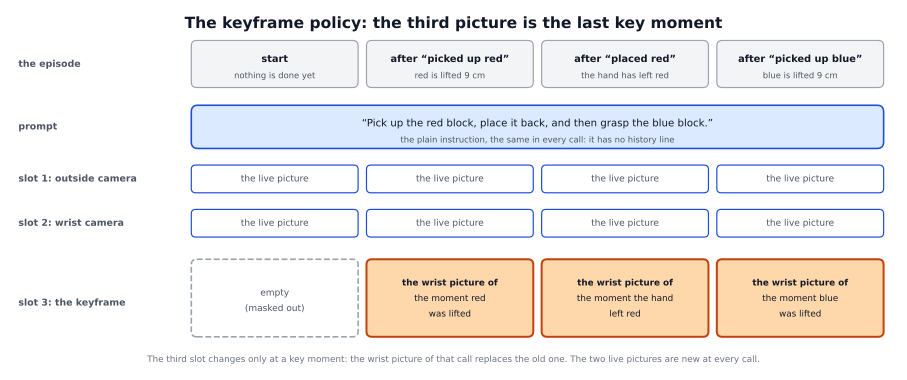

# The keyframe policy: a picture of the last key moment

## The idea

A VLA policy decides from what it sees now. After the robot has put the red block back, the table looks the way it did at the
start, so the policy cannot tell what has already been done. The [history method](../history/README.md) answers with words.
The keyframe policy answers with **a picture**.

The policy gets the plain instruction, as a memoryless policy would. Its two cameras show the scene now. In its **third image
slot** (pi0.5 has three; the reference policy uses two) it gets the wrist camera's picture of **the last key moment of its
own episode**: the moment the writer last said that a skill was done. In the reference task the key moments are "picked up
red", "placed red" and "picked up blue". Before the first one, the slot is empty.



- A **writer** decides when a skill is done, as for the history method: the simulator's ground truth or the rules writer on
  the robot's gripper and hand signals (the other writers are possible but were not measured). At the call at which the
  writer completes a skill, the method keeps that call's wrist picture and sends it with every observation from then on. The
  next key moment replaces it.
- The policy is **trained on demonstrations relabelled in the same way**: a frame after a key moment gets the wrist picture
  of a frame drawn from the 16 frames after that moment, never from the future.
- The picture tells the policy which phase it is in, where the live cameras alone look alike: at the start, and after the
  first block was put back. It is the picture counterpart of the history line.

**What it cannot do:**

- **It depends completely on the picture.** With the picture never sent, the policy lifted the red block and held it in the
  air until the end of the episode: 0 full tasks of 100. The picture is what starts the place phase.
- **The picture must come at the right moment.** In 60 of 187 episodes the "placed red" picture was taken with the hand lower
  than 8 cm above the cube, lower than in the training data, and 25 of these 60 grasped red again; from 8 cm on, 1 of 127
  did.
- **It keeps only the last key moment.** The next picture replaces the old one. The policy does not see the earlier ones.
- **We cannot read what it remembers.** A picture has no words. We did not test whether the policy reads what the picture
  shows or only that a picture is there.
- **It needs a policy trained for it.** The policy needs a third image slot that it ignores while the slot is empty, and it
  must be fine-tuned on pictures drawn the same way. The environment must send the raw wrist picture.
- **Grasping is still its main weakness.** Most failures that remain are grasps: with the simulator's events, 7 of the 22
  failed episodes never lifted the red block and 5 never lifted the blue block.
- **It was measured with two writers only,** the simulator's events and the rules writer, on one task in simulation.

A walkthrough of how it works, step by step, with the code and the training data:
[detailed/README.md](detailed/README.md).

## Prerequisites

- The recorded demonstrations as two LeRobot datasets of the same frames: the memoryless policy's, with the plain instruction
  as each frame's task (`training/convert_to_lerobot.py --no-videos`), and the history policy's, whose prompts mark the key
  moments (`training/relabel_history.py`).
- A policy that takes a third picture, `observation/memory_image`, and ignores it while the picture is absent or all zero
  (pi0.5 has a third image slot with a mask), trained on that dataset.
- At run time: an environment that sends the raw wrist picture (`memory/wrist_raw`) and what the writer reads
  (`memory/oracle_prompt` for the simulator's key moments, `memory/proprio_steps` for the rules writer), as
  `vla_memory.env_keys.ControlKeys` builds them. The later "placed" picture also needs the joint state in `observation/state`
  (the 7 arm joints first). The forward kinematics of the reference Franka arm (the calculation of where the hand is from the
  joint angles) is built in, and the height of the centre of a placed object resting on the table comes from the task file
  (`keyframe.rest_z`, 0.76 m for the 4 cm cube).

## How to use it in the framework

1. **Training data:**

   ```
   python training/relabel_keyframe.py --train <frames train>:<history train> --val <frames val>:<history val> \
       --root <dataset root> --repo-id <user>/<name> [--task task.yaml]
   ```

   It checks that both datasets of a split hold the same frames and writes `<name>_train` and `<name>_val`, with the image
   column `memory_image` and a per-frame list, `keyframe_frames.csv`.
2. **Training:** one policy from `pi05_base` with the memoryless policy's recipe (30,000 steps) on the dataset of step 1
   (`vla_memory/red_blue_v2_abs_keyframe_train`, written with `--repo-id vla_memory/red_blue_v2_abs_keyframe`; not
   distributed, see `training/README.md`), with the third image slot reading `memory_image`.
3. **Run:** serve a checkpoint and start the proxy with the keyframe method. It keeps the plain instruction as the prompt:

   ```
   python -m vla_memory.proxy --writer oracle --method keyframe --task task.yaml --listen-port <port> \
       --upstream-port <policy port> [--keyframe-mode off] [--keyframe-placed-later]
   ```

   `--task` can be left out for the reference task. `--writer rules` takes the rules writer instead of `oracle`.
   `--keyframe-mode off` takes the pictures and never sends them: the control. `--keyframe-placed-later` takes the picture of
   a placing event ("placed red" in the reference task) only once the fingertips are at least 10 cm above the placed cube
   (`--keyframe-placed-height`), at the latest at the third call after the signal (`--keyframe-placed-calls`). Every line of
   the proxy's log says which key moment the current picture belongs to, the step it was taken at and whether it was sent.

## Our findings

Reference task: pick up and put back a red and then a blue cube with a Franka arm in Isaac Sim. The keyframe policy
(checkpoint 29000: the policy after 29,000 training steps, the best of 30 saved checkpoints on the development seeds 1-20, 19
of 20) on 100 fresh seeds of 500 control steps, a policy call every 8 steps. A seed fixes where the cubes start; the fresh
seeds were not used to choose anything. A **full task** means: red picked up and put back, then blue picked up and put back.

| policy and writer | full tasks of 100 |
|---|---|
| keyframe policy, the simulator's key moments (`--writer oracle`) | 78 |
| keyframe policy, the rules writer (`--writer rules`) | 75 |
| keyframe policy, the picture never sent (`--keyframe-mode off`) | 0 |
| history policy: ground truth / rules / VLM / event head | 82 / 79 / 77 / 78 |
| memoryless policy | 11 |

- **As good as the history policy with every writer.** Seeds that only one of two policies completed split almost
  evenly: for the keyframe policy with the simulator's events against the history policy with the ground truth, 12 seeds
  went only to the keyframe policy and 16 only to the history policy, a split that could easily be chance. The same
  holds across all eight pairs of these two kinds of runs: none shows a clear difference.
- **Far better than the memoryless policy:** 78 against 11. The picture is the reason: without it the policy lifts red and
  holds it until the end.
- **It grasps better than the history policy,** with 0.68 to 0.70 lifts per grasp attempt against 0.34 to 0.42, **and loses
  that margin by grasping red again after placing it** (10 episodes with the simulator's events, 16 with the rules writer).
  The cause is a "placed red" picture taken with the hand too low: below 8 cm above the cube 25 of 60 episodes grasped red
  again, from 8 cm on 1 of 127. The simulator's place event fires 6 cm above the cube, while the training pictures show the
  hand about 10 cm up.
- **The later "placed" picture removes the re-grasps but does not clearly raise the full tasks.** On 100 new seeds
  (2001-2100) the re-grasps fell from 17 of 94 episodes to 0 of 90 with the rules writer (a drop far too large to be
  chance) and from 5 of 92 to 1 of 89 with the simulator's events. The full tasks went from 74 to 82 with the rules
  writer and from 83 to 78 with the simulator's events: differences that chance produces easily. The failures that
  remain are grasps. The original moment stays the default.
- **The writers are on time.** With the simulator's events all 264 pictures were taken at the simulator's call. The rules
  writer took 258 of 263 at the same call; 2 came one call late, and 3 a little early, with the hand 5.5 to 5.8 cm above the
  cube, just under the simulator's 6 cm rule.
- **A picture costs about 3 ms per policy call,** the proxy's hop (172 against 170 ms); the later "placed" picture adds 1 to
  3 ms.
