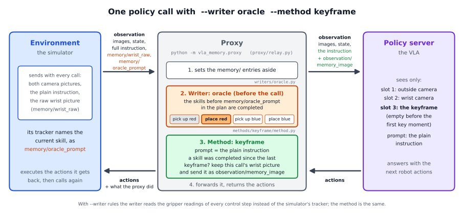
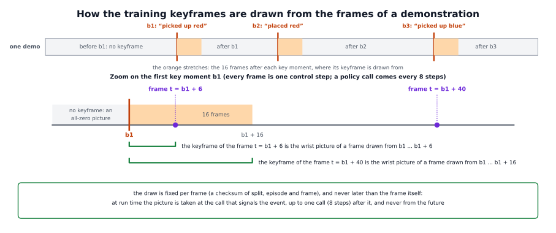

# The keyframe policy in detail

The short page, [docs/methods/keyframe](../README.md), says what the keyframe policy does and what we found. This page
explains how it works: why a picture, how the proxy keeps and sends the picture at every call, how the policy and its
training data are made, and how to use the method with your own policy and task.


## 1. The problem and the idea

**The problem.** A VLA policy chooses its next movement from what it sees now. It does not remember earlier calls. In our
reference task, the robot picks up the red block and puts it back, then does the same with the blue block. After the red
block is back on the table, the scene looks almost exactly as it did at the start. A policy trained on the plain instruction
completed 11 of 100 tasks.

**The idea.** Give the policy a picture of the last important thing that happened. The prompt stays the plain instruction, as
for the memoryless policy. The policy already has an image slot that the memoryless version leaves empty: pi0.5 reads three
pictures (the outside camera, the wrist camera, and a third slot). The method puts into that third slot the wrist picture of
the last **key moment** of the episode. A key moment is a skill the writer has just completed. In the reference task there
are three: "picked up red" (red lifted 9 cm), "placed red" (the hand has put the red block down and left it) and "picked up
blue". Before the first, the slot is empty, and the policy ignores it.

**Why a picture.**

- *It is the picture twin of the history line.* The [history method](../../history/README.md) says in words what has been
  done. The keyframe says it by showing the moment. The policy sees two kinds of scene that look alike (the start, the moment
  after red is put back) as different: its third slot is empty in the first and holds a picture of the put-down in the
  second.
- *It needs no vocabulary.* There are no phrases to write for each verb, and no wording that has to match the training data.
- *It can carry what words cannot:* where things were, what the scene looked like. UniMem found that a text history alone
  fails on tasks where positions matter (section 2). Our task does not need positions.
- *It is cheap.* It needs no new part in the network: the slot exists, and the picture is one array that the proxy keeps.

**Why the policy learns to read it.** For frames that look alike but need different actions, the third picture is the only
input that differs, just as the history line is for the history policy. So the training loss rewards the policy for looking
at it.

**What the method does not do.** It does not decide when a skill is done; the writer does. It keeps one picture only. And it
does not help the policy grasp.

## 2. Related work

The works below are the closest to this method. The numbers are arXiv ids.

- **UniMem** (Osterberg, Wang and Schwager, 2026, arXiv 2608.22869) writes events as text into the prompt and, at the same
  moment, stores the camera views as a keyframe (at most four, encoded once and cached). It reports 93.4 % against 68.2 % for
  a variant with frames at fixed intervals in simulation, and 80.0 % against 43.5 % for MemER on hardware. Text alone was
  enough for a sequential task (UpDown3Times: 93) and failed on a task where positions matter (TableClean: 0 with text only
  against 80 with text and keyframes). This is the case for pictures.
- **KEMO** (Zeng et al., 2026, arXiv 2606.23589) picks keyframes with a kinematic rule: the peaks of a saliency that is high
  when the robot slows down near a manipulation event, kept only if a DINOv2 picture embedding differs enough from the last
  keyframe (DINOv2 turns a picture into a vector of numbers that describes it). Each keyframe becomes 16 pooled tokens (the
  pieces a network reads) that pi0.5 reads through a gated cross-attention, a way for the network to look at extra inputs. On
  a real dual-arm robot, success went from 27.8 to 51.4; event keyframes beat uniformly sampled and recent frames.
- **EventVLA** (Yang et al., 2026, arXiv 2606.20092) predicts, with a head on the VLA's last-layer states, the probability
  that a keyframe is due, and stores the frames as raw images: the first frame, two anchors and up to five keyframes. On
  RoboTwin-MeM it scored 75.2 against 7.8 for pi0.5.
- **MemER** (Sridhar et al., 2025, arXiv 2510.20328) lets a vision-language model (Qwen2.5-VL-7B) choose and track keyframes
  and write the next sub-instruction for a pi0.5 low-level policy; it keeps at most eight keyframes.
- **ARM** (James and Davison, 2021, arXiv 2105.14829) defines the classic keyframe rule of imitation learning: a moment where
  the gripper changes state or the arm comes to rest (also used in C2F-ARM, arXiv 2106.12534, and PerAct, arXiv 2209.05451).
  Such a rule fires at the grasp, before the lift: earlier than the moments our policies are trained on.

**What we do differently.** The key moment is a completed skill, signalled by a writer that can be exchanged (the same as for
the history method), not a rule of the keyframe method itself. There is exactly one picture, the last one. It goes into a
slot that already exists, so the policy's network is unchanged; it is trained on demonstrations alone, with the pictures
taken from the recorded frames.

## 3. How it works in the framework

This section follows one run of

```
python -m vla_memory.proxy --writer oracle --method keyframe --task vla_memory/tasks/red_blue_blocks.yaml \
    --listen-port 8001 --upstream-port 8000
```

from the command line to the policy call, and names the function that does each step. `--task` names the task file; for the
reference task it can be left out. The parts every writer shares (the server, the relay, the connection to the policy) are
explained step by step in the [oracle walkthrough](../../../writers/oracle/detailed/README.md).



### The pieces

| file | what it does |
|---|---|
| `vla_memory/methods/keyframe/method.py` | `KeyframeMethod`: keeps the keyframe and adds it to the observation; the options |
| `vla_memory/methods/keyframe/placed.py` | `PlacedLater`: the option that takes the picture of a placing event once the hand has risen |
| `vla_memory/methods/keyframe/labels.py` | the training labels: which frame's wrist picture every training frame gets |
| `vla_memory/methods/memory_policy/kinematics.py` | `FrankaKinematics`: where the fingertips are, from the 7 joint angles (for the later picture) |
| `vla_memory/methods/base.py`, `vla_memory/proxy/relay.py` | the method interface, and `Relay.infer`, what happens at every policy call |
| `training/relabel_keyframe.py` | makes the training dataset (section 4) |

### Start-up

1. **The command line is read twice** (`parse_command_line`). `resolve_method("keyframe")` finds
   `"vla_memory.methods.keyframe.method:KeyframeMethod"` and imports it only now. The second pass reads the options the
   method adds (`KeyframeMethod.add_arguments`): `--keyframe-mode` (`normal` or `off`), `--keyframe-max-events`,
   `--keyframe-placed-later`, `--keyframe-placed-height` and `--keyframe-placed-calls`.
2. **The task file is loaded** (`TaskSpec.load_or_default`) and **the parts are built** (`build_components`).
   `KeyframeMethod.build(args, task)`:
   - sets the number of key moments that take a picture, `max_events`: `--keyframe-max-events`, else `history.max_lines` of
     the task file (3);
   - takes the name of the policy's wrist image from `--image-keys` (the second entry, `observation/wrist_image`): the
     fallback when the environment sends no raw picture;
   - with `--keyframe-placed-later`, builds `PlacedLater.for_task(task, height, calls)`: the placing verbs
     (`TaskSpec.placed_verbs`: `keyframe.placed_verbs` of the task file, else the verbs of its `set_down` rules, here
     "place"), the first placing event in the task order (the second in the reference task), the resting height of an object
     (`keyframe.rest_z`, 0.76 m) and the arm's kinematics.
3. **`KeyframeMethod.__init__`** calls `start_episode`: no keyframe yet (`keyframe = None`, `event = 0`).
4. **The proxy tells the environment its settings** when it connects: `KeyframeMethod.metadata()` adds `{"keyframe": {"mode",
   "max_events", ...}}` to the description.

### What the environment sends

- the policy's usual entries and the plain instruction as `prompt`;
- `memory/wrist_raw`: the raw wrist picture of this call (240 x 320 in the reference setup). The training pictures are of
  this kind. Without it the method falls back to the policy's own wrist image, and says so once in the log;
- what the writer reads: `memory/oracle_prompt` for the oracle, `memory/proprio_steps` and the picture for the rules writer;
- for `--keyframe-placed-later`, the joint state in `observation/state`, the 7 arm joints first.

`vla_memory/env_keys.py` (`ControlKeys`) builds the `memory/` entries.

### One policy call

`Relay.infer` handles the call:

1. **Sort the entries** (`split_control_keys`) and **start a new episode if one begins** (`_begin_episode`):
   `KeyframeMethod.start_episode` forgets the keyframe and `PlacedLater.reset` forgets a waiting one.
2. **The writer decides, before the call** (`writer.before_call`): for the oracle, `OracleWriter` points at the skill that
   `memory/oracle_prompt` names; the skills before it are completed.
3. **The method sets the prompt** (`Relay._decide_prompt`): `KeyframeMethod.prompt` returns the instruction unchanged.
4. **`KeyframeMethod.before_policy`** does the work of this method:
   1. `events = min(len(writer.completed()), max_events)`: how many key moments there are.
   2. If `events` is larger than the number of the current keyframe's event (`self.event`), a skill was completed since the
      keyframe was taken, and `_take` stores a new one: `wrist_frame` gives `memory/wrist_raw` of this call (else the
      policy's wrist image, "fallback"); it is copied into `self.keyframe`, and the event number and the step are noted.
   3. If there is a keyframe and the mode is `normal`, it goes into the observation as `observation/memory_image`. In mode
      `off` it is kept and logged but never sent.
   4. The log record is returned: `keyframe_mode` and `keyframe`: `source` (the writer), `events`, `stored` (a picture was
      taken at this call), `event`, `step`, `sent`, and `frame` ("raw" or "fallback") at a call that stores one.
5. **The call** (`_forward`): the observation goes to the policy server. On the policy's side, an input transform puts
   `observation/memory_image` into the third image slot (in openpi, `right_wrist_0_rgb`) and switches that slot's mask on (the
   mask tells the network whether to look at the slot). A missing picture or an all-zero one gives an empty slot with the mask
   off.
6. **After the call** (`writer.after_call`; the oracle does nothing) and **the reply goes back** with the log record.

If two skills are completed within one call, the one picture of that call becomes the keyframe of the newest event. A new
episode clears the keyframe. Key moments after the `max_events`-th do not replace the picture.

### The later "placed" picture (`--keyframe-placed-later`)

By default the picture of a key moment is the wrist picture of the call at which the writer signals it. For a placing event,
that call can come while the hand is still low: the simulator's rule fires with the fingertips 6 cm above the cube, while the
training pictures of "placed red" show the hand about 10 cm up. A picture lower than any seen in training can make the robot
grasp the placed block again. With the option, `_take_later` does this:

1. `PlacedLater.fingertip_height` computes the fingertips' height above a resting object: the forward kinematics (the
   calculation of where the hand is from the joint angles) of the 7 joint angles in `observation/state`
   (`FrankaKinematics.tcp_position`) gives the fingertips' height, from which `rest_z` is subtracted.
2. A placing event (`PlacedLater.is_placing`: its skill has one of the placing verbs) does not take its picture at once.
   `_wait_for_hand` asks `PlacedLater.wait` at every call: take it now if the fingertips are at least
   `--keyframe-placed-height` (0.10 m) above the object ("height"), take it now if this is the `--keyframe-placed-calls`-th
   (third) call after the signal ("fallback"), else keep waiting ("waiting"). Until then the previous keyframe stays in the
   slot.
3. A key moment that comes while a placing event waits is taken at once, and the waiting one is dropped (`dropped_pending`).
4. The log record gets `placed_later`: the height, `pending_calls`, `signal_step`, `reason` (waiting, height or fallback).

### A whole episode of the reference task

| calls | the writer | the keyframe sent with the observation |
|---|---|---|
| until the red block is 9 cm up | no skill completed | none: the slot is empty and masked out |
| from the first call after the lift | "pick up the red block" completed | the wrist picture of this call, red lifted |
| from the first call after the hand has left the red block | "place the red block" completed | the wrist picture of this call (or, with the later option, of the first call with the fingertips 10 cm above the cube) |
| from the first call after the blue block is 9 cm up | "pick up the blue block" completed | the wrist picture of this call |
| after the blue block is set down | "place the blue block" completed: a fourth skill | unchanged: only three key moments take a picture |

With `--writer off` the writer never completes a skill, so no picture is ever taken: the policy gets an empty slot at every
call. With `--keyframe-mode off` the pictures are taken and logged but never sent; this is the control that shows whether a
policy reads the picture.

### Checking a run

With `--log FILE`, every line is one call. `keyframe.event` says which key moment the current picture belongs to,
`keyframe.step` the control step (a tick of the robot's controller, 15 per second) at which it was taken, `keyframe.sent`
whether it went to the policy, and `keyframe.stored` whether it was taken at this call. `prompt` is the plain instruction at every call.

## 4. How the policy and its data are made



**The demonstrations.** The same 250 scripted demonstrations as for the other policies: 200 for training (63,644 frames) and
50 for checking (15,907 frames). In them, the first key moment comes at frames 84 to 89, the second at 150 to 155 and the
third at 252 to 257 of episodes of 318 to 323 frames: the scripted expert has nearly fixed timing.

**Two datasets of the same frames.** The script reads two LeRobot datasets (the data format the training code reads) per
split: the memoryless policy's (the cameras stored as images, `training/convert_to_lerobot.py --no-videos`, the plain
instruction as each frame's task) and the history policy's (`training/relabel_history.py`). The history prompts tell how many
skills are completed at every frame. The script compares the two datasets column by column (both cameras' PNG bytes, state,
actions, timestamps and indices) and stops if one frame differs.

**The labels** (`vla_memory/methods/keyframe/labels.py`, called by `training/relabel_keyframe.py`):

1. `history_counts` reads the number of history lines of every frame's prompt, and checks that each prompt is the instruction
   followed by a history of the task's skills in order.
2. `boundaries` finds b1, b2 and b3: the first frame whose history has 1, 2 and 3 lines. These are the key moments.
3. `label_episode` gives every frame its event e (the number of boundaries at or before it) and a **source frame**: the frame
   whose wrist picture becomes this frame's keyframe. It is drawn from the frames b_e to min(b_e + 16, t), where t is the
   frame itself, with a fixed draw per frame (a checksum of the split, the episode and the frame). A frame before b1 gets an
   all-zero picture.

Why **16 frames after the key moment, and never later than the frame itself.** At run time the picture is taken at the first
call after the writer signals the key moment: 0 to 7 control steps after the signal (a writer that decides after the call,
like the head writer, is one call later: up to 15). Drawing the training picture from a window of 16 frames, instead of using
one fixed frame, trains the policy on this jitter. A keyframe can never come from the future: a draw from the whole window
for every frame would have given 4,879 of the 63,644 training frames (7.7 %) a picture from their own future. In the
demonstrations every segment between two key moments is at least 66 frames long, so the window never reaches the next key
moment. The window assumes that the writer's signal comes at the key moment of the labels. For "placed red" the simulator's
rule fires a little earlier than the labels change (the fingertips 6 cm above the cube, against a retreat of about 10 cm in
the demonstrations). This is what the later "placed" picture corrects (section 3).

**What the datasets hold.** `<name>_train` and `<name>_val` hold every frame of the memoryless dataset with its plain
instruction, the new image column `memory_image` (stored like the wrist picture) and, in each dataset's folder,
`keyframe_frames.csv`: for every frame the event, the first frame of the event and the source frame (−1: none). In the 200
training episodes the frames split as follows (the validation split in brackets):

| the keyframe of the frame | frames |
|---|---|
| none yet: an all-zero picture | 16,805 (4,200) |
| the picture of "picked up red" | 13,200 (3,300) |
| the picture of "placed red" | 20,439 (5,107) |
| the picture of "picked up blue" | 13,200 (3,300) |

The datasets were checked frame by frame: for all 79,551 frames the pictures, state, actions, timestamps and indices of the
plain, the history and the keyframe dataset are identical; the keyframe is all zero before the first key moment and pixel for
pixel the source frame's wrist picture after it; and the lists of events and source frames agree with a second, independent
computation.

**Training.** The policy is trained as the memoryless policy: pi0.5 from `pi05_base` with LoRA, 30,000 steps at batch size
16, the learning rate falling from 2.5e-5 to 2.5e-6 on a cosine curve after 1,000 warm-up steps, about 38 hours on one RTX
3090 (`training/README.md`). Two things differ from the memoryless policy's training: the dataset (above), and the input
transform, in which the column `memory_image` fills the third image slot and its mask is on for every frame that has a
picture. The prompt is the plain instruction, and the normalisation statistics (the means and spreads that scale the numbers
going into the network) are those of the memoryless policy, because the pictures do not change them. The policy reads the
three pictures and the prompt, with no joint angles.

**Choosing a checkpoint.** A checkpoint was saved every 1,000 steps. All 30 were tried on the 20 development seeds (a seed
fixes where the cubes start) with the simulator's events, and the one that got furthest through the task on average was
taken: checkpoint 29,000. The task is scored by seven milestones, counted in order: reached red, lifted red (the cube more
than 9 cm above its resting height), placed red, retreat, reached blue, lifted blue, placed blue.

## 5. Limitations

- **The policy depends on its picture.** A writer that never signals a key moment, or an environment that never sends the raw
  wrist picture (the method then sends the policy's own wrist image, which differs from what the policy was trained on),
  leaves the policy without the input it was trained to rely on.
- **The picture must match the training pictures.** A key moment signalled at another point of the movement than in the
  labels gives a picture the policy has never seen. For a placing event this means the height of the hand; the later
  "placed" picture (section 3) is there for that.
- **One picture only.** The next key moment replaces it, so the policy never sees the earlier ones. A task that needs the
  second to last moment needs more slots, or the history method.
- **Nothing is known about what it reads.** We did not test a wrong picture, so we do not know whether the policy reads the
  content of the picture or only its presence.
- **No test where positions matter.** Our task needs no position, so the case that should favour pictures was not tested.
- **Grasping is not helped.** The picture tells the policy what has been done, not how to grasp.
- **The event head is fitted per policy.** The head writer's event head was fitted on the history policy; for the keyframe
  policy it would have to be fitted again.
- **One policy, one task, simulation.** The method was built and tested with one pi0.5 policy trained on 200 scripted
  demonstrations of one task, in simulation.

## 6. Using it with your own policy and task

1. **A policy with a free image slot.** pi0.5 has a third slot (`right_wrist_0_rgb`). Another VLA needs a slot of its own for
   the picture, with a mask or an equivalent that makes it ignore an empty slot.
2. **Two datasets of the same frames:** the plain one and the history one
   (`training/relabel_history.py --task your_task.yaml` gives the key moments). Then
   `training/relabel_keyframe.py --task your_task.yaml` writes the dataset with `memory_image`. Its draw (16 frames after
   each key moment) fits a writer that signals at most a call or two after the event; for a slower writer, widen `WINDOW` in
   `labels.py` and train on the new window.
3. **Train** with your policy's own recipe, with the new column in the third slot.
4. **Check the key moments of your writer** against the training moments: they must be the moments where your history labels
   change. For a task with a placing event, check at what height the hand is when the writer signals it; if it is lower than
   in the training pictures, use `--keyframe-placed-later` with a height from your data (`--keyframe-placed-height`).
5. **The task file:** the `history` section (its `max_lines` is the number of key moments), and for the later picture the
   `keyframe` section: `rest_z`, the height of the centre of a resting object, and `placed_verbs`, the verbs of the placing
   skills (default: the verbs of the `set_down` rules). Another arm needs its own forward kinematics: pass an object with a
   method `tcp_position(joints)` as `kinematics` to `PlacedLater`.
6. **Run** the proxy with `--method keyframe`, and `--keyframe-mode off` as the control that shows whether your policy reads
   the picture.
