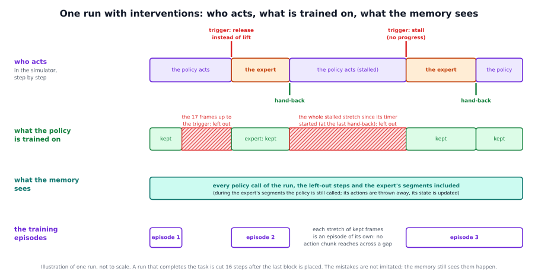
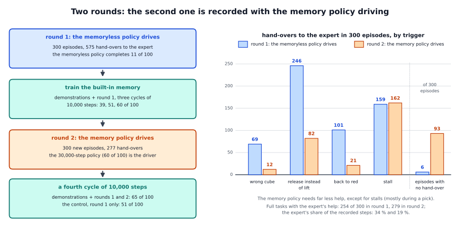

# Learning from interventions: the robot's own mistakes, corrected by an expert

## The idea

**The problem.** A policy trained on demonstrations has only seen perfect runs. When it runs by itself it makes mistakes that
no demonstration shows, and some are mistakes of memory: it goes for the blue block before red was lifted, it lets go of a
cube it should lift, it turns to red again after putting red back. To learn to avoid them, the training data must contain
these moments together with the right action.

**The idea.** Let the policy run. When it makes such a mistake, or stops making progress, a scripted expert takes over, puts
things right and hands control back, and the run goes on (an **intervention**). The frames of the mistake are left out of the
training. The expert's correction and everything the policy did right are kept. This is the idea of DAgger (Ross et al.,
2011): let the policy drive, and let an expert show the right action in the states the policy really reaches. Here the expert
steps in only on errors, as in HG-DAgger (Kelly et al., 2019).



Why record the data this way:

- In demonstrations, the current picture already tells what comes next in the moments where a memory could matter. In the
  policy's own runs it does not: a held cube near the table can be on its way up or down, and the table after red was put
  back looks like the start. A policy can fit such data only with a memory. These runs are what the
  [built-in memory](../builtin_memory/README.md) learns from.
- The mistake itself is not imitated, but the memory still sees it happen: its history runs over the whole run.
- Once a memory policy exists, the next round is recorded with it driving, so that the corrections come from the states the
  memory policy itself reaches.

**What it cannot do:**

- **It needs a way to see the mistakes and an expert who can fix them.** In our simulator that is the privileged state (the
  true positions of the cubes) and a scripted expert. On a real robot it would be a person who takes over; we have not tried
  it.
- **Its rules are made by hand for this task:** four triggers with thresholds that we set by looking at the memoryless
  policy's runs. A new task needs its own.
- **It helps only together with a memory.** For a policy without one, look-alike scenes with different right actions
  contradict each other.
- **The second round gave only a small gain** over the policy it started from (see "Our findings").
- **What is left is mostly grasping.** Stalls, mostly failed grasps, are 162 of the 277 hand-overs of round 2, and 27 of the
  best policy's 35 failures are grasps. Whether more data of this kind fix grasps is open.
- **The framework ships no collection tool.** The detailed page specifies the procedure; the recording belongs to the
  simulator.

The exact rules, how a run becomes training data and how the training reads it: [detailed/README.md](detailed/README.md).

## Prerequisites

- A simulator with the privileged state the rules read at every control step: the cubes' positions, the fingertips' position,
  the gripper's command and its width.
- A scripted expert that can complete any step of the task from wherever the policy left it (here: inverse kinematics along
  the demonstrations' waypoints, with the cube's true pose).
- The policy that drives: first the memoryless policy, then the memory policy, served with its state per episode (the
  [built-in memory's](../builtin_memory/README.md) server and episode markers).
- The built-in memory's training ([integrations/openpi](../../../integrations/openpi/README.md)), which reads the runs as split
  episodes with feature caches.

## How to use it in the framework

1. **Write the collection into your simulator** as the [detailed page](detailed/README.md) specifies: a tracker of the task's
   phases, four triggers that hand control to the expert, the expert's segments with their hand-back tests, and the caps.
2. **Record** every control step of every run, the policy's and the expert's alike.
3. **Make the training data:** leave out the frames of each mistake, make every remaining stretch of frames an episode of its
   own (split episodes), and compute the built-in memory's feature cache for every recorded step, the left-out ones included.
4. **Train** the built-in memory on the demonstrations and all rounds together:

   ```
   python -m builtin_memory.train --exp-name <name> --init-checkpoint <checkpoint dir> \
       --dataset <demonstrations repo id> <its feature index> --dataset <round 1 repo id> <its feature index>
   ```

5. **Record the next round** with the memory policy driving, served behind the proxy:

   ```
   python -m builtin_memory.serve --checkpoint <checkpoint dir> --port <policy port> --center-crop 0.95
   python -m vla_memory.proxy --writer off --task task.yaml --listen-port <port> --upstream-port <policy port>
   ```

   `--task` names the task file; for the reference task it can be left out. While the expert acts, the environment keeps
   calling the policy: its actions are thrown away, but its memory is updated, so at the hand-back it knows what happened.

## Our findings

Reference task: pick up and put back a red and then a blue cube. 300 episodes per round (the first round's training data also
hold its 10 trial episodes), then 100 fresh seeds of 500 control steps per policy. A *full task* is the whole sequence: red
picked up and put back, then blue picked up and put back. Round 1 was recorded with the memoryless policy driving, round 2
with the memory policy driving:

| | round 1, the memoryless policy driving | round 2, the memory policy driving |
|---|---|---|
| hand-overs to the expert | 575 | 277 |
| wrong cube / release instead of lift / back to red / stall | 69 / 246 / 101 / 159 | 12 / 82 / 21 / 162 |
| episodes without a hand-over | 6 | 93 |
| full tasks with the expert's help | 254 | 279 |
| the expert's share of the recorded steps | 34 % | 19 % |
| frames recorded / left out of the training | 159,331 / 31,953 | 131,592 / 27,630 |
| frames kept for training (split episodes) | 127,378 (856) | 103,962 (520) |



Full tasks of 100 for the policy with the memory and its phase head, after each training:

| policy | training data | steps | full tasks of 100 |
|---|---|---|---|
| after three cycles, the starting point | demonstrations + round 1 | 30,000 | 60 |
| a fourth cycle, the matched-steps control | demonstrations + round 1 | 40,000 | 51 |
| a fourth cycle with round 2 | demonstrations + rounds 1 and 2 | 40,000 | 65 |

- **The memory policy needs far less help:** 277 hand-overs instead of 575, and 93 of 300 episodes without any (6 in round 1).
  The mistakes a memory prevents fell in every kind (wrong cube 69 to 12, release instead of lift 246 to 82, back to red 101
  to 21). The stalls stayed (159 and 162), so the second round is mostly the expert's grasp recoveries.
- **The second round helps.** 65 against 51 for the same training on round 1 alone, a clear difference. Against the
  starting point the gain is not clear (60 to 65): on the old data a fourth cycle gives nothing, the new data add a
  little. The difference opens between red and blue: 90 episodes reached the blue cube against 76, a clear difference
  ([the picture](detailed/interventions_results.svg)).
- **Interventions are only useful with a memory.** The same round-1 data trained into the memoryless policy gave 0 of 100.
