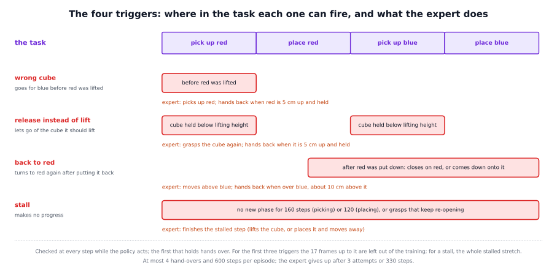

# Learning from interventions in detail

The framework ships no tool that collects intervention data: the recording belongs to the simulator. This page is the
specification of the procedure, with every rule and threshold, and it explains how a run becomes training data, how the
built-in memory's training code reads that data, and how to do the same for another task. What the method is for and what we
found are on the short page, [docs/methods/learning_from_interventions](../README.md).


## The pieces

| part | where it lives |
|---|---|
| the tracker, the four triggers, the expert, the recording | your simulator (sections 2 to 5); not in the framework |
| the left-out frames, the split episodes, the feature cache | your conversion scripts (sections 6 and 7); the cache's format is defined in `integrations/openpi/builtin_memory/sequences.py` |
| the training | `python -m builtin_memory.train` (`integrations/openpi/builtin_memory/train.py`, `data.py`, `sequences.py`) |
| the memory policy that drives the next round | `python -m builtin_memory.serve` behind `python -m vla_memory.proxy --writer off` |

## 1. Why the data are recorded this way

A policy trained by imitation learns to copy an expert's runs. Run by itself, it soon reaches states that the expert never
visited, because its own small mistakes pile up, and there it has nothing to copy. In the reference task (pick up and put
back a red and then a blue cube) many of these mistakes are mistakes of memory, because the task needs a memory (the
[built-in memory](../../builtin_memory/README.md) page explains why):

- it goes for the blue cube although red was not lifted yet;
- it closes the gripper on a cube and opens it again before lifting, so it lets go of the cube it should lift;
- after putting red back it turns to red again;
- it stalls: it grasps again and again and gets nowhere.

None of these is in a demonstration, and the right action in these scenes is often the opposite of the right action in a scene
that looks the same: after red is back on the table the next block is blue; at the start it is red.

So the policy drives, rules watch for these mistakes, and an expert shows the right continuation in the states the policy
really reaches. Four design choices:

- **The expert steps in only on errors.** It does not label every frame; the policy does everything it can by itself.
- **The mistake is left out of the training, the correction is kept.** Imitating the mistake would teach it. The frames just
  before a **trigger** (a rule that detects one of the mistakes), or the whole stalled stretch, are not training targets. The
  expert's correction and everything the policy did right are.
- **The memory still sees the mistake.** The feature cache holds every recorded step, also the left-out ones, so the memory's
  history of calls runs over the whole run. At the **hand-back** (the moment the expert gives control back to the policy) the
  memory knows what happened.
- **The expert hands back as soon as the next step is unambiguous,** so the policy keeps as much of the run as possible.

A memory is learned only when the data require it. In demonstrations the current picture already tells the phase in the
moments that matter, so a memory trained on them stays unused. The intervention data contain look-alike scenes with different
right actions, so a policy can fit them only if it remembers. Without a memory the same data contradict each other.

## 2. The setting

The policy that drives the first round is the memoryless policy, with the plain instruction as the prompt at every call, also
after a hand-back. The simulator runs as in the evaluation (same cameras, same grasp physics, a policy call every 8 control
steps), with at most 600 control steps per episode instead of 500. Every rule below reads the **privileged state** (what the
simulator knows but a robot's sensors would not tell directly) once per control step, after the step's action was applied:

- the fingertips' mean position (the tip);
- the gripper's commanded value: closed if it is at least 0.35;
- the finger width, the sum of the two finger joints in metres: 0.08 open, about 0.040 closed on the 4 cm cube, 0.032 closed on
  nothing;
- the cubes' centres, and the cube's resting height of 0.76 m.

## 3. The tracker

A tracker follows the task. Its phases never go back:

| phase | name | it ends when |
|---|---|---|
| 0 | pick up red | red's centre is more than 9 cm above its resting height while the gripper is closed ("lifted") |
| 1 | place red | the gripper is open and red is within 1 cm of its resting height for 3 steps in a row ("placed") |
| 2 | pick up blue | the same for blue: lifted |
| 3 | place blue | the same for blue: placed |
| 4 | done | no more triggers; the episode ends 20 steps after the final placement |

## 4. The four triggers

The triggers are checked at every step while the **policy** acts; the first that holds, in this order, hands over to the
expert. A *close* event is the gripper command crossing 0.35 upwards, an *open* event crossing it downwards.



| trigger | it fires when |
|---|---|
| **T1, wrong cube** | In phase 0, with red never lifted, the fingertips are closer to blue than to red and either the gripper closes within 4 cm of blue's centre, or the hand has arrived above blue (within 3 cm sideways and less than 10 cm above its centre). |
| **T2, release instead of lift** | In phase 0 or 2 the gripper opens while the cube it should lift is below the lifting height (9 cm) and within 4 cm of the fingertips, after the same closing had held it for at least 3 steps. *Held* means: the gripper is closed, the finger width is between 3.4 and 4.6 cm (the fingers were stopped by the cube) and the cube's centre is within 2.5 cm of the fingertips. Held steps count whoever acts, so a grasp made by the expert counts. |
| **T3, back to red** | From the moment red is released at its place until the end, the fingertips are closer to red than to blue and either the gripper closes within 4 cm of red's centre, or the fingertips have come down 2 cm from their highest point since the release (or since the last hand-back after it) while within 3 cm sideways of red and less than 6 cm above it. |
| **T4, stall** | Either no new phase for 160 steps while picking up or 120 while placing (a *timeout*), or, while picking up, at least 3 closings that opened again while the cube to pick moved more than 1.5 cm sideways or turned more than 5 degrees since the phase began (*chatter*). The timer starts afresh at every phase change and at every hand-back. |

## 5. The expert's segments

The expert is a script. It knows the cubes' true poses and moves the hand along waypoints (inverse kinematics, the
calculation of joint angles for a desired hand pose, on the waypoints of the demonstrations), with the gripper command set to
0.60 when closed, up to 3 attempts, a budget of 330 steps and the cube's yaw (its rotation on the table) matched; a retry
beyond 0.72 m uses a grasp pitched by 15 degrees. It takes over at the step after the trigger.

| trigger | the expert | it hands back when |
|---|---|---|
| T1 | picks up red: opens in place if closed, moves 10 cm up, above red, descends, closes, lifts | red is at least 5 cm above its rest, the gripper is closed, and red is within 3 cm of the fingertips |
| T2 | picks up the cube it should lift, as above | the cube is at least 5 cm up and held (same test) |
| T3 | goes for blue but stops before the descent: opens in place if closed, 10 cm up, moves above blue at the pre-grasp pose with the yaw matched | the fingertips are within 2.5 cm sideways of blue's centre and 10 ± 3 cm above it; or the move above has settled (40 settle steps): then the hand-back is marked "above_settled" |
| T4 | completes the stalled step: pick up (grasp and lift), or place (over the cube's spot, lower, open, retreat 10 cm) | for a pick-up: the phase advances (9 cm lift); for a place: the cube is placed and the fingertips are at least 6 cm above it or 8 cm away, which is where the demonstrations' labels switch from "place" |

If the expert gives up (3 attempts or 330 steps) it hands back too ("gave_up"). After every hand-back the policy gets a fresh
call, and T3's reference for "coming down" and T4's timer start afresh.

**Caps.** At most 4 hand-overs per episode. The first trigger after the fourth hand-over is logged as uncorrected and ends the
episode, with its window left out as for its type; nothing after it is recorded. At most 600 control steps. A completed run
ends 20 steps after the final placement.

## 6. What is left out of the training

- **T1, T2, T3** at step t: the frames t-16 to t, 17 frames, whoever acted (a window can reach into the end of an earlier
  expert segment).
- **T4**, a stall at step t: every policy frame since the stall timer started, that is since the phase change or hand-back
  that started it, up to t. The frame at the restart is skipped when it is the expert's last frame of a hand-back.
- **Uncorrected triggers** (after the cap) follow the same rule by type.
- **A completed run** is cut 16 steps after the final placement.
- Everything else, the policy's frames and the expert's, is kept.

The stall rule differs on purpose. A timeout means up to 160 (picking) or 120 (placing) steps of the policy making no
progress. Leaving out only the last 16 of those would keep a long stretch of stalling in the data and teach the policy to
stall.

## 7. From a run to training episodes

- **Split episodes.** Every stretch of kept frames becomes an episode of its own in the LeRobot dataset, so that no action
  chunk (the next 10 actions a training frame predicts) reaches across a left-out window.
- **The feature cache** has a row for every recorded step of the run, also for the left-out steps and the expert's steps: the
  frozen policy's summary of that step, as the built-in memory reads it. Its index file (`.npz`, the format at the top of
  `sequences.py`) gives, per run, where its rows start (`start`), how many recorded steps it has (`n`) and its episode number
  (`ep`), the phase label of every step (`phase`) and, for split episodes, `frame_step` and `frame_n`: for every frame of a
  split episode, the recorded step it was taken from. An optional `train_mask` marks the steps that may be training targets.
- **The phase labels** are the tracker's phase at each step, with "done" counted as place blue.

How the training reads it (`sequences.py`): `FeatureIndex` loads an index and checks that `frame_step` rises inside each
episode (`_frame_steps`); `FeatureIndex.rows` maps every dataset frame to its cache row. `HistoryDataset` keeps only the frames
that may be targets (`train_mask`), and for each one `call_frames` walks back over **recorded steps** to build the history of
calls (gaps of 6 to 10 steps, at most 96 calls). Because the walk goes over recorded steps, a history holds the left-out steps
and the expert's steps too: the memory saw them happen, the policy is not trained to imitate them.

## 8. Training and the next round

The built-in memory trains on the demonstrations and every round together, uniformly over their kept frames
(`data.create_data_loader` concatenates the datasets in the order given):

```
python -m builtin_memory.train --exp-name <name> --init-checkpoint <checkpoint dir> \
    --dataset <demonstrations repo id> <its feature index> --dataset <round 1 repo id> <its feature index> \
    [--dataset <round 2 repo id> <its feature index>] [--feature-stats <stats.npz>] [--steps 10000]
```

A cycle is 10,000 steps. Every further cycle is a warm restart from the last checkpoint (`--init-checkpoint` names it, and a
checkpoint that holds the memory brings its own feature statistics): 200 warm-up steps, then a cosine decay of the learning
rate from 1e-5 to 1e-6. The [built-in memory page](../../builtin_memory/detailed/README.md) explains the training code.

**Round 2** uses the same triggers, expert segments, caps and rules for what is left out, with the memory policy driving,
on new seeds and from natural start layouts. Serve the memory policy and put the proxy in front of it:

```
python -m builtin_memory.serve --checkpoint <checkpoint dir> --port <policy port> --center-crop 0.95
python -m vla_memory.proxy --writer off --task task.yaml --listen-port <port> --upstream-port <policy port>
```

`--task` names the task file; for the reference task it can be left out. While the expert acts, the simulator keeps calling
the policy at every action chunk with the current observation: the policy's actions are thrown away, but its memory state is
updated, so at the hand-back it reflects what happened. The state is never reset within an episode: the environment sends
`memory/new_episode` only at the start of an episode.

## 9. Using it with another task, robot or policy

1. **Say what the phases are and how to follow them.** Write a tracker that follows them from the state your simulator or robot
   can give you.
2. **Write triggers for the mistakes that matter for your task.** Each needs a phase in which it is armed, a condition on the
   state, thresholds, and the step at which the mistake counts as complete. Add a stall rule.
3. **Check the triggers before collecting.** Run them without any hand-over over recorded runs of the policy: how often does
   each fire, and does any fire in a run that succeeded? One that does is too eager. Also replay the trigger code offline on
   a few recorded runs and check that it fires where the online run did.
4. **Write the expert.** It must be able to finish any step of the task from wherever the policy left it, and each trigger
   needs a goal test at which it hands back. Choose the caps (hand-overs per episode, steps per segment, steps per episode).
5. **Decide what is left out.** Our rule: the frames of the mistake, never the expert's correction.
6. **Record, split and cache.** Record every step with its pictures. Convert the kept stretches to episodes, compute the
   feature cache for all recorded steps (with `frame_step` and `frame_n` for the split episodes), and label every step with
   its phase.
7. **Train the built-in memory** on the demonstrations and the rounds together, a cycle at a time, and compare against a
   control trained for the same number of steps without the new round.
8. **Record the next round with the memory policy driving**, served with its state, and keep calling it while the expert
   acts.

With a person instead of a scripted expert the loop is HG-DAgger: the person takes over when needed and hands back; the
triggers become the person's judgement, and the phase labels and the left-out windows have to be set by some rule or by the
person. We have not tried it.

## Limits to keep in mind

- **It needs a way to see mistakes and an expert.** The rules read the simulator's privileged state, and the expert knows the
  cubes' true poses. On a real robot the state would have to come from sensors and the expert would be a person.
- **The rules are made by hand for one task.** They were set by looking at the memoryless policy's runs on the evaluation
  seeds; no policy was trained on those runs, but the rules are not independent of those seeds. They find the mistakes we
  thought of, and stalls; a mistake of another kind is noticed only when it stalls the run.
- **The left-out windows are rules of thumb:** 17 frames before a trigger, the whole stalled stretch for a stall. Other
  lengths were not tried.
- **The data are tied to the driving policy.** A round recorded with one policy trains another one.
- **Grasp failures are shown, not practised.** The stalled stretches are left out, so the data show the expert's grasp but
  not the policy's failed attempts.
- **No re-weighting.** All kept frames count the same, the expert's as much as the policy's.

## Where the idea comes from

- **DAgger** (Ross, Gordon and Bagnell, 2011) is the base of the loop: a model trained only on an expert's data meets states
  the expert never visited, so the learner drives and the expert labels the states the learner reaches.
- **HG-DAgger** (Kelly et al., 2019, arXiv 1810.02890) lets a human take over when needed instead of labelling every state.
  Our expert also steps in only on errors; in simulation a scripted expert plays the human.
- **Sirius** (arXiv 2211.08416), **Sirius-Fleet** (arXiv 2410.22689) and **RoboCat** (arXiv 2306.11706) run the same loop of
  rollouts, interventions and training, with a human deciding what is written into the weights.
- **pi*0.6 with RECAP** (Physical Intelligence, 2025, arXiv 2511.14759) trains a value function on autonomous rollouts and
  expert interventions and asks the policy for "good" behaviour. We keep the interventions and drop the value function; the
  framework's [RECAP-lite](../../recap/README.md) is the other half, the successful rollouts.
- **Present but Not Remembered** (arXiv 2607.03372) shows why demonstrations alone teach no memory: when the present already
  tells what to do, a policy has no reason to consult its past.
- **Grounded in Time** (arXiv 2610.04255) builds benchmark tasks from pairs of similar observations that need different
  actions: the kind of scene our interventions produce.
