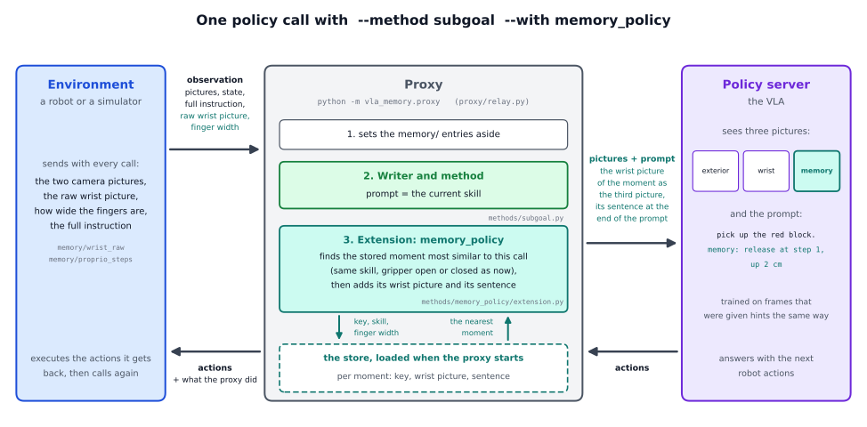
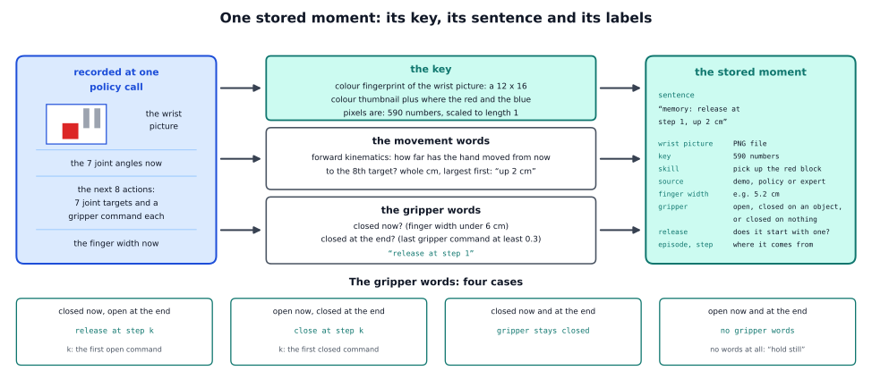
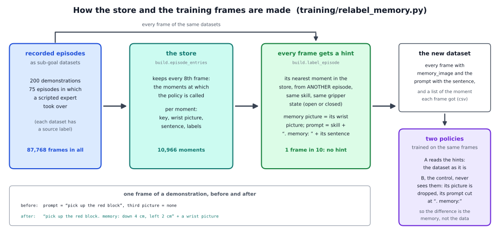

# The memory policy in detail

This page explains how the memory policy works: its design, one policy call through the code, how the store and the training
data are made, and how to use it with another policy or task. What it is for and what we found are on the short page,
[docs/methods/memory_policy](../README.md).



## 1. The design

A store holds moments of recorded episodes: demonstrations, the policy's own episodes, and episodes in which a scripted
expert took over from the policy. At every call the policy gets the most similar moment as a hint, next to its own two
cameras, and it is trained to read such hints, so it can learn when to trust them. Three decisions follow:

1. **The hint is a picture and a sentence.** π0.5 has three picture slots and the reference policy uses only two, so the third
   is free for the stored moment's wrist picture. The movement is written as words in the prompt, because words are cheap:
   π0.5's prompt holds at most 200 tokens (word pieces), and a sentence takes few of them, while the same 8 actions written as
   numbers would need more than the whole prompt.
2. **The sentence must not depend on the scene of the stored episode.** The policy's actions are absolute joint targets, and
   the cubes lie somewhere else in every episode, so a stored target would point at another episode's cube. The sentence says
   instead how far the hand moved, in centimetres along the bench's axes. The policy gets no joint state either (it works out
   where its arm is from the pictures), so a hint in terms of the hand's movement is the natural form.
3. **The policy must stay in control.** If a training frame were given its own episode's moment, the hint would be a perfect
   copy of the answer and the policy would learn to copy it. Every frame is therefore given the nearest moment of *another*
   episode ("leave one episode out"), as a deployed policy would get it. One frame in ten gets no hint at all, so that a call
   without a hint is in the training data too.

## 2. The pieces

| file | what it does |
|---|---|
| `vla_memory/methods/memory_policy/extension.py` | `MemoryPolicyExtension`: the options, the hook before the policy call, the log |
| `.../retrieve.py` | `candidates` and `neighbour`: the retrieval rule |
| `.../key.py` | `WristKey`: the key of a raw wrist frame |
| `.../query.py` | what a call provides: the wrist frame, the finger width, the skill |
| `.../prompt.py` | `with_memory` and `strip_memory`: the prompt with the hint, and back |
| `.../gripper.py` | `gripper_state`: open, closed on an object or closed on nothing, from the finger width |
| `.../store.py` | `MomentStore` (reads a store), `save_store` (writes one) and the files of a store |
| `.../pictures.py` | `Pictures`: the wrist pictures, decoded when first needed, in a bounded cache |
| `.../sentence.py`, `kinematics.py` | `sentence`: the movement and gripper words; `FrankaKinematics`: where the hand is, from the joints |
| `.../build.py` | the store builder and the training labels (arrays in, arrays out) |
| `training/relabel_memory.py` | reads and writes the datasets, and calls `build.py` |
| `vla_memory/fingerprint.py` | the colour fingerprint (the VLM writer's example store uses it too) |

The parts every writer and method share (the server, the relay, the connection to the policy) are explained step by step in
the [oracle walkthrough](../../../writers/oracle/detailed/README.md); this page concentrates on what the memory policy adds.

## 3. One run, step by step

This section follows one run of

```
python -m vla_memory.proxy --writer rules --method subgoal --task vla_memory/tasks/red_blue_blocks.yaml \
    --with memory_policy --memory-store store/ --listen-port 8001 --upstream-port 8000
```

`--task` names the task file; for the reference task you can leave it out. The extension works with every writer. It needs
the sub-goal method, because the policy was trained on skill prompts.

### 3.1 Start-up

1. `parse_command_line` reads the command line twice. The first pass finds `--with memory_policy`; `resolve_extension` finds
   the name in `EXTENSIONS` (`proxy/extensions.py`) and imports the class only now. The second pass reads everything,
   including the options the extension adds with `add_arguments`:

   | option | meaning | default |
   |---|---|---|
   | `--memory-store DIR` | the store directory | required |
   | `--memory-mode normal\|off\|wrong` | `normal`: the retrieved moment; `off`: no hint at all; `wrong`: a random moment of another skill | normal |
   | `--memory-seed N` | the seed of the random choice in mode `wrong` | 0 |
   | `--memory-cache N` | how many decoded wrist pictures stay in memory (230 KB each; 0 decodes at every call) | 1024 |

2. `build_components` calls `build_extensions`, which calls `MemoryPolicyExtension.build(args, task, built)`. It takes the
   name of the policy's wrist image from `--image-keys` (the second entry, used only as a fallback, see 3.3). A store that
   cannot be read is a usage error.
3. `MemoryPolicyExtension.__init__`:
   - `MomentStore.load(path)` reads `meta.json`, `entries.jsonl` and `keys_fingerprint.npy` and checks that the keys are
     `fingerprint` keys. The pictures stay on disk.
   - `WristKey(task)` builds the fingerprint from the task file's `fingerprint` section (section 4.4).
   - `_check_key_size` compares the length of the task's key with that of the store's keys (590 in the reference). A
     difference means the store was built with another task file, and the proxy stops.
   - `Pictures(store.pictures, cache)` sets up the picture cache: a picture is decoded from its PNG file at first use (about 1
     ms), and the most recently used ones stay in memory.
   - The log notes how many moments were loaded and how long it took.
4. The writer and the method are built as for every run. The extension's `attach` does nothing: it needs no planner.

### 3.2 What the environment sends

Besides the policy's usual entries and the full instruction, the extension reads two entries that
`vla_memory.env_keys.ControlKeys` builds:

| entry | what the extension does with it |
|---|---|
| `memory/wrist_raw` | the raw wrist frame (240 × 320 × 3 in the reference bench): the store's keys were computed on frames of this kind |
| `memory/proprio_steps` | the finger width is column 0 of the last row (the width at the call's own step); at the first call of an episode, when this array is still empty, `memory/finger_width` is used |

### 3.3 One policy call

The relay handles the call as for every writer: it sets the `memory/` entries aside, starts a new episode if one begins, asks
the writer, and lets the method set the prompt. The extension's turn comes in `Relay._decide_prompt`, after the method has set
the prompt and before the observation goes to the policy. For each extension the relay calls `before_policy(observation,
control_keys, prompt, writer.monitor)`:

1. **Count the call** (`MemoryPolicyExtension.before_policy`). With `--memory-mode off` nothing else happens and the record is
   `{"memory": None}`: the policy gets the bare skill prompt and no picture.
2. **Gather what the call provides** (`retrieve`, with the functions of `query.py`):
   - `skill_of(prompt, planner, skills)`: the prompt, if it is one of the task's skills; otherwise the writer's current skill;
     otherwise nothing;
   - `wrist_frame(...)`: `memory/wrist_raw`; if it was not sent, the policy's own wrist image (the extension says so once in
     the log, because a resized picture gives a different key than the raw frames the store was built on);
   - `finger_width(...)`.
3. **Check that everything is there** (`_missing`). No skill (`no_skill`), no frame (`no_frame`) or no finger width
   (`no_width`) means no hint at this call, with one warning per run. A frame of another shape than 240 × 320 × 3 gets one
   warning, and the key is computed anyway.
4. **Compute the key** (`WristKey.key_of`): the colour fingerprint of the frame, scaled to length 1 (section 4.4).
5. **Find the moment** (`neighbour`, section 3.4). In mode `wrong`, `_wrong_entry` takes a random moment of another skill
   instead.
6. **Hand it to the policy**, if a moment was found:
   - `observation["observation/memory_image"]` becomes the moment's wrist picture (`Pictures`, 240 × 320 × 3, uint8);
   - `observation["prompt"]` becomes `with_memory(prompt, sentence)`: the skill, then `. memory: `, then the words of the
     sentence ("pick up the red block. memory: release at step 1, up 2 cm").
7. The relay notes the changed prompt in its record (`prompt`), forwards the observation (`_forward`) and returns the policy's
   reply untouched. The extension has no hook for the reply.

If no moment is found, the observation stays as the writer and method made it: the bare skill prompt and no `memory_image`.
The policy treats a missing picture as an empty slot, which is the same as a frame without a hint in its training.

### 3.4 The retrieval rule

`neighbour(store, key, skill, width)` first decides which moments are *admissible* (`candidates`), then takes the one with the
highest cosine similarity (a dot product of two keys of length 1: 1 for the same direction, 0 for unrelated ones;
`store.keys @ key`). There is no cut-off: the best admissible moment is shown, however poor the match.

The admissible moments are those of the same skill, and then:

| the call's gripper (from the finger width) | admissible moments | `rule` in the log |
|---|---|---|
| open (6 cm or wider) | moments with an open gripper | `open` |
| closed on an object (3.4 to 6 cm) | moments with a closed gripper (on an object or on nothing) | `closed` |
| closed on nothing (under 3.4 cm), and the skill has moments that release | only the moments whose sentence starts with a release | `release` |
| closed on nothing, and the skill has no such moment | all moments with a closed gripper | `closed_fallback` |

Why the last two rules: the fingers of the reference gripper stop at about 3.2 cm when they close on nothing, and at 3.7 cm
or more on a cube. A gripper closed on nothing has missed. The only sensible next movement is to open it again, so only
moments that do so are offered. Few stored moments are closed on nothing, so this rule applies rarely.

### 3.5 The three modes

- `normal` (the default): the moment `neighbour` finds.
- `off`: no hint at all, the bare skill prompt and no third picture. This is the same checkpoint run without its memory, and
  it is what the policy saw on one training frame in ten.
- `wrong`: a random moment of *another* skill, picture and sentence together (seeded with `--memory-seed`). The test of
  whether the content of the hint matters.

### 3.6 What is logged

Every line of the proxy's log carries `memory_mode`. With a hint it also holds `memory`: `entry` (the moment's number in the
store), `episode` and `step` (where it comes from), `source` (`demo`, `policy` or `expert`), `skill`, `width` (the call's
finger width in m), `similarity`, `rule` (`open`, `closed`, `release`, `closed_fallback` or `wrong`), `sentence` and `ms` (the
time of the whole step in milliseconds). Without a hint, `entry` is empty and `rule` says why (`no_skill`, `no_frame`,
`no_width`, or the retrieval rule that found no admissible moment). The environment is told the store, its size and the mode
when it connects (`memory_policy` in the proxy's metadata). When the proxy stops, the log notes how many calls got a hint and
how many pictures were decoded.

### 3.7 How it hooks into the proxy

The extension uses these hooks of `proxy/extensions.py`: `add_arguments`, `build`, `config`, `metadata`, `log_fields`,
`before_policy` and `close`. That is all. It uses none of the VLM writer's planner hooks, so it changes neither the plan
request nor the questions the VLM writer asks the planning model. It reads `writer.monitor.current_skill` only when the prompt
is not one of the task's skills. With the oracle there is no monitor (`None`), and the prompt is a skill. This is why the
memory policy runs with every writer.

## 4. How the store and the training data are made



```
python training/relabel_memory.py --train <demos>:demo --train <corrections>:expert --val <demos val>:demo \
    --store <store dir> --root <dataset root> --repo-id <user>/<name> [--task task.yaml]
```

Run it where `lerobot` is installed (the openpi environment). It refuses to write into a
store directory that is not empty, or over an output dataset that exists. The script reads and writes the files; the work
itself is in `vla_memory/methods/memory_policy/build.py`, which only handles arrays.

### 4.1 The recorded episodes

The input is LeRobot datasets (v2.1) in which both cameras are stored as images, not video, with the 8-value state (the 7
arm joint angles and the gripper's closedness last), the 8-value action (7 absolute joint targets and a gripper command from 0
to 0.6) and, as each frame's task, the skill the policy was given there (`convert_to_lerobot.py --no-videos`, then
`relabel_subgoals.py`). Each dataset gets a source label with `--train PATH:LABEL` (or `--val PATH:LABEL`), which every stored
moment keeps; the labels of one split must differ, because they make the episode ids (`<label>_<split>_<index>`).

The reference data: scripted demonstrations, and recorded episodes in which the policy drove and a scripted expert took over.
Three things were left out of the take-over episodes: the stretch before each hand-over in which the policy failed repeatedly
(so that the policy does not learn to copy its own failed attempts), everything more than 16 steps after the task was
complete, and the skills an episode never completed. What remained was cut into pieces, which count as episodes of their
own.

### 4.2 The store

`build.call_moments` picks the **moments** of an episode: every 8th frame, starting at the first, that still has 8 actions
after it. These are the moments at which the policy is called, because the bench executes 8 actions of every chunk
(`HORIZON`). For each moment `build.store_entry` makes one entry:

| field | content |
|---|---|
| `id` | the entry's number, 0 to n - 1 |
| `episode`, `step` | where it comes from: the episode and the control step |
| `seed` | the simulator seed; the framework's builder always writes -1, because a LeRobot dataset does not record it |
| `skill`, `skill_index` | the skill the policy was given, and its place in the task's skill list |
| `source` | the label of the dataset the moment comes from (`demo`, `expert`). The reference store also tells the policy's own frames from the expert's (`policy` and `expert`); the builder takes one label per dataset |
| `width`, `gripper` | the measured finger width in m (both fingers together), and the state from it: `open`, `closed_object` or `closed_nothing` |
| `release` | whether the sentence starts with a release (the entries a gripper closed on nothing is offered) |
| `sentence` | the memory sentence of the moment's next 8 actions (4.3) |
| `wrist_png` | the path of the wrist picture |

A store is a folder (written by `save_store`, read by `MomentStore.load`):

| file | content |
|---|---|
| `entries.jsonl` | one JSON line per moment, with the fields above |
| `keys_fingerprint.npy` | the key of every moment's wrist picture, one row per moment (4.4) |
| `wrist/NNNNN.png` | the raw wrist picture of moment NNNNN (240 × 320, RGB) |
| `meta.json` | what the store holds: counts by source, skill and gripper state, the release moments per skill, the thresholds, the time it was built |
| `chunks.npz` | the joint angles and the 8 actions each sentence was made from, kept for checks (not needed to read the store) |

The first line of the reference store's `entries.jsonl`:

```
{"id": 0, "episode": "demo_train_000000", "seed": -1, "step": 0, "skill": "pick up the red block", "skill_index": 0,
 "source": "demo", "width": 0.08, "gripper": "open", "release": false, "sentence": "memory: down 6 cm, back 1 cm",
 "wrist_png": "wrist/00000.png"}
```

### 4.3 The sentence

`sentence.sentence(q_now, chunk, width_now)` writes what the robot did during the moment's 8 actions. `q_now` are the 7 joint
angles of the moment, `chunk` the 8 actions that follow (7 joint targets and a gripper command each) and `width_now` the
measured finger width.

**The movement words.** Forward kinematics (`FrankaKinematics.tcp_position`) turn a set of joint angles into the position of
the hand's tool centre point, the point between the fingertips. The sentence takes the position after the *last* target of
the chunk minus the position at the moment's own joint angles, and says it in whole centimetres along the bench's axes: up or
down (z), left or right (y), forward or back (x). A component under 1 cm is left out. The largest component comes first; equal
sizes are ordered by a fixed rule, because the training labels were made with it.

**The gripper words.** Is the gripper closed *now*? That is read from the measured finger width: closed if under 6 cm. (The
policy changes its gripper command only at the start of a chunk, so the first command of a chunk would never show its own
opening.) Is it closed *at the end*? That is read from the last command: closed if it is 0.3 or more (the commands run from 0
to 0.6). Four cases:

| now | at the end | words | k |
|---|---|---|---|
| closed | open | `release at step k`, placed first | the first open command, counted from 1 |
| open | closed | `close at step k`, placed last | the first closed command, counted from 1 |
| closed | closed | `gripper stays closed`, placed last | |
| open | open | no gripper words | |

A sentence with no words at all is `hold still`. Every sentence starts with `memory: `. Examples from the reference store:

| sentence | what it says |
|---|---|
| `memory: down 6 cm, back 1 cm` | the hand goes 6 cm down and 1 cm back; the gripper stays open |
| `memory: close at step 6` | the hand hardly moves; the gripper closes at the 6th action |
| `memory: gripper stays closed` | the hand hardly moves and the gripper holds |
| `memory: up 12 cm, left 1 cm, gripper stays closed` | a cube is being lifted |
| `memory: release at step 1` | the gripper opens at once; the hand hardly moves |
| `memory: hold still` | nothing moves, nothing changes |

The rule is fixed: **the sentence must not change without making the training data again**, because the policy learned these
exact words.

### 4.4 The key

The key is the colour fingerprint of the raw wrist frame (`WristKey`, built with `vla_memory/fingerprint.py`). For the
reference task it has 590 numbers, scaled to a length of 1:

- a colour thumbnail of the picture, 12 rows × 16 columns × 3 colour values, 576 numbers (weight 1);
- for each object colour, 7 numbers about the pixels of that colour (weight 6): how large an area they cover (on a log scale),
  where their centre is (two numbers), how far they spread (two numbers), and whether they touch the left or the top edge of
  the picture. That is 2 colours × 7 = 14 numbers.

The task file defines the colours by channel differences on the 0 to 255 scale: red is "red exceeds green and blue by more
than 60", blue is "blue exceeds red by more than 40 and green by more than 15" (`fingerprint.colours`). Computing a key takes
a few milliseconds on a CPU and needs no model. The similarities of retrieved moments are all very close to 1, probably
because most of every wrist picture is the same bright table, so the ranking counts, not the number.

The key needs the same kind of picture at run time as at build time: the raw 240 × 320 frame. A key computed from the
policy's resized 224 × 224 picture is different, which is why the extension asks for `memory/wrist_raw`.

### 4.5 Labelling every training frame



The store holds only the call moments, but *every* frame of the training datasets gets a hint (`build.label_episode`, called
by `write_episode` in the script). A frame has two roles. As a store entry (if it is a call moment) it contributes its wrist
picture and the sentence of its own next 8 actions. As a training example its target stays its own 8 actions, while its prompt
and its third picture come from the nearest moment of another episode. For each frame:

1. The key of its raw wrist frame (`WristKey.keys_of`).
2. `label_frame` calls the same `neighbour` function that the proxy calls at run time, with the frame's own skill and measured
   finger width and with its own episode left out (`exclude_episode`). So the policy is trained on exactly the kind of
   neighbour it will get. "Another episode" means another episode of the dataset: one that was cut into pieces counts as
   several.
3. One frame in ten gets no hint (`no_memory`): the frames whose checksum of `"<episode id>:<step>"` is divisible by 10. No
   random generator is involved, so every run picks the same frames. A frame for which no moment is admissible gets no hint
   either.
4. A frame with a hint gets the prompt `with_memory(skill, sentence)` and, as its `memory_image`, the moment's wrist picture.
   A frame without one gets the bare skill and an all-zero picture.

The finger width of a training frame comes from the dataset's state (`finger_width(state)` in the script: 2 × 0.04 × (1 − the
state's last value), the reference robot's convention). The output datasets are `<root>/<repo-id>_train` and
`<root>/<repo-id>_val`. `write_episode` also writes one line per frame into `memory_frames.csv` in each dataset folder: the
episode, the frame, its source, skill, finger width and gripper state, whether it has a hint, the moment it got (its number,
episode, source, similarity and rule) and the prompt.

### 4.6 The policy side

The policy is trained with its own code; `training/README.md` lists the data it needs. What it must do is small:

- **The third picture.** `observation/memory_image` goes into π0.5's third image slot with its mask switched on. If the picture
  is missing or all zero, the slot stays empty and masked out, exactly as for a policy that does not use it.
- **The prompt** goes through as it is: the skill, then `. memory: ` and the sentence.
- **Two policies, one dataset.** The policy that reads the hints, and a control that gets the same frames with the picture
  dropped and the prompt cut at `. memory:` (`prompt.strip_memory`), so it sees two pictures and the bare skill prompt.
  Whatever the two policies do differently, the memory is the cause, not the data.

The reference policies were trained from `pi05_base` with the sub-goal recipe (LoRA, batch 16, absolute joint targets, no
joint state input), shortened to 20,000 steps. No checkpoint and no dataset is distributed with the framework.

## 5. Using it with another policy or task

**Another policy.** It must accept two things: a third picture, `observation/memory_image`, with a mask that is switched off
while the picture is missing or all zero, and a prompt that ends in `. memory: <sentence>`. Train it on the dataset
`relabel_memory.py` writes, and train a control on the same frames without the hints. The proxy needs no change: it sends the
picture under `observation/memory_image`, and `--transport` connects it to a policy server that speaks another protocol.

**Another task.** The skills, the object colours (`fingerprint.colours`) and the prompts come from the task file. Record
episodes, label every frame with its skill (`relabel_subgoals.py --task your_task.yaml`), then run `relabel_memory.py --task
your_task.yaml`. The proxy then runs with the same `--task`.

**What is fixed to the reference bench** and needs a change in the code for another robot:

| where | what is fixed |
|---|---|
| `sentence.py` | 8 actions per call (`HORIZON`), the gripper command's closed level 0.3 (`CLOSED_COMMAND`), the words for the bench's axes |
| `kinematics.py` | the Franka arm's joint chain and the bench's base pose. `sentence()` takes any object with `tcp_position(joints)`, but the builder (`build.store_entry`) does not pass one yet, so it uses the Franka chain |
| `gripper.py` | the open and the closed-on-nothing finger widths, 6 cm and 3.4 cm (the Franka hand with 4 cm cubes) |
| `key.py` | the raw wrist frame's shape, 240 × 320 × 3 (a frame of another shape only gives a warning) |
| `training/relabel_memory.py` | `finger_width(state)`: the finger width from the red/blue state's last value |

**Before training, and after.** Before training, check the retrieval on recorded runs: how far the movement of the retrieved
moments is from the real next movement, against a random moment of the same skill and gripper state. After training, compare
the first chunk of actions with the right hint, with no hint and with a wrong one (`--memory-mode off` and `wrong`) against
the noise floor, the difference between two runs of the same input. These checks tell whether the policy reads its memory at
all, before any long evaluation. The framework has no script for them.

## 6. Limits to keep in mind

- **The key sees colours in one picture:** not the exterior camera, not the robot's state, not the actions. It needs clearly
  coloured objects; for other scenes a learned key may be needed (argued, not tested here).
- **One moment and no cut-off.** Only the best moment is shown, even when the match is poor, and the similarity values hardly
  tell a good match from a poor one.
- **The store is fixed during a run,** and the store at run time is the store the policy was trained with.
- **The sentence is coarse.** It says whole centimetres and leaves out anything under 1 cm, so slow and precise movements read
  as "hold still" or have no movement words.
- **The policy side is not shipped.** The third picture and the control need an input step in the policy's own code.

## Where the idea comes from

- **VINN** (Pari et al., 2021, arXiv 2112.01511) is the nearest-neighbour idea in its purest form: look up demonstration
  frames by similarity and use their actions directly, with no learned policy. The memory policy does not copy the stored
  actions; it shows them as a hint.
- **RAP** (Kagaya et al., 2024, arXiv 2402.03610) returns the temporal neighbourhood of the best-matching moment, and **STRAP**
  (Memmel et al., 2024, arXiv 2412.15182) retrieves sub-trajectories with dynamic time warping. Both return what happened
  *next*, not only a frame; our hint is the same kind of thing: the next 8 actions of the matching moment.
- **RICL** (Sridhar et al., 2025, arXiv 2508.02062) is the closest relative. It puts retrieved experience into a VLA's own
  input: π0-FAST gets parts of 10 to 20 demonstrations of a new task, retrieved at test time. We also put the retrieved moment
  into the policy's input, and we train the policy to read it.
- **RA-VLA** (Jang et al., 2026, arXiv 2608.25585) pairs GR00T N1.5 with a retriever trained for the purpose; swapping only the
  retriever changes the result a lot, so the key matters. **COLLAGE** (arXiv 2508.01131) found that retrieval from a single cue
  imports harmful data, and **Robota-Embed** (arXiv 2610.19495) that a key must carry the actions. Our key is a single cue,
  the colour fingerprint of the wrist picture.
- **OnEvoMemory** (Chen et al., 2026, arXiv 2608.08749) keeps a bank of progress, failure and recovery events. The idea of
  storing moments in which something was corrected comes from this line of work.
- **"Present but Not Remembered"** (arXiv 2607.03372) reports that VLAs often do not consult past inputs: a policy trained on
  demonstrations in which the present already tells what to do has no reason to use a past it can reconstruct. The same
  could happen to a hint.
