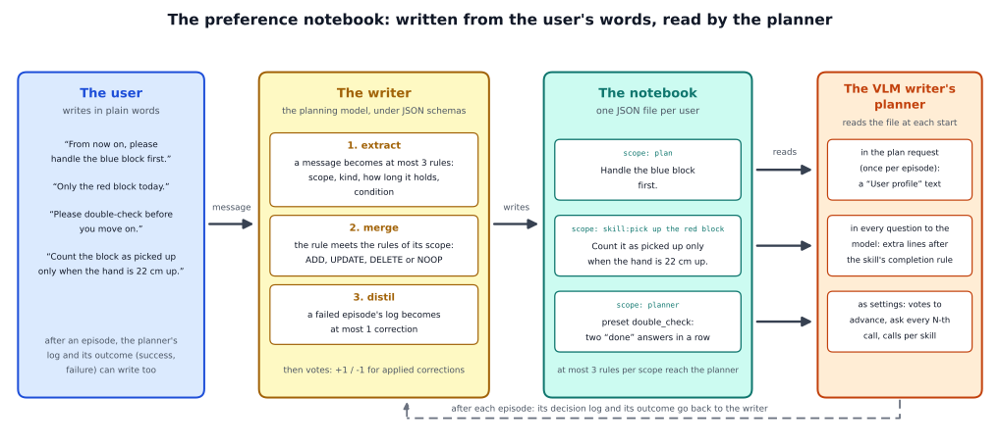

# The preference notebook: a memory of the user

## The idea

A robot that works for one person should learn how that person wants things done, and should not need to be told again every
day. An instruction only says what to do now. It cannot say "from now on", "only today" or "be more careful". Without a
memory, the robot follows a wish only in the episode right after it was said, and a user who wants it followed every time has
to repeat every wish before every episode.

The notebook keeps the wishes as short rules about the user. They are written once and read at the start of every episode by
the planner of the VLM writer (the writer that asks a vision-language model for the plan and for whether each skill is done).
The notebook holds **preferences** (how the user wants the task done, said in words) and **corrections** (rules written after
a failure). Nothing in the policy or in the planning model changes.

Every rule has a **scope**, which decides where it acts. The scope decides, never a similarity search:

| the user says | scope | where it acts |
|---|---|---|
| "from now on, please handle the blue block first", "only the red block today" | `plan` | a paragraph in the plan request |
| "count the red block as picked up only when the hand is 22 cm up" | `skill:<skill>` | after that skill's completion rule, in every question to the planning model |
| "double-check before you move on", "be quick" | `planner` | a preset of the planner's settings: two "done" answers in a row, or a question only at every second policy call |

A plan rule reaches the planning model like this:

```
User profile (apply unless the instruction says otherwise):
- Handle the blue block first.
```



**Five rules keep it a profile and not a growing log:**

- **Few rules per scope.** At most three active rules per scope reach the planner, ranked by importance, then by how recent
  they are.
- **A newer rule replaces an older one.** A message that contradicts a rule replaces it; the old rule stays in the file with the
  time it ended. A repetition confirms a rule. A withdrawal ("forget what I said about the order") retires it.
- **Votes.** A rule's importance starts at 2. After an episode, a correction that was applied gains a point on success (up to
  5) and loses one on failure. At 0 it is retired. The robot's own failures never vote out a preference the user stated.
- **Validity.** A rule holds until it is withdrawn, for the day or for the session, as its words say ("today", "this time").
  The notebook keeps its own clock and checks validity at every episode start. A rule for the day that replaces a lasting one
  only hides it until the day is over.
- **The instruction comes first.** If the instruction names any of the task's objects, it decides which objects are handled
  and in which order. A plan rule that names objects is then held back for that episode (it is logged, not applied).

**Who writes it.** The planning model does, under JSON schemas built from the task's skills, so its answer can only be a rule
the planner understands. It answers three questions: a user message becomes at most three rules; a failed episode's decision
log becomes at most one correction; and a proposed rule is merged with the rules of its scope (add, update, delete or no
change). The merge follows Mem0, the votes follow ExpeL, and the way old rules are kept follows Zep, three memories for
language-model agents (the detailed page lists the papers). A gold writer answers the same questions from annotations, for
tests.

**What it cannot do:**

- **It acts only where the planner can.** It changes the plan, the completion rules and the planner's care. It cannot change
  how the arm moves or where a block is put down.
- **It learns from words and failures only.** It does not infer a wish from what the user does.
- **It cannot make the policy good at what the policy does badly.** Following a wish for an order the policy was not trained
  on cost success (see "Our findings").
- **Corrections written from failures are weak.** The planning model finds the skill where an episode went wrong but restates
  the rule already in force instead of tightening it. The corrections in our tests came from annotations.
- **Votes see only outcomes.** They retired a correction that made every episode fail. But a rule the planner's model simply
  ignores causes no failure and is kept: votes cannot tell a rule that does nothing from one that helps.
- **The planning model can misread a message.** Of four unusual ways to withdraw a wish, two were understood and two gave no
  rule ("Never mind the order of the blocks, any order is fine." and the bare "Forget it.").
- **One user, one task so far.** The ten-day test had a scripted user and the reference task.

How it works in the code, and how the notebook is written: [detailed/README.md](detailed/README.md).

## Prerequisites

- The VLM writer (`--writer vlm`): the notebook is read by its planner (the plan request, the completion rules, the
  settings). The task file's skills define the scopes.
- For the model writer, the planning model's server (any OpenAI-compatible chat API). The gold writer needs none.
- One JSON file per user. The writer creates it.

## How to use it in the framework

`--task task.yaml` names the task file. For the reference task it can be left out.

Run the proxy with the VLM writer and the notebook. It re-reads the file at the start of every episode, so a writer may
change it in between. `--profile-off` runs the same command line without the notebook:

```
python -m vla_memory.proxy --writer vlm --method subgoal --with notebook --profile notebook.json --task task.yaml \
    --listen-port <port> --upstream-port <policy port>
```

The proxy only reads the notebook. Your application writes it between episodes:

```python
from vla_memory import OpenAICompatibleVLM, TaskSpec
from vla_memory.methods.notebook import PreferenceWriter, ProfileStore

writer = PreferenceWriter(OpenAICompatibleVLM(), TaskSpec.load_or_default("task.yaml"), ProfileStore("notebook.json"))
writer.from_message("From now on, please handle the blue block first.")
writer.from_failure(planner_records, "failed", "You moved on too early.")   # a correction after a failed episode
writer.feedback(applied_ids, success)                                       # the votes after an episode
```

`vla_memory.methods.notebook.session.run_session` runs a scripted session of messages, episodes and clock steps against any
episode runner (a class with a `run` method that plays episodes through the proxy), in four conditions: `profile` (the
notebook), `none`, `first` (each message in front of the next instruction only) and `every` (all messages so far in front of
every instruction). It writes one JSON line per message, episode, vote and correction and scores the writer against
annotations. Two example sessions are in `vla_memory/methods/notebook/sessions/`: `validity_and_precedence.yaml` and
`harmful_correction.yaml`.

## Our findings

The VLM writer in its settled configuration drove the sub-goal policy in simulation (the planner loop). The planning
model wrote the notebook.

**Ten days with one user.** A scripted user, 80 episodes over ten days, 8 a day. Every episode's instruction was "Pick up
each block and put it back on the table.", except episodes 31 and 32, two controls whose instruction names both blocks:
"Pick up the red block and put it back, then do the same with the blue block." The user sent nine messages:

| day | episodes | what the user says before the day's episodes, word for word |
|---|---|---|
| 1 | 1-8 | after episode 4: "Please double-check before you move on to the next step." |
| 2 | 9-16 | "From now on, please handle the blue block first." |
| 3 | 17-24 | "Please only do the red block today." |
| 4 | 25-32 | nothing |
| 5 | 33-40 | "You keep moving on too early: count the red block as picked up only when the hand is at least 35 cm above the table." |
| 6 | 41-48 | "No need to double-check any more, please be quick." |
| 7 | 49-56 | "Forget what I said about doing the blue block first." |
| 8 | 57-64 | "Thanks, the last few days went well." and "How long does one run take?" |
| 9 | 65-72 | nothing |
| 10 | 73-80 | "This time, please do the blue block first." A new session starts after episode 76. |

Three robots ran the same 80 episodes. They differ only in how the user's messages reach them:

- **The notebook:** the writer turns each message into rules once, and the planner reads the rules that hold at the start
  of every episode.
- **No memory:** a message is put in front of the instruction once, for the next episode only. On day 2 the first episode
  gets "From now on, please handle the blue block first. Pick up each block and put it back on the table."; the other seven
  get only "Pick up each block and put it back on the table."
- **The repeating user:** before every episode the user types every wish said so far again, in front of the instruction;
  only a wish for the day or the session drops out when it ends. By day 7 that is five sentences before every episode,
  "from now on, blue first" and "forget what I said about blue first" among them.

In all three the user's words reach only the planning model: inside the instruction, which it reads once per episode to
make the plan, or through the notebook. The policy gets the same skill prompts in all three ("pick up the blue block");
only which skills, and in which order, differ. We counted, per episode (fixed in writing before the first episode):

- **Planned as asked:** the plan has the blocks and the order the user asked for: blue first on day 2, only red on day 3,
  red first again after "forget blue first". Counted from day 2 on, 72 episodes: before that the user had said nothing
  about the blocks, and every robot plans red first.
- **Checked as asked:** the planner checks progress the way the user asked. After "double-check" it moves on only after two
  "done" answers in a row; after "be quick" it asks the planning model only at every second policy call. Counted from the
  fifth episode on, 76 episodes. An instruction cannot change how the planner checks, so only the notebook can score here.
- **Task done:** every block in the plan was picked up and put back.
- **Done the user's way:** the task done, planned as asked, and the plan's first block was also the first one lifted.

| measure | the notebook | no memory | the repeating user |
|---|---|---|---|
| planned as asked | 72 of 72 | 33 of 72 | 72 of 72 |
| checked as asked | 76 of 76 | 0 of 76 | 0 of 76 |
| task done | 54 of 80 | 73 of 80 | 58 of 80 |
| task done, plan starting with blue | 14 of 34 | 2 of 2 | 15 of 34 |
| task done, plan starting with red | 40 of 46 | 71 of 78 | 43 of 46 |
| done the user's way | 54 of 80 | 40 of 80 | 58 of 80 |
| minutes per episode (median) | 3.8 | 4.4 | 4.6 |
| model calls per episode (the plan and the questions) | 26 | 30 | 34 |
| what the user typed in ten days | 9 messages, 91 words | 9 messages, 91 words | 280 messages, 3,376 words |

- **The notebook follows the user as the repeating user does, with 91 words instead of 3,376.** Both planned as asked in
  all 72 episodes. Without memory the robot did so in 33: in the episode right after a message, and whenever the user
  wanted what it does anyway (red first, as on days 7 to 9).
- **Blue first is hard for the policy, whoever remembers the wish.** With a plan starting with blue the policy finished 14
  and 15 of 34 episodes (the notebook's 14 include the two lost to the harmful rule, below), with a plan starting with red
  40 and 43 of 46, likely because its demonstrations always took red first. The robot without memory planned blue first
  only twice, right after a message. So it finished the most tasks, 73, but only 40 the way the user asked.
- **The notebook is also the fastest.** Its episodes were the shortest and needed the fewest model calls, because from day 6 on "be
  quick" halves the questions. It also gives the planning model the least extra text to read. Once per episode the planner
  asks the model for the plan; the notebook adds its rules to that request, 17 words while a rule about the blocks holds
  ("User profile (apply unless the instruction says otherwise): - Prioritize the blue block over the red block") and none
  otherwise, 8.8 words per episode on average. The repeating user's sentences added 42.
- **Time.** Reading the notebook takes about half a millisecond at an episode start. The writer works between episodes: 1
  to 19 seconds per message (median 6 s; 12 model calls for the 9 messages). The three robots ran at the same time and
  shared one planning model, which then needed 3 to 5 seconds per question instead of 2.5. So all episode times here are
  longer than with a model of their own.
- **Rules ended on time, and no rule acted where it must not.** The rule for the day ended at midnight, the rule for the
  session with the session, and the withdrawal held for three days. In the two episodes whose instruction named both blocks,
  the instruction's own order won. There was no false application in the 80 episodes.
- **A harmful rule retired itself.** The correction "count the red block as picked up only when the hand is at least 35 cm up"
  cannot be met (the hand rises to about 28 cm). It was applied in two episodes, both failed, and its importance went 2, 1, 0
  and it was retired. It was never applied again.
