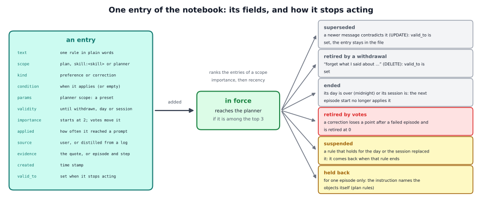

# The preference notebook in detail

This page explains how the notebook works: what it holds, how the code reads it from the command line to the planner's
questions, how the notebook is written, and how to use it with another policy or task. What it is for and what we found are on
the short page, [docs/methods/notebook](../README.md).


## 1. What the notebook can act on

An instruction says what to do now: "pick up each block and put it back". A robot that works for one person needs more: how
this person wants things done in general ("blue first"), what holds only for today ("only the red block"), how careful to be
("double-check"), and what went wrong and must change ("you moved on too early"). Saying it again every time costs the user
words, and some wishes cannot be said in an instruction at all, because an instruction does not reach the planner's settings.

The notebook keeps the wishes as short text rules, written once, that the planner reads. Text is cheap, readable and editable
by a person, and it needs no change in the policy: the notebook changes only what the planner is told.

The planner of the VLM writer asks the planning model for the plan once per episode (the **plan request**) and, at a policy
call, may ask whether the current skill is done (the **monitor question**); the completion rule in the task file says when a
skill counts as done. What the planner can act on decides what the notebook can hold:

| what the user wants | where the planner can act | how |
|---|---|---|
| the task's order ("blue first unless I say otherwise") | the plan | a paragraph in the plan request; the answer schema already admits any legal order |
| what to skip ("only the red block today") | the plan | the same paragraph |
| how careful to be ("double-check", "be quick") | the planner's settings | a fixed table of presets, no model |
| a stricter completion rule ("lift it higher before you call it picked up") | the monitor question | extra text after that skill's completion rule |
| motion style, where to put a block | the policy | not reachable for the planner |

## 2. What the notebook holds

The notebook is one JSON file per user. Its `entries` are rules, each with these fields (`entry.Entry`):

| field | meaning |
|---|---|
| `text` | the rule as one short sentence in plain words |
| `scope` | where it acts: `plan` (which skills, in which order), `skill:<skill>` (an extra condition for when that skill counts as done) or `planner` (how carefully progress is checked) |
| `kind` | `preference` (how the user wants things done) or `correction` (something went wrong and must change) |
| `condition` | when it applies, as a clause ("when the instruction names no order"), or empty for always |
| `params` | for the `planner` scope: the settings of a preset |
| `validity`, `expires` | how long it holds: `until_withdrawn`, `day` or `session`; for the last two, `expires` is the end of that day |
| `importance` | starts at 2; votes move it; at 0 the rule is retired |
| `source`, `evidence` | `user` (stated) or `distilled` (from a failed episode's log); the quote, or the episode and step |
| `created`, `valid_to` | when it was made, and when it was superseded or retired (the record stays in the file) |
| `applied`, `supersedes`, `id` | how often it reached a prompt; the id of the rule it replaced; its own id |

An entry in the file:

```
{"id": "47700cb0", "kind": "preference", "scope": "plan", "text": "Only perform actions involving the red block",
 "condition": "", "params": {}, "source": "user", "evidence": "\"Please only do the red block today.\"",
 "created": "2026-10-04T09:00:01.635735", "valid_to": null, "importance": 2, "applied": 20, "supersedes": null,
 "validity": "day", "expires": "2026-10-05T00:00:00.000000"}
```

The three **presets** a `planner` rule can name (`entry.STRICTNESS_PRESETS`):

| preset | settings | meant for |
|---|---|---|
| `double_check` | `votes_to_advance` 2, `min_calls_per_skill` 2 | "double-check before you move on": two "done" answers in a row |
| `quick` | `call_every` 2 | "be quick": ask the planning model only at every second policy call |
| `default` | `votes_to_advance` 1, `min_calls_per_skill` 2, `call_every` 1 | back to normal checking |

`votes_to_advance` is how many "done" answers in a row move the plan on, `min_calls_per_skill` the earliest call at which a
skill may end, and `call_every` asks the planning model only at every N-th policy call.



**How an entry stops acting** (`ProfileStore`, `store.py`):

- **Superseded.** A message that contradicts a rule makes the writer choose UPDATE: the new rule is added, and the old one gets
  `valid_to` and stays in the file.
- **Retired by a withdrawal.** "Forget what I said about ..." makes the writer choose DELETE: the rule gets `valid_to`.
- **Ended.** A rule for the day or the session has an end. The notebook judges every rule as of the last `reload`, which the
  planner calls at every episode start, so a rule never ends in the middle of an episode. A day rule ends at midnight, a
  session rule when a new session starts (`new_session`). Ended rules stay in the file.
- **Retired by votes.** After an episode, `feedback` gives an applied correction one point more on success (up to 5) and one
  less on failure. At 0 it is retired.
- **Suspended.** A rule that holds for a shorter time and replaces a lasting one only hides it. "Only the red block today"
  hides "blue first from now on" until the day is over. The lasting rule is retired only if the new one holds at least as
  long.
- **Held back.** For one episode only, and only for plan rules: if the instruction names any of the task's objects, it decides
  which objects are handled and in which order. A plan rule that names objects too could only repeat or contradict it, so it
  is not applied and the planner logs why (`profile_plan_held`). Rules that name no object, and instructions that name none
  ("put each block back"), are not affected.

At most three active rules per scope reach the planner (`max_rules`), ranked by importance and then by how recent they are.

## 3. How the notebook is read, step by step

This section follows one run of

```
python -m vla_memory.proxy --writer vlm --method subgoal --with notebook --profile notebook.json \
    --task vla_memory/tasks/red_blue_blocks.yaml --vlm-url http://127.0.0.1:8100/v1 --vlm-model Qwen3.8-27B-INT4 \
    --listen-port 8001 --upstream-port 8000
```

`--task` names the task file; for the reference task you can leave it out, and the two `--vlm-` options when the model runs at
those defaults. The parts every writer shares are explained in the [oracle walkthrough](../../../writers/oracle/detailed/README.md),
and the VLM writer's own steps in the [VLM walkthrough](../../../writers/vlm/detailed/README.md). This page concentrates on
what the notebook adds.

| file | what it does |
|---|---|
| `vla_memory/methods/notebook/extension.py` | `NotebookExtension`: the options and the three planner hooks |
| `.../store.py` | `ProfileStore`: the notebook file; add, retire, vote, query by scope, write the prompt text; the clock |
| `.../entry.py` | `Entry`, the presets, the validity |
| `.../writer.py` | `PreferenceWriter`: a message becomes rules, a failed episode a correction; the merge; the votes |
| `.../writer_schema.py`, `writer_log.py` | the answer schemas and the texts for the planning model; the failed episode as the writer reads it |
| `.../gold.py` | `GoldWriter`: the same questions answered from annotations |
| `.../session.py`, `session_schedule.py`, `session_score.py` | scripted sessions: running, scheduling and scoring them |
| `.../sessions/` | two example sessions |
| `vla_memory/writers/vlm/plan.py`, `question.py`, `planner.py` | where the planner calls the extension's hooks |

### 3.1 Start-up

1. `parse_command_line` reads the command line twice. The first pass finds `--with notebook`, and `resolve_extension` imports
   `NotebookExtension`. The second pass reads everything, including the two options the extension adds: `--profile FILE` and
   `--profile-off`.
2. `build_components` calls `NotebookExtension.build(args, task, built)`. It stops with a message unless `--writer vlm` is
   chosen (the notebook is read by the VLM planner) and a `--profile` file is given. With `--profile-off` it builds an
   extension without a notebook: every hook then returns nothing, which is the baseline with the same command line. Otherwise
   `ProfileStore(args.profile)` loads the file (a missing file is an empty notebook), and the log notes how many rules are
   active.
3. `VlmWriter.build(args, task, extensions)` builds the planner and hands it the list of extensions. The extension's `attach`
   does nothing.
4. When the environment connects, the proxy tells it the notebook file (`profile` in the metadata).

### 3.2 The start of every episode

The relay starts an episode by calling `writer.start_episode(instruction, episode, objects)`, which is
`Planner.start_episode`. It resets the working memory (the plan, the position, the counters, and the settings back to the
command line's values) and then calls `extension_plan_input` (`plan.py`), which asks every extension for two things in this
order:

1. **`parameters()`.** The notebook re-reads its file (`ProfileStore.reload`), so a rule that a person or a writer added
   between episodes is in force from this episode on, and validity is judged as of now. It collects the settings of the
   active `planner` rules (`planner_overrides`); where two set the same value, the higher-ranked rule wins. The planner takes
   them for this episode: `votes_to_advance`, `call_every` and `min_calls_per_skill`.
2. **`plan_request(instruction)`.** The notebook takes the active plan rules without those held back because the instruction
   names the task's objects (`plan_rules_for`; `named` finds object names as whole words, in any case, also in the plural),
   at most three. It counts the prompts the rules go into (`note_applied`, which saves the file) and returns the text block
   (`plan_text`) and the record fields.

The planner puts the block into the plan request (`plan_messages`) between the instruction and the request for a JSON answer,
and asks the planning model (`ask_for_plan`). The answer is forced into the plan schema, so the plan can only hold the task's
skills. A plan rule is advice to the planning model: no code reorders the plan afterwards. If the model's answer is unusable,
the planner falls back to the task's order (`chosen_plan`), and the notebook has no effect in that episode.

### 3.3 Every question to the planning model

At every policy call `Planner.observe` may ask the monitor question. `monitor_messages` builds it, and in `question_text` the
completion rule of the current skill is followed by whatever the extensions add (`_extension_criterion_text`). The notebook's
`criterion_text(skill)` returns the active rules of the scope `skill:<current skill>` (`rules_for_skill`, at most three),
counts them as applied and puts their ids into the call's record. The planner's settings from 3.2 act inside the planner:
`votes_to_advance` and `min_calls_per_skill` in `_advance_if_ready`, `call_every` in `_is_monitor_call`.

### 3.4 What the planning model reads

The plan request, with one plan rule (the two lines in the middle are the notebook's):

```
Instruction: "Pick up each block and put it back on the table."
User profile (apply unless the instruction says otherwise):
- Handle the blue block first.
Return the ordered skill list as JSON.
```

The monitor question, with one rule for the skill (the last two lines are the notebook's):

```
Current skill: "pick up the red block".
Completion criterion: <the task file's rule for "pick up", with the object filled in>
Additional rules from the user for this skill:
- Count the block as picked up only when the hand is at least 22 cm above the table.
```

A rule with a condition is written `- text (condition)`, or `- text (when: condition)` if the condition is not already a
clause that starts with "when", "if", "unless", "only" or "as long as".

### 3.5 What is logged

With `--log FILE` the planner writes its own log, `FILE.planner.jsonl`. Its plan record holds `profile_plan_rules` (the ids of
the rules put into the plan request), `profile_plan_held` (the rules held back, each with its reason, for example "the
instruction names red, blue; the rule names blue"), `profile_planner_rules` and `profile_params` (the settings in force).
Every monitor record that carried skill rules holds `profile_rules` (their ids). The notebook file itself counts how often
each rule was applied (`applied`).

### 3.6 Which hooks it uses

The extension uses the hooks `add_arguments`, `build`, `metadata`, and three of the planner's: `parameters`, `plan_request`
and `criterion_text`. It uses none of the proxy's per-call hooks (`before_policy`, `on_reply`, ...), so the notebook never
touches the observation that goes to the policy, and the policy does not know that it exists. It also does not use the
planner's `memory`, `examples`, `allow_switch` or `end_call`: it never shows pictures, and it never vetoes a switch.

## 4. How the notebook is written

There is no command-line option for writing. Your application writes the notebook between episodes, with `PreferenceWriter`
(`writer.py`). The planning model answers its questions under JSON schemas that the task's skills define, so an answer can
only name a scope, a skill or a preset that exists.

### 4.1 The three questions

| call | the question | the schema allows | the model's room |
|---|---|---|---|
| `extract(message)` | turn the message into at most 3 rules | per rule: `text` (up to 200 characters), `kind` (preference, correction or withdrawal), `scope` (plan, planner or one of `skill:<skill>`), `validity` (until withdrawn, day or session, from the message's words), `condition` (up to 120 characters), `params` (a preset or none) | 400 tokens |
| `distil(records, outcome, remark)` | read a failed episode's log and write at most 1 correction that would have prevented it | the same, with the step where it went wrong instead of kind and validity (a correction holds until withdrawn) | 300 tokens |
| `merge(proposal)` | compare the proposed rule with the notebook's rules of the same scope | `op` (ADD, UPDATE, DELETE or NOOP) and `id` (one of the rules shown, or none) | 64 tokens |

### 4.2 A message, step by step (`from_message`)

1. The store is re-read (the planner may have saved its counters since).
2. `extract` asks the first question. The system text names the skills, the scopes and the presets in words; the user text is
   `Message: "..."`. A message without a lasting wish (thanks, small talk, a question, a remark about the scene) gives no
   rule. A wish for this time or for today is a rule too, with that validity. `_proposal` checks every answer against the
   vocabulary: a rule needs a scope that exists and some text, and a `planner` rule needs a preset (the planner reads only the
   settings of that scope).
3. For every proposal `merge` runs. It shows the model up to 8 active rules of the proposal's scope, each as
   `[id] text (condition) [preset ...] [today only]`, and asks for one operation:
   - **ADD**: a new rule that leaves the others as they are. A scope without rules means ADD **without** a model call.
   - **UPDATE `<id>`**: the proposal changes, refines or contradicts rule `<id>` and replaces it (`store.add` with
     `supersedes`).
   - **DELETE `<id>`**: the proposal only withdraws rule `<id>` (`store.retire`).
   - **NOOP `<id>`**: the proposal says the same as rule `<id>`: a repetition. It confirms the rule (`store.upvote`) and keeps
     the longer of the two validities (`store.extend`).
4. A **withdrawal** ("forget what I said about ...") is never stored as a rule. It can only DELETE a rule of its scope or
   change nothing. A failed model call keeps a statement rather than lose it (ADD, marked `fallback`), but a withdrawal then
   changes nothing. An UPDATE, DELETE or NOOP without a valid id falls back to ADD, no change and no change.
5. `from_message` returns what was proposed, what was done and every model call with its answer, time and token counts.

### 4.3 A failed episode (`from_failure`)

The writer reads the failed episode as the planner logged it (`writer_log.render_log`): the instruction, the plan, the task's
completion rules, the outcome, the user's remark if there was one, and one line per question to the planning model. A long
log keeps every switch with the question before it and the end of the episode, up to about 40 lines, and merges runs of
identical questions into one line with the ranges of the sensor readings. The model proposes at most one correction, usually a
stricter completion rule for the skill where it went wrong, with `source: distilled` and the step as evidence. The merge then
runs as for a message.

### 4.4 The votes (`feedback`)

After an episode, `feedback(applied_ids, success)` gives every applied, still active correction one point more on success (up
to a cap of 5) and one point less on failure (retired at 0). Preferences are not voted by default (`kinds`), because the
robot's own failures say nothing about what the user wants. The cap keeps a correction that was confirmed many times from
becoming impossible to vote out with a few failures.

### 4.5 The validity and the notebook's clock

A rule that holds for the day or the session gets `expires` at the end of the day it was made in. The notebook keeps its own
clock (the wall clock plus an offset, `move_clock`) and the start of the current session (`new_session`), so a test can
simulate later days and new sessions without waiting. `ProfileStore.ended` is true for a rule whose `expires` has passed, or
whose session is over. Outside tests the offset is 0.

### 4.6 The gold writer

`GoldWriter` asks the same questions with the same texts, schemas and store operations, and answers them from annotations: a
list of rules with their scope, text, validity and, for the merge, which earlier rule they replace, revoke or repeat. No model
is called. It is the oracle for tests and dry runs, and for experiments in which the writer's mistakes would hide what is
tested.

### 4.7 Sessions

`session.py` runs a scripted session: a YAML file lists, in order, user messages (with annotations: the rules they should
produce), blocks of episodes (with what "following" means for them: the plan, its first skills, or the settings in force),
clock steps ("next day", "new session"), and optionally remarks and corrections for failed episodes. `run_session` writes one
JSON line per message, clock step, episode, correction and vote, and a summary with the writer's scores (`session_score.py`:
precision and recall of the rules it extracts, false memories, the merges and the validities). The episodes themselves are
played by an `EpisodeRunner` that you supply: a class with a `run(episodes, profile)` method that plays them through the proxy
(with `--profile` for the notebook condition) and returns an `Outcome` for each (success, the planner's records).

A session runs in four conditions: `profile` (the notebook), `none` (no memory), `first` (each annotated message is put in
front of the next episode's instruction only: a robot that hears the user but remembers nothing) and `every` (all messages so
far are put in front of every instruction: a user who repeats everything). A message whose rules hold only for the day or the
session is no longer repeated after that day or session. A session can also change parts of the task file for its episodes
(`task_override`), for example to give the planner an older completion rule.

## 5. Using it with another policy or task

**Another policy.** Nothing changes. The notebook never touches what the policy receives.

**Another task.** The scopes come from the task's skills (`scopes(task)`), and the writer's texts and answer schemas are built
from the task's skills and objects, so they take their words from whatever task file is loaded. The completion rules that a
`skill:<skill>` correction extends are the task file's `criteria`. `named(instruction, task.objects)` finds the objects for the
instruction's precedence.

**Another planning model.** `--vlm-url`, `--vlm-model` and `--vlm-backend` (the VLM writer's options); the writer takes any
`VLMBackend` that can force a JSON answer.

**Another set of presets.** `PreferenceWriter(..., presets={...})` takes other bundles. The notebook can only set the planner's
three settings: `votes_to_advance`, `call_every` and `min_calls_per_skill`.

**Another wording of the questions.** The writer's instructions (`EXTRACT_TASK`, `DISTIL_TASK`, `MERGE_TASK`, `WITHDRAW_TASK`)
are class attributes, so a subclass can change them without copying the methods.

**Your own session.** Write a session file (`sessions/validity_and_precedence.yaml` shows the format), implement an
`EpisodeRunner` that plays a block of episodes through the proxy with `--profile` for the notebook condition, and call
`run_session`. It scores the plan following, the settings and the writer.

**On a real robot.** The notebook is read from a file at every episode start. Any application that writes the file, or calls
the writer, between episodes works.

## 6. Limits to keep in mind

- **A plan rule is advice.** It is a paragraph in the plan request. No code reorders the plan afterwards, so a planning model
  that ignores the paragraph does not follow the rule.
- **The validity comes from the message's words** ("today", "this time"), not from guessing.
- **Votes see only outcomes.** A rule the planner's model ignores causes no failure and is never voted out. A harmful rule is
  retired only after it has made episodes fail. The notebook does not check whether a rule makes sense.
- **The instruction's precedence is crude.** If the instruction names any of the task's objects, plan rules that name objects
  are held back for that episode, even where the user would have wanted the rule to win.
- **One file per user.** No sharing between users, and no order between rules beyond importance and recency.

## Where the idea comes from

- **TidyBot** (arXiv 2305.05658): a language model summarises a few examples into per-user rules that are reused on new
  objects. **HELPER** (arXiv 2310.15127; HELPER-X, arXiv 2404.19065) keeps pairs of a language request and a program, and
  personalises by adding the user's own pairs.
- **DROC** (Zha et al., 2023, arXiv 2311.10678) is the closest match. A language model turns each correction into task-level or
  skill-level knowledge, keyed by the task and the objects, and needed far fewer corrections per task over time. It has no
  mechanism for conflicts or forgetting; scopes, replacement and votes are our addition.
- **Mem0** (arXiv 2504.19413) decides for every new fact whether to add, update, delete or leave unchanged the memories it
  resembles. Our merge does the same, over the rules of one scope. **Zep** (arXiv 2501.13956) gives facts a validity interval
  and invalidates a contradicted fact instead of deleting it; our rules keep the time they ended (`valid_to`).
- **ExpeL** (arXiv 2308.10144) keeps rules with counters: a new rule starts at 2, gains a point when it helps, loses one when it
  harms, and is removed at 0. Our votes work the same way. **Reflexion** (arXiv 2303.11366) and **ReasoningBank** (arXiv
  2509.25140) write memory after failed trials, the model for the corrections written from failed episodes.
- **PairPref** (arXiv 2609.34526) and **MEMENTO** (arXiv 2505.16348) warn that similarity alone is unsafe when the same
  preference meets a changed situation. That is why a rule's scope, not a similarity search, decides where it acts.
  **RLVF/C3PO** (arXiv 2402.10893) found that feedback given in a prompt is over-applied, and that a scope per rule reduces
  that.
- **PrefEval** (arXiv 2502.09597) measured how preferences stated only in the prompt fade: after ten turns most models followed
  them less than 10 % of the time. **PersonaMem** (arXiv 2504.14225) and **HaluMem** (arXiv 2511.03506) are benchmarks for
  memory of a user; the session runner scores the writer in the way HaluMem does.
- We know of no published system that keeps a persistent text memory of the user for a planner plus VLA loop.
