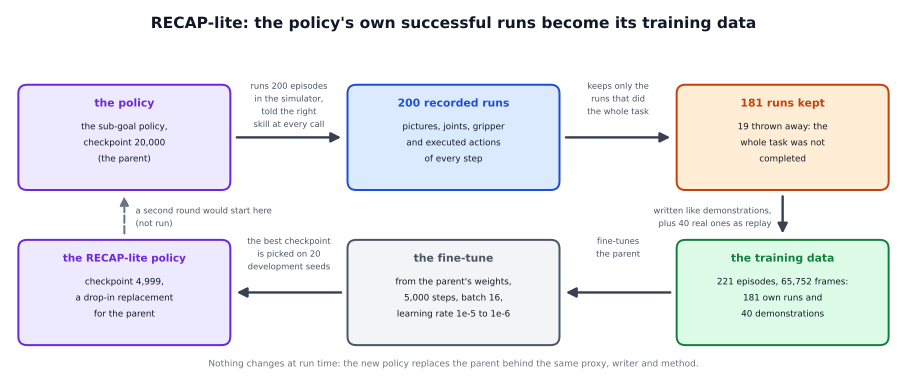
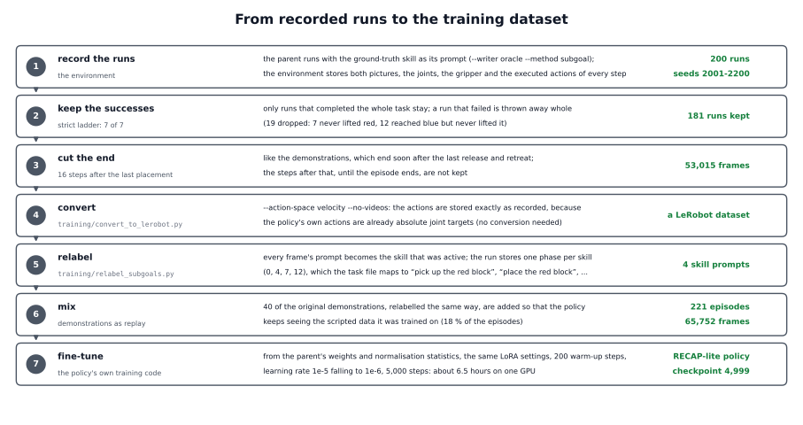

# RECAP-lite in detail

The short page, [docs/methods/recap](../README.md), says what RECAP-lite does and what we found. This page explains why it
was built this way, how the training data are made and selected (the scripts in `training/`), how the new policy is used
behind the proxy, and where the method stops.



## 1. The problem and the idea

**The problem.** Every run of a policy in the simulator is experience: what the policy sees, what it does, and whether it
worked. Normally the run ends and the experience is lost; the policy is exactly the same afterwards. The other memories of
the framework are read while the robot runs: text in the prompt, a picture, a store. This one asks a different question: can
what the policy has done be turned into a better policy?

**The idea.** Keep the runs that worked and train on them. In simulation, whether a run worked is known for free: a strict
scoring of the recorded movements says whether the whole task was completed. The kept runs are written like demonstrations
and the policy is fine-tuned on them, together with a few of the real demonstrations. This is **filtered behaviour cloning**:
copy only the behaviour that succeeded.

**Why the policy's own runs.** The scripted demonstrations show the task from perfect positions, in the scripted expert's
style. The policy's own runs show the states the policy itself gets into and the way it moves. Among the 181 runs we kept,
163 contain no failed grasp, 17 contain one and one contains eight: 18 hold a retry after a failed grasp that ended well. The
demonstrations contain none.

**Why the weights.** After the fine-tune nothing is read, looked up or added at run time. A policy call takes as long as
before, the checkpoint has the same size, and the writer, the method and the proxy do not change. The price is paid
once, in the training round: a slow, offline memory, the opposite of a store that can be edited at any moment.

**What the method does not do.** It does not use the runs that failed, it does not teach a new skill, and it keeps no memory
of the current episode. It makes the policy better at what it already does.

## 2. Related work

The works below are the closest to this method. The numbers are arXiv ids.

- **pi*0.6 with RECAP** (Physical Intelligence, 2025, arXiv 2511.14759) is the source. The robot's own runs and expert
  interventions train a value function; every step is relabelled with a binary advantage indicator; the policy is fine-tuned
  on all the data and, at run time, asked for the "good" behaviour. The paper reports more than twice the throughput and
  about half the failure rate on the hardest tasks. RECAP has six ingredients. RECAP-lite keeps the first:

  | ingredient of RECAP | RECAP-lite |
  |---|---|
  | the robot's own runs | kept: 200 rollouts (recorded runs) of the parent (the sub-goal policy at checkpoint 20,000, the policy RECAP-lite starts from), ground-truth skills |
  | corrections by an expert | dropped |
  | a value function trained on the runs | dropped |
  | an advantage indicator for every step, as text in the prompt | dropped: the runs are kept or thrown away whole |
  | several rounds | dropped: one round |
  | training on diverse data first | RECAP's first stage, trained on successful demonstrations only, is plain behaviour cloning: that is the parent |

- **Self-Demonstrated Generative Control** (Garg et al., 2026, arXiv 2608.19490) uses zero-shot rollouts of pi0.5 as extra
  training data, a close relative of this recipe.
- **Reinforcement learning on VLAs:** SimpleVLA-RL (Li et al., 2025, arXiv 2509.09674: LIBERO-Long from 17.3 to 91.7 with one
  demonstration per task and a reward for success), pi-RL (Chen et al., 2025, arXiv 2510.25889: an open recipe for flow-based
  pi0 and pi0.5), ConRFT (arXiv 2502.05450), iRe-VLA (arXiv 2501.16664), VLA-RL (arXiv 2505.18719). They learn from a reward,
  not only from the successes; we did not try them.
- **A human as the filter:** HG-DAgger (arXiv 1810.02890), Sirius (arXiv 2211.08416) and RoboCat (arXiv 2306.11706) run the
  same loop with a human who corrects. In simulation, a scripted expert can play that part.
- **Forgetting and replay:** fine-tuning on new data can erase what a policy knew. Zhu et al. (2026, arXiv 2605.26820)
  fine-tuned pi0.5 on real arms one task after another: plain sequential fine-tuning scored 31.4 and forgot (backward
  transfer of -81: how much the old tasks changed afterwards; a large negative number means that much was forgotten), while
  experience replay with a buffer of 20 % of the old data scored 97.2 (backward transfer +1.5). Liu et al. (2026, arXiv
  2603.03818) find pi0 more resistant to forgetting than expected, and a 20 % replay buffer takes its forgetting from 0.562
  to -0.068 (negative backward transfer). Our mix has about 18 % demonstrations (40 of the 221 episodes).

## 3. How it works in the framework

RECAP-lite is a training recipe. The framework's part is the data side: the proxy that drives the rollouts, the two scripts
that turn recorded runs into a dataset, and the proxy that serves the new policy. The recording, the filter and the training
belong to the environment and to the policy's own code base.



### The rollouts through the proxy

```
python -m vla_memory.proxy --writer oracle --method subgoal --task vla_memory/tasks/red_blue_blocks.yaml \
    --listen-port 8001 --upstream-port 8000
```

`--task` names the task file; for the reference task it can be left out. This is the oracle writer with the sub-goal method:
at every call, the simulator's current skill is set as the policy's prompt (`OracleWriter.before_call`, then
`SubgoalMethod.prompt`). The code path of the call is in the [oracle walkthrough](../../../writers/oracle/detailed/README.md)
and the [sub-goal page](../../subgoal/detailed/README.md); RECAP-lite adds nothing to it. The environment, not the proxy,
records every step. The reference round used the parent's checkpoint 20,000 on the seeds 2001 to 2200 (a seed fixes where the
cubes start), 500 control steps each (a control step is one tick of the robot's controller, 15 per second), a policy call
every 8 steps.

### The new policy behind the proxy

```
python -m vla_memory.proxy --writer oracle --method subgoal --task task.yaml --listen-port <port> --upstream-port <new policy port>
```

Nothing else changes: the new policy is trained on the same four skill prompts as its parent, so every writer and the
sub-goal method work unchanged. The proxy's log, the writers' options and the extensions are the same as for the parent.

## 4. How the data are made and selected

**Step 1: record.** Per episode the environment stores one `.npz` file, in the format of the demonstrations: both camera
pictures at full size (240 x 320) for every control step, the state (the 7 arm joint angles and the gripper state), the
actions the policy executed (7 absolute joint targets and the gripper command), the episode's instruction, the cubes' start
positions and the frame rate. Instead of the waypoint phase that a demonstration stores, a rollout stores one representative
phase per skill: 0 for "pick up the red block", 4 for "place the red block", 7 for "pick up the blue block", 12 for "place
the blue block", from the prompts the policy was given. (With the plan format, `plan` and `skill_index` per frame, the same
information is stored directly; `training/README.md` describes it.)

**Step 2: filter.** The environment scores every run by the strict ladder: seven milestones, counted in order: reached
red, lifted red (the cube more than 9 cm above its resting height), placed red, retreat, reached blue, lifted blue,
placed blue. The score of a run is how many it reached, and the mean score is the average over runs. Only runs that
completed the whole task are kept: a **full task** is red picked up and put back, then blue picked up and put back. Of
the 200 rollouts, 181 were kept. The 19 that failed were thrown away whole: 7 never lifted the red block, and 12 reached
the blue block and never lifted it.

**Step 3: cut.** A kept run ends 16 steps after the final placement, as the demonstrations end soon after the last release
and retreat. The 181 runs hold 53,015 frames.

**Step 4: convert** (`training/convert_to_lerobot.py --action-space velocity --no-videos`). The script writes the recordings
as a LeRobot dataset (the data format the training code reads), with the pictures as PNG. `--action-space velocity` stores
the actions exactly as recorded. The name comes from the demonstrations, which record velocities; for them
`--action-space absolute` converts back to absolute targets. A rollout's actions are the policy's own absolute targets, so no
conversion is wanted. The reference round converted in 10 pieces in parallel and merged them.

**Step 5: relabel** (`training/relabel_subgoals.py --raw-dir <kept runs> --start 0`). Every frame's prompt becomes the skill
that was active: the stored phase maps to a skill through the task file's `demo_phases.phase_to_skill` (0 to 3 "pick up the
red block", 4 to 6 "place the red block", 7 to 11 "pick up the blue block", 12 to 14 "place the blue block"). Before it
touches an episode, the script checks that the dataset's joint state equals the recording's exactly, and that the episode
goes through its skills in order; at the end it checks the metadata it wrote. Only the prompts change; pictures, state and
actions are copied. `--start 0` is right because the episodes of the merged dataset are in the same order as the recordings.

**Step 6: mix with demonstrations.** The relabelled demonstrations of 40 episodes (12,737 frames) are added. The result: 221
episodes, 65,752 frames, four prompts, 18 % of the episodes from demonstrations. The reference round converted the rollouts
and the demonstrations separately and merged the two datasets with a script that is not part of the framework. The scripts in
`training/` convert one folder in one action mode. For a single conversion, store the rollouts' arm actions in the
demonstrations' convention (the target minus the measured position, divided by the time step) and convert everything with
`--action-space absolute`; the conversion back is exact. We did not run it that way.

**Step 7: fine-tune.** The policy's own training code runs, starting from the parent's weights (checkpoint 20,000) with: the
same LoRA settings (LoRA trains small added matrices instead of all weights) and the parent's normalisation statistics (the
means and spreads that scale the numbers going into the network), so that the loaded weights stay consistent; 5,000 steps at
batch size 16 (80,000 samples, about 1.2 passes over the 65,752 frames); the learning rate (the size of each training step)
rising over 200 warm-up steps to 1e-5 and falling to 1e-6 on a cosine curve (the parent's own recipe: 2.5e-5 to 2.5e-6 over 30,000 steps). It took about 6.5
hours on one GPU, with a peak of 22 GB of memory.

**Step 8: select a checkpoint.** A checkpoint was saved every 500 steps. All were tried on the 20 development seeds with the
ground-truth skills. The rule was fixed beforehand: the best mean sequence score; scores within 0.25 of the best are a tie,
broken first by the number of full tasks and then by the loss on held-out demonstrations (how far the policy's predicted
actions are from those of demonstrations it was not trained on; lower is closer). Steps 4,500 and 4,999 tied, and 4,999 won
on the loss.

## 5. Limitations

- **Successes only.** A run that fails is thrown away whole. The policy gets no example of what to do in the states that led
  it astray.
- **Little to gain from a strong parent.** The method can only copy what the parent already does well. A parent that
  succeeds almost always leaves little room; a policy that fails more often has more to gain, but must still succeed often
  enough to produce good runs.
- **One round, one policy, one task, simulation.** More rounds, other tasks, other policies and a real robot were not tried.
- **It needs a recording environment.** Every step with its pictures and executed actions, the active skill, and a success
  criterion that can be evaluated. The framework describes the data side only; the environment records and the policy's own
  code trains.
- **Forgetting.** The demonstrations in the mix are meant to prevent it. Skills outside the data may be forgotten; this was
  not tested.
- **It inherits its parent's weaknesses.** Rollouts recorded with one camera position cannot teach the policy another one.
- **A noisy choice of checkpoint.** On 20 development seeds several checkpoints score almost the same, so the screen cannot
  separate them well; the loss on held-out demonstrations decides between the tied ones.

## 6. Using it with your own policy and task

1. **A parent policy** that already succeeds often enough to produce good runs, and a way to run it closed-loop with its
   prompts (the proxy, with any writer and method).
2. **Record every step** of the rollouts in the demonstration format: both pictures, state, executed actions, and the active
   skill (the phase table of the task file, or `plan` and `skill_index` per frame).
3. **Define success** for your task and keep only the runs that meet it; cut them shortly after the final success.
4. **Convert and relabel** with `training/convert_to_lerobot.py` and the relabel script of your parent's method
   (`relabel_subgoals.py` for the sub-goal policy; `relabel_history.py` and `relabel_keyframe.py` exist for the other two
   methods, but only the sub-goal policy was done). Keep the action convention of your recordings consistent: the actions
   must mean the same in the demonstrations and in the rollouts.
5. **Mix in demonstrations** (about a fifth of the episodes) and fine-tune from the parent with a short schedule and a low
   learning rate; keep the parent's normalisation statistics.
6. **Screen** the checkpoints on development seeds, then run fresh seeds, and compare with the parent seed by seed. The new
   policy is served behind the same proxy; nothing in the framework changes.
