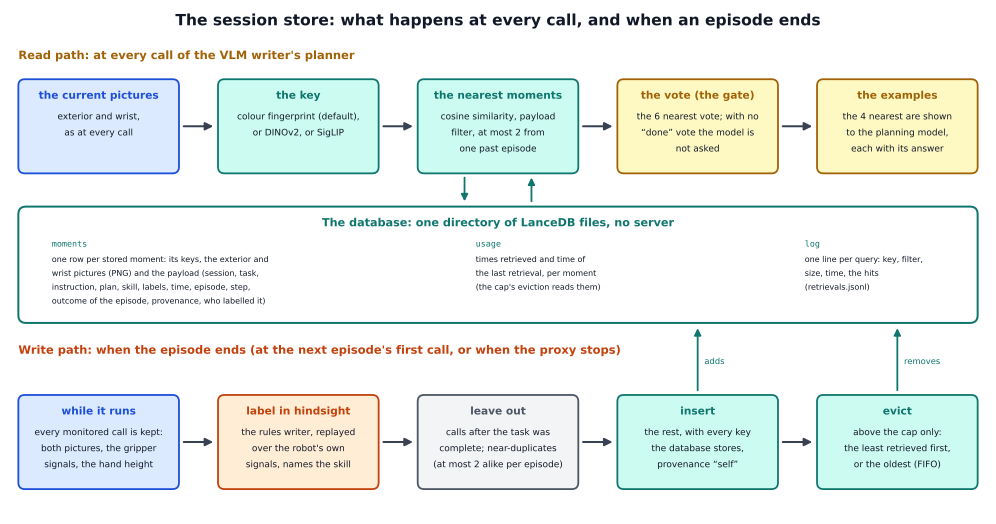

# The session store in detail

The short page, [docs/methods/session_store](../README.md), says what the session store is and what it gave us. This page
explains why it is built this way, follows the code from the command line to the planner's questions and to the write at the end
of an episode, shows how the store is made, and how to use it with another policy or task.

The session store is not a writer of its own. It is a part of the [VLM writer](../../../writers/vlm/README.md): the writer's
long-term memory, in place of the example store of `--memory`. The VLM writer still decides when a skill is done; the
session store decides nothing. It changes where the writer's memory is kept, and lets that memory grow from the robot's own
episodes.



## 1. The question behind it

The [VLM writer](../../../writers/vlm/README.md) asks a large model at every policy call whether the current skill is
done. A question takes the model about 0.7 s, and 2.9 s when four example pairs are attached, against 0.17 s for a
policy call. So the model's questions set the speed of every episode. A long-term memory helps in two ways: the stored
moments (the two pictures of a past policy call and what was true then) that look like the current pictures **vote** on
the answer, and when none of them says "done" the question is skipped (the memory-vote gate); and the nearest ones are
shown to the model as **examples**, each with its right answer.

Before the session store, this memory was the VLM writer's **example store**: one array file (`--memory`), built once from
recorded demonstrations with their own labels and never changed. That leaves questions open:

- The key that decides what "looks like" means is hand-made: a colour thumbnail plus where the coloured objects are. It needs
  clearly coloured objects. A second task or a real robot would need a learned key that does not depend on colours.
- The store is the same for every user and every instruction. Moments of one instruction might mislead the monitor under
  another one.
- It cannot grow from the robot's own episodes, and has no cap, no record of where a moment came from, and no measured cost
  as it grows.

A vector database, which finds the rows whose vector is nearest to a query vector, addresses these. What it adds over a
plain file is not better answers but a learned and general key, payload filters so that one store serves many sessions and
tasks, persistence with provenance, and costs that can be measured as the store grows. We chose an embedded engine (LanceDB:
a directory of files, no server).

**What changes against the example store, and what does not.** The planner does not notice the difference. It asks its
memory for the 6 nearest moments, they vote, and the 4 nearest become the examples, written by the same code as before
(section 3.3). Two things are new:

- **The write path** (section 3.4). After every episode the robot's own calls are labelled in hindsight by the rules writer,
  replayed over the robot's gripper signals, and added to the database. The example store was filled once, from
  demonstrations, and never changed during a run.
- **The database** (section 4): several keys side by side, filters on the payload (task, instruction, plan, session), a record
  of where every moment came from and who labelled it, use counters, and a size cap with a rule for what goes.

An example store can be imported as the starting point (`--store-import`, section 4.4); without it the session store starts
empty.

## 2. Related work

The papers this work builds on or compares itself with, with their arXiv ids.

- **RAP** (Kagaya et al., 2024, arXiv 2402.03610) and **JARVIS-1** (Wang et al., 2023, arXiv 2311.05997) retrieve an agent's past
  experience as examples for a planner; JARVIS-1's memory grows with playing time. The exemplar store was already a memory of
  this kind. The session store is the same memory, written by the agent itself.
- **Hindsight Experience Replay** (Andrychowicz et al., 2017, arXiv 1707.01495) relabels an episode afterwards with what was
  actually achieved. Our write path does the same: it labels the calls of an episode when the episode has ended, knowing its
  future.
- **FailBench** (Navasardyan et al., 2026, arXiv 2609.03611) found that VLM failure detectors lean towards predicting success
  when the evidence is unclear. That is why the planner's own verdicts make poor labels, and the labels come from the rules
  writer instead (section 4.5).
- **OnEvoMemory** (Chen et al., 2026, arXiv 2608.08749) keeps a first-in-first-out buffer plus banks chosen by a learned value.
  **Memory Anchors** (Du et al., 2026, arXiv 2608.26545) found that keeping a small share of old experiences anchors old skills.
  **MemoryBank** (arXiv 2305.10250) and **Generative Agents** (arXiv 2304.03442) forget by recency, importance and use instead
  of by age alone, which is the model for the use-and-recency rule.
- **RoboMME-Interference** (arXiv 2606.22338) measures what unrelated sessions between a relevant session and the query do to a
  memory, and found that a visual-similarity step in front of the history restores the rate without distractors. The store's
  filters address the same problem.
- **RA-VLA** (Jang et al., 2026, arXiv 2608.25585) and **STRAP** (Memmel et al., 2024, arXiv 2412.15182, which uses DINOv2 and
  dynamic time warping) show that the retrieval key matters a lot. **COLLAGE** (arXiv 2508.01131) found that a single cue
  imports harmful data, and **Robota-Embed** (arXiv 2610.19495) that a key must carry the actions.
- **eMEM** (arXiv 2606.03374) and **MessyMem** (arXiv 2609.15976) are the systems closest to ours that build their own index
  behind one graph model. No robot paper we know of names a vector database such as FAISS, Chroma, LanceDB, Qdrant or
  Milvus.
- **Zep** (arXiv 2501.13956) and similar memory systems keep provenance on every entry. Every moment of the store carries where
  it came from and who labelled it. Provenance is also named as a defence against poisoned or injected memories (AgentPoison,
  arXiv 2407.12784; MINJA, arXiv 2503.03704).

## 3. How it works in the framework, step by step

This page follows one run of

```
python -m vla_memory.proxy --writer vlm --method subgoal --task vla_memory/tasks/red_blue_blocks.yaml \
    --vlm-url http://127.0.0.1:8100/v1 --vlm-model Qwen3.8-27B-INT4 --log run/planner.jsonl \
    --with session_store --store-dir stores/session_a --store-filter instruction --store-session reference \
    --listen-port 8001 --upstream-port 8000
```

`--task` names the task file; for the reference task you can leave it out, and the two `--vlm-` options when the model runs at
those defaults. The parts every writer shares are explained in the [oracle walkthrough](../../../writers/oracle/detailed/README.md),
and the VLM writer's own steps in the [VLM walkthrough](../../../writers/vlm/detailed/README.md). This page concentrates on what
the session store adds.

| file | what it does |
|---|---|
| `vla_memory/methods/session_store/extension.py` | `SessionStoreExtension`: the options, the planner's memory, the hooks around every call and at the end of an episode |
| `.../store.py` | `SessionStore`: the database; insert, nearest-k with payload filters, eviction, import of an example store |
| `.../keys.py` | `KeyEncoder`: the three keys |
| `.../online.py` | the write path: `EpisodeRecorder` and the labellers |
| `.../options.py` | what the options choose from (no heavy imports) |
| `vla_memory/memory.py` | `MemoryStore`: the interface the planner's memory implements |
| `vla_memory/writers/vlm/gate.py`, `question.py`, `exemplar.py` | the vote, the question and the examples (`ExemplarStore.fewshot_content` writes the examples' text) |

### 3.1 Start-up

1. `parse_command_line` reads the command line twice. The first pass finds `--with session_store`, and `resolve_extension`
   imports `SessionStoreExtension`. The second pass reads everything, including the `--store-*` options.
2. `build_components` calls `SessionStoreExtension.build(args, task, built)`:
   - it stops unless `--writer vlm` is chosen (the store is the VLM writer's memory);
   - `--store-import` needs an instruction for the imported demonstrations (`--store-import-instruction`, or the task file's
     first instruction example);
   - `import_database` imports `store.py`, which needs `lancedb` and `pyarrow`; a missing package is a usage error that names
     the extra to install;
   - `require_encoders` checks, before a database is created, that `torch` and `transformers` are installed if a learned key is
     wanted;
   - `SessionStore(...)` opens the database directory, or creates it: the tables `moments` and `usage`, `info.json`, and
     `retrievals.jsonl` for the query log;
   - with writing on, `require_encoders` checks again, because an existing database may hold learned keys that new moments
     need as well;
   - with `--store-import` and an empty database, `import_exemplar_store` adds every moment of the example store as a
     demonstration (section 4.4);
   - it returns the extension with an `EpisodeRecorder` (none with `--no-store-write`).
3. `VlmWriter.build` calls `build_memory`, which takes the planner's memory from the extensions (`memory_from`): the session
   store is used in place of `--memory`.
4. When the environment connects, the proxy tells it the database directory (`session_store` in the metadata).

### 3.2 What the environment sends

Everything the VLM writer needs (the two raw camera pictures, the closedness of the gripper, the hand height, the step, the
episode markers, the objects), plus what the write path labels from: the gripper signals of every control step, as
`memory/proprio_steps` (finger width, squeeze, fingertip position; at an episode's first call, when that array is still empty,
the current values), which `vla_memory.env_keys.ControlKeys` builds. With `--store-labeller oracle` it also reads
`memory/oracle_prompt`.

### 3.3 Every call: the read path

1. `VlmWriter.before_call` calls `observe_call`. First `before_decision` of the extension: it gives the store the context of
   this call (`set_context`: the plan, the episode, the step; the instruction was set at the start of the episode in
   `plan_request`). The payload filter uses this context.
2. `Planner.observe` calls `retrieve_with_gate`, which asks the store for the 6 nearest moments (`--k-vote`; the model will see
   4 of them): `SessionStore.retrieve`.
   - `KeyEncoder.encode` makes the key of the current pictures (the colour key by default).
   - `search` asks the database for the nearest rows by cosine similarity of that key (the dot product of two keys of
     length 1: 1 means the same direction), with the payload filter applied *before* the search (a prefilter) and
     exactly (no approximation). It fetches `max(8k, 48)` rows, keeps at most 2 from any one past episode (so that the
     examples are not near-copies of each other), and widens the search four times over if fewer than k remain.
   - The use counters of the hits go up, and the query is logged.
3. The vote and the examples work as for the example store ([VLM walkthrough](../../../writers/vlm/detailed/README.md), sections 4
   and 6): `vote` counts the moments that are labelled with a later skill than the current one, `gate_skips` settles the call as
   "not done yet" if none says "done", and otherwise `monitor_messages` calls `fewshot_content` to write the 4 nearest moments
   as examples. The store hands `fewshot_content` the rows of its hits, and an `ExemplarStore` built from just those rows
   writes the text, so the examples read exactly as with the array file.
4. The planning model answers, and the pointer moves or not.
5. `after_decision` of the extension calls `EpisodeRecorder.record`: the call's two pictures (copied), the gripper rows since
   the previous call, the closedness, the hand height and the simulator's prompt, if one was sent. Nothing else is computed
   while the episode runs.

### 3.4 The end of an episode: the write path

The write happens when the next episode's first call arrives (`Relay._begin_episode` calls `_end_episode`) or when the proxy
stops (`Relay.close`; a SIGTERM becomes a clean stop, so the last episode is written too). The relay calls
`SessionStoreExtension.end_episode`, which calls `EpisodeRecorder.finish(store, episode, context)`:

1. **Label every call** (`RulesLabeller.label`): the rules writer, replayed over the robot's own signals. Section 4.5 explains
   what a label holds.
2. **Choose the calls** (`_admissible`): drop the calls without a label, the calls after the task was complete ("terminal"), and
   any call with fewer than two pictures.
3. **Compute the keys** of the rest, one per key the database stores.
4. **Leave out near-duplicates** (`_without_duplicates`): an episode keeps at most two calls with the same labels and a
   colour-key cosine of 0.9999 or more to each other. The colour key decides, whichever key retrieves, so which calls are
   admitted does not depend on the retrieval key.
5. **Insert** the rest (`store.insert`): the keys, the two pictures as PNG, and the payload (section 4.2).
6. **Evict** above the cap (`store.evict`).
7. **Write the counters** (`store.end_update`): the use counters, `info.json`; every 10th update the table is compacted.
8. The extension returns a `store_update` record, which the relay writes into the planner's log.

This write runs inside the first call of the next episode, before that call's plan request, so that call waits for it.

### 3.5 What is logged

The planner's log (`<log>.planner.jsonl`) gets one `store_update` record per episode: the episode, the number of calls, how many
moments were `added`, how many near-duplicates were `rejected`, how many calls were `dropped` and why, how many moments were
`removed` (with their ids), the `size` of the store, whether the task was `complete`, the skills done, the session, the
instruction, the update number, the `oracle_agreement` (the labels against the simulator's prompts, if it sent them), the time
of each step in `ms`, and the size on disk. The monitor records note the store's size and the retrieval time (`memory_entries`,
`retrieval_ms`), and every proxy log record notes the size (`memory_entries`). The database's own `retrievals.jsonl` has one
line per query: the key, the filter, the size, the times, and the hits with their similarity, session, skill and provenance.

### 3.6 How it hooks into the proxy and the VLM writer's planner

The extension uses these hooks: `add_arguments`, `build`, `config`, `metadata`, `log_fields`, `close`; the planner's `memory`
(it *is* the planner's memory) and `plan_request` (it only reads the instruction for the filter and adds no text); and the
proxy's `start_episode` (the episode's objects go to the labeller), `before_decision`, `after_decision` and `end_episode`. It
does not use `before_policy` or `on_reply`, so it never touches what the policy receives, and it does not change the
questions' text: it changes which moments the examples are.

## 4. How the store is made

### 4.1 The database on disk

`--store-dir` names one directory (`SessionStore`, `store.py`):

| in the directory | content |
|---|---|
| `moments.lance/` | one row per stored moment: its id, one vector column per stored key, the two pictures (PNG, light compression), and the payload |
| `usage.lance/` | the use counters: id, times retrieved, time of the last retrieval. They are rewritten at every episode end and kept apart from the moments, because counting a retrieval in the moments table would rewrite every retrieved row with its pictures (a LanceDB update is a delete plus an append) |
| `info.json` | the creation record (format, time, task, keys and their lengths) and the number of updates (episodes written) |
| `retrievals.jsonl` | one line per query (section 3.5) |

Old versions of a table are kept; the table is compacted every 10 updates. A new database stores the colour key (which also
decides the near-duplicates), the retrieval key and any further keys asked for. An existing database keeps its keys and
retrieves with any of them.

### 4.2 The row

The payload of a moment, as `store.PAYLOAD` defines it:

| field | content |
|---|---|
| `session`, `task` | the session the moment was written in (a name, by default the start time), and the task |
| `instruction`, `plan` | the instruction of the episode, normalised (lower case, single spaces, no final full stop), and its plan, the skills joined with `" \| "` |
| `skill`, `subgoal`, `phase` | the skill active at the moment, its index in the task's skill order, and the demonstration's phase (demonstrations only, else -1) |
| `labels` | the state at the moment, as JSON: each object resting, held low or held lifted; the gripper open or closed; whether the hand is high above the table |
| `time`, `episode`, `step` | when it was written; the episode as `<session>/<episode>@<update>` (a demonstration: `demo/NN`); the control step |
| `outcome`, `skills_done` | whether the episode ended with the task complete (by the labeller), and how many skills it completed |
| `provenance`, `labeller`, `update_no` | `demo` (an imported demonstration) or `self` (the robot's own); who labelled it (`rules`, `oracle` or `phase`); the number of the update that wrote it |

### 4.3 The three keys

Each key turns the pictures of one moment into a vector of length 1 (`KeyEncoder`, `keys.py`):

| key | what it is | numbers |
|---|---|---|
| `colour` | the colour fingerprint of both pictures (the same one the example store uses): a 12 × 16 colour thumbnail of each picture plus, for each object colour, the area, position, spread and edge contact of its pixels. No model, a few milliseconds | 1,180 for the reference task |
| `dinov2` | DINOv2 ViT-S/14 (`facebook/dinov2-small`), the exterior picture only, resized whole to 224 × 294 (height × width, no crop), ImageNet normalisation, the class token after the last layer norm | 384 |
| `siglip` | SigLIP base/16 (`google/siglip-base-patch16-224`), the exterior and the wrist picture, each through the model's own processor (224 × 224); the two embeddings are joined and divided by the square root of 2 | 1,536 |

The learned models are frozen, loaded when first used, and run on the CPU by default (`--store-device cuda` for a GPU), with 8
threads (`--store-threads`).

### 4.4 Retrieval and import

**Retrieval** (`SessionStore.retrieve` and `search`): the nearest moments by cosine similarity of the chosen key, among the rows
the payload filter admits. `--store-filter` offers: none; the same task; the same instruction (normalised); the same plan; the
same session. At most 2 hits come from one past episode, none from the episode left out (`exclude_episode`, used in
leave-one-out evaluations). Search is exact. On the imported example store with the colour key the similarities equal those of
the array file's retrieval to 1e-5, and the ids equal them except where similarities tie.

**Import** (`import_exemplar_store`): every moment of an example store file (`.npz`) is added as a demonstration (`session`
"demo", `provenance` "demo", `labeller` "phase", the outcome "complete"), its colour key recomputed with the task's
fingerprint, and the other keys computed. The labels come from the file.

### 4.5 Labelling the robot's own episodes

The write path needs a label for every call: which skill was active, and what was true then. Where could it come from?

- **The simulator's prompt** (`--store-labeller oracle`): only in simulation, and it lags, because the simulator updates its
  flags only at call steps.
- **The planner's own pointer:** the planner's verdicts are the thing the store is meant to check, so the memory would grade
  itself, and every early "done" of a planner would be stored as a false "complete" moment.
- **The rules writer, replayed over the robot's own signals** (`--store-labeller rules`, the default): after the episode, the
  rules writer is run over every control step's gripper signals, in the task's order (`RulesLabeller`, which uses a
  `RuleMonitor` with its reordering switched off, so that a pick of the wrong block writes nothing). It needs no simulator
  and no model. On recorded episodes it agreed with the simulator's tracker on almost every call.

A label (`RulesLabeller.replay`) holds, per call:

- **the skill** (`subgoal`): the index in the task's order of the rules writer's current skill;
- **the state of every object:** resting, held low or held lifted. The grasp cycle says whether the gripper holds something;
  the colour identifier names the held object from the wrist picture; "lifted" means more than 6 cm above where the grasp
  began (`lifted_above_grasp`);
- **the gripper:** closed if the closedness is at least 0.3, else open (`closed_threshold`);
- **whether the hand is high above the table:** more than 17 cm (`high_above_table`).

These thresholds can be changed in the task file's `proprio` section. The two heights were chosen where the robot's own
labels agreed best with the demonstrations' labels.

**What is stored and what is not:**

- **Every episode is admitted,** complete or not. A failed episode stored with correct labels is a correct negative example.
- **Calls after the task was complete are left out.** Labelled as the last skill, they would vote "done" for "pick up the blue
  block" during its approach.
- **Near-duplicates:** an episode keeps at most two calls with the same labels and a colour-key cosine of 0.9999 or more.
  Retrieval takes at most two moments of one past episode anyway, so a third identical copy never changes a vote; idle and
  stuck phases produce long runs of them.
- **Eviction** above `--store-cap` (`SessionStore.evict`): `fifo` removes the lowest ids, the oldest inserts; `use_recency`
  (the default) removes the least retrieved first and, among equally used moments, the oldest.

## 5. Limitations

- **It saves questions, not tasks.** The store lets the planner skip questions to the planning model; it does not make the
  policy complete more episodes.
- **The colour key needs colours.** The default key needs clearly coloured objects and the task file's colour definitions. For
  other scenes a learned key may be needed, and then the store needs `torch` and `transformers` to grow.
- **Exact search slows down as the store grows.** A cap, or for a learned key an index, keeps it fast. Whether an index works
  for the colour key is open.
- **The write is synchronous.** It runs inside the first call of the next episode. With all three keys computed on the CPU it
  takes seconds; with the colour key alone it takes a fraction of that. On a real robot the next episode would wait.
- **The labels are the rules writer's.** A moment is as right as the rules writer's reading of the robot's gripper signals. It
  needs the signals of every control step, and a task without grasps needs `signals` rules first. Moments are labelled in the
  task's order of skills, so an episode that handles the objects in another order cannot be stored faithfully. A wrong label
  stays until the moment is evicted: there is no revision.
- **The filters are not shown to matter.** No test showed a case in which a filter changed what the monitor answered.
- **The vote assumes a fixed order of skills.** For a task whose objects can be handled in any order, switch the gate off
  (`--no-gate`).
- **The store grows without bound by default,** about 40 moments per episode, and the directory keeps old table versions.
- **Nothing is checked automatically.** Provenance lets a person audit the store, but a wrong or injected moment is used like
  any other.
- **Narrow testing.** It was built and tested with one policy, one task and one planning model, in simulation.

## 6. Using it with another policy or task

**Another policy.** Nothing changes. The store acts on the VLM writer's questions and never touches what the policy receives.

**Another task.** The labels come from the task file: the rules writer's rules (`history.rules`) decide when a skill is done,
the `proprio` section holds the gripper thresholds (`closed_threshold`, `high_above_table`, `lifted_above_grasp`), and the colour
key's colours come from `fingerprint.colours`. A learned key needs no colours. `--store-import-instruction` falls back on the task
file's first instruction example.

**A real robot.** The write path needs the finger width, the squeeze and the fingertip position of every control step
(`memory/proprio_steps`), the gripper's closedness and the hand height, as for the rules writer.

**Another key.** A key is a name in `options.KEY_NAMES` and a branch in `KeyEncoder.encode`; a new one needs a few lines there.
A database keeps the keys it was created with, and a new moment gets all of them.

**Another labeller.** `online.LABELLERS` maps a name to a class with `set_objects(objects)` and `label(calls)`, which returns a
label for every call, whether the task is done at each call, and the number of skills done. The simulator's prompt
(`--store-labeller oracle`) is one.

**Another memory behind the planner.** Anything that implements `MemoryStore` (`__len__`, `retrieve`, `describe_hit`,
`fewshot_content`) and is returned by an extension's `memory()` is used by the planner's vote and examples, as the session store
is.

**Starting from demonstrations.** `--store-import FILE` fills a new database with an example store as demonstrations.

**Reading a store outside the proxy.** `SessionStore` (open, query by key and filter, insert, evict) reads a directory directly,
for example to re-encode it with another key and measure the recall offline.

**Checking a run.** The `store_update` records in the planner's log say what was added, rejected, dropped and removed at each
episode's end, and how long it took; `retrievals.jsonl` in the store directory says what every query returned.
