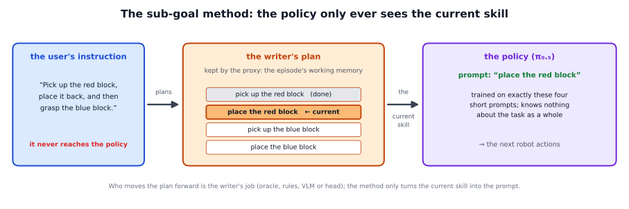

# The sub-goal method: the current skill as the prompt

## The idea

A VLA policy on its own has no memory. After the robot has put the red block back, the table looks exactly as it did at
the start, so the policy cannot tell whether it should pick up red again or move on to blue. A policy trained on the full
instruction completed only 11 of 100 tasks in our tests.

The sub-goal method takes the memory out of the policy:

- the policy is trained on a few **short skills** only, such as "pick up the red block" or "place the red block";
- a **writer** keeps the plan, the skills in order, and knows which skill is current;
- at every policy call the method gives the policy **only the current skill** as its prompt. The user's long instruction
  never reaches the policy.



The policy stays unchanged and memoryless; the memory is the writer's plan, kept by the proxy for the running episode. Who
moves the plan forward is up to the writer: the simulator's ground truth, the rules writer, the VLM writer or the policy's
own event head. Writers that decide before the policy call show a switch in the same call; the head writer, which decides
after the call, from the next one. With the VLM writer this setup is called the planner loop.

**What matters most: when the writer switches.** The policy learned from demonstrations whose labels switch at fixed
moments. The writer has to switch at the same moments. In our first runs the simulator switched from "place the red block"
to "pick up the blue block" as soon as the fingers opened. The policy then heard "pick up" while its open hand was right
above the red cube, and grasped it again. Switching only after the hand had moved back up, where the training labels
switch, fixed it ([the picture](detailed/README.md#5-when-to-switch)).

**What it cannot do:**

- **The policy is blind to the task as a whole.** It cannot notice a wrong plan or a wrong switch; it simply does whatever
  skill it is given.
- **The skills must be trained.** A new skill needs demonstrations of it, and its prompt must be worded exactly as in the
  training data.
- **A missed or wrong switch costs the episode.** If the writer never moves on, the policy repeats the finished skill; if it
  moves on too early, the policy may undo or repeat what it was doing.
- **It needs a writer.** Without one (`--writer off`) the policy gets the instruction, which a skill-trained policy cannot
  follow.

A walkthrough with the training data, the code, the timing and all results: [detailed/README.md](detailed/README.md).

## Prerequisites

- A VLA policy trained on the task's skills, served over openpi's websocket protocol (another kind of server through
  `--transport`). For the reference task, every frame of the demonstrations was relabelled with the skill that was active
  (`training/relabel_subgoals.py`).
- A task file whose skills are worded exactly like the policy's training prompts (`vla_memory/tasks/red_blue_blocks.yaml`).
- A writer and what it needs: the simulator's ground truth (`oracle`), the robot's gripper readings (`rules`), the
  planning model (`vlm`), or the policy's event head (`head`).

## How to use it in the framework

```
python -m vla_memory.proxy --writer vlm --method subgoal --task task.yaml --listen-port <port> --upstream-port <policy port>
```

`--task` can be left out for the reference task. `--writer rules` or `--writer oracle` can replace `vlm`; without `--writer`
and `--method` the proxy runs `vlm` with `subgoal`. The method has no options of its own. Every line of the proxy's log
holds the prompt the policy received (`prompt`).

## Our findings

Reference task: pick up and put back a red and then a blue cube with a Franka arm in Isaac Sim; the sub-goal policy
(π0.5); 100 fresh seeds of 500 control steps, a policy call every 8 steps:

| writer | full tasks of 100 | median episode |
|---|---|---|
| `oracle` (the simulator's ground truth) | 92 | 50 s |
| `rules` | 94 | 55 s |
| `vlm`, no example store | 94 | 84 s |
| `vlm`, 20 stored episodes | 87 | 133 s |
| no writer: a policy trained on the full instruction | 11 | 60 s |

- The writers are within noise of each other. The failures that remain are mostly failed grasps, not memory.
- The sub-goal policy grasps more reliably than the history policy (it lifted the red cube in 95 of 100 episodes, against
  87), which is why it completes more tasks with the same writer (92 against 82 with the ground truth).
- Switching at the right moment matters: before the fix, the policy grasped the red cube again in 14 to 16 of 20 episodes;
  after it, the best checkpoints completed 18 to 20 of 20 tasks, and no checkpoint grasped a placed cube again.
