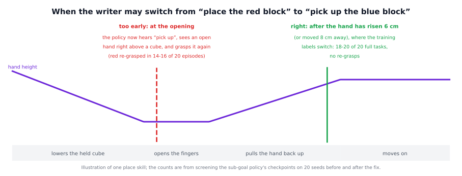

# The sub-goal method in detail

This page explains how the sub-goal method works in the code, how the policy is trained for it, why the moment of the
switch matters so much, and how to use the method with your own policy and task. What the method is for and what we found
are on the short page, [docs/methods/subgoal](../README.md).


## The pieces

| file | what it does |
|---|---|
| `vla_memory/methods/subgoal.py` | `SubgoalMethod`: hands the writer's current skill to the policy as its prompt |
| `vla_memory/methods/base.py` | `Method`, the interface every method implements, and `METHODS`, the list of methods by name |
| `vla_memory/proxy/relay.py` | `Relay.infer`: what happens at every policy call |
| `vla_memory/writers/` | the writers. Each keeps the plan and a pointer to the current skill (`current_skill`) |
| `vla_memory/task.py` | `TaskSpec`: the task file, which defines the exact text of every skill |
| `training/relabel_subgoals.py`, `training/lerobot_tools.py` | the training data: every frame's prompt becomes the skill that was active |

The parts that every writer and method share (the start-up, the server, the connection to the policy) are explained step by
step in the [oracle walkthrough](../../../writers/oracle/detailed/README.md). This page concentrates on the method.

## 1. What the code does

Take this run:

```
python -m vla_memory.proxy --writer oracle --method subgoal --listen-port 8001 --upstream-port 8000
```

**At start-up** `resolve_method("subgoal")` finds `vla_memory.methods.subgoal:SubgoalMethod` in `METHODS` and imports it.
`Method.build` makes `SubgoalMethod(task)`. The method adds no command-line options and keeps no state.

**At every policy call** `Relay.infer` goes through these steps:

1. It takes the `memory/` entries out of the observation (`split_control_keys`). They are meant for the proxy, not for the
   policy.
2. At a new episode it lets the writer start a fresh plan (`writer.start_episode`). The method has nothing to reset.
3. It lets the writer decide (`writer.before_call`). The oracle, rules and VLM writers move their pointer here, so a switch
   reaches the policy in the same call.
4. It asks the method for the prompt (`_decide_prompt`, which calls `SubgoalMethod.prompt(instruction, writer)`). The method
   returns `writer.current_skill`: the skill at the writer's pointer, or the last skill once the whole plan is done. The
   relay puts it into the observation's `prompt`, in place of the user's instruction.
5. It sends the observation to the policy server (`_forward`) and waits for the actions.
6. It lets the writer look at the reply (`writer.after_call`). Only the head writer decides here, so its switch reaches the
   policy from the next call on.
7. It sends the actions back to the environment. With `--log FILE` it also writes one JSON line for the call, whose
   `prompt` field is the skill the policy received.

Three special cases:

- **`--writer off`.** This writer sets `drives_prompt = False`, so the relay never asks the method, and the policy gets the
  instruction unchanged.
- **A text that is not a skill.** If the simulator sends a text that is not one of the task's skills as
  `memory/oracle_prompt`, the oracle writer's `current_skill` is that text, and the policy receives it as it is.
- **No way back.** The writers only move their pointer forward. If a placed block falls over, the method keeps prompting the
  next skill.

## 2. How the policy is trained for it

The policy has to know the short skills, so every frame of its training data must be labelled with the skill that was active.

1. **Record demonstrations.** One `.npz` file per episode, with the camera frames, the joint state, the actions and, for every
   frame, the waypoint the scripted expert was moving to (its `phase`).
2. **Convert them** to a LeRobot dataset, the data format the training code reads (`training/convert_to_lerobot.py`).
3. **Relabel the prompts:**

   ```
   python training/relabel_subgoals.py --src <converted dataset> --dst <new dataset> --raw-dir <recordings> \
       [--start N] [--task task.yaml] [--dry-run]
   ```

   For every episode the script (`relabel_episode`, `episode_subgoals`):
   - checks that the dataset's `state` column equals the recording exactly (`states_match`), so that a skill is never
     attached to another episode's frames;
   - finds the skill of every frame: from its phase and the task file's table `demo_phases.phase_to_skill`, or, for a task
     whose plan changes from episode to episode, from the recording's own `plan` and `skill_index` (`episode_plan`,
     `episode_positions`);
   - checks that the episode goes through its skills in order;
   - writes a new `task_index` column. The pictures, the state and the actions are copied unchanged.

   At the end it rewrites the dataset's `meta/` files (`update_task_meta`) and reads them back to check them
   (`verify_output`). `--start N` is the number of the first recording behind the dataset (for a validation split that
   starts at recording 200, say). `--dry-run` checks every episode and writes nothing.
4. **Fine-tune the policy** on the new dataset with its own training code ([training/README.md](../../../../training/README.md)).
   The reference policy is π0.5, fine-tuned with LoRA (small added matrices are trained, the original weights stay frozen).

The reference task's table from phases to skills:

| phases | skill | what happens |
|---|---|---|
| 0-3 | pick up the red block | approach, descend, close, lift |
| 4-6 | place the red block | lower, open, move the hand back up |
| 7-11 | pick up the blue block | the move away from red belongs to it, so the direction of movement stays continuous |
| 12-14 | place the blue block | |

Two details matter. The hand's retreat after opening (phase 6) still belongs to "place", which decides when a writer may
switch (section 3). And the script works by phase, not by frame number, because the phases last different times in
different episodes.

## 3. When to switch



The writer must switch at the moment the training labels switch.

**Switching too early.** Suppose a writer declares "placed" as soon as the fingers have opened and the cube rests on the
table. At that moment the hand is still around the cube. The policy now hears "pick up the blue block" while it sees an open
hand right above a cube, a picture that in its training data belongs to a pick. So it closes the fingers on the red cube
again.

**The right moment.** "Placed" therefore also requires the hand to have moved at least 6 cm up from the cube, or 8 cm away
from it. This is the end of the retreat, where the demonstrations' labels switch from "place" to the next skill.

**What this means for every writer.** The rules writer's `set_down` rule (6 cm up or 8 cm away, in the task file's
`history.rules`) and the VLM writer's completion rule for "place" (the hand at least 19 cm above the table, in the task file's
`criteria`) describe the same moment. Being a little late is harmless: the policy keeps the old skill a little longer, as it
did in training just before each switch. Being early is not: the policy then works on the next skill in a situation it has
only seen during the previous one.

## 4. Using it with your own policy and task

1. **Record demonstrations** that note the active skill at every frame: a waypoint phase per frame plus a phase table in the
   task file (`demo_phases.phase_to_skill`), or the plan and the plan position of every frame (`plan`, `skill_index`).
2. **Write the task file.** Its objects, verbs and `skill_template` (or `skill_templates` for a verb with its own wording)
   must produce exactly the prompts you will train on ([Creating a new task](../../../tasks/README.md)).
3. **Make the training data and train** (section 2): `convert_to_lerobot.py`, then `relabel_subgoals.py --task
   your_task.yaml`, then your policy's own training code.
4. **Choose a writer and check its timing** on recorded runs before you trust it: it must switch where your labels switch,
   never earlier. For the rules writer: `python -m vla_memory.writers.rules.validate --episodes 'exported/*.npz' --task
   your_task.yaml`.
5. **Run.** Start your policy server, then the proxy:

   ```
   python -m vla_memory.proxy --writer rules --method subgoal --task your_task.yaml --listen-port <port> \
       --upstream-port <policy port> --log run.jsonl
   ```

   Connect your environment to `<port>` instead of the policy server. It sends the full instruction as `prompt`, plus the
   `memory/` entries the writer needs, which `vla_memory/env_keys.py` builds.
6. **Check the run.** Every line of `run.jsonl` is one policy call. `prompt` is the skill the policy got, so a switch shows
   where `prompt` changes from one line to the next. When a grasp fails the skill simply stays current and the policy tries
   again.

## Where the idea comes from

This is the classic split between a planner and a library of skills. SayCan (Ahn et al., 2022, arXiv 2204.01691) had a
language model choose the next skill from a fixed set of trained skills, while a low-level policy carried each skill out. The
sub-goal method keeps that split but makes the planner exchangeable: here the "planner" is whichever writer runs. The method
does not care who decides; it only turns the decision into the prompt.
