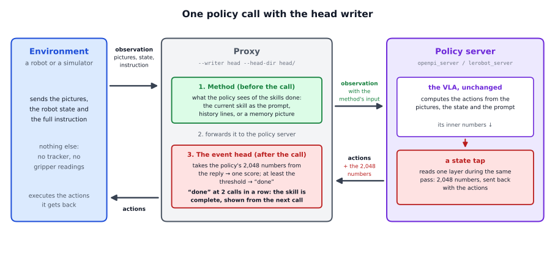
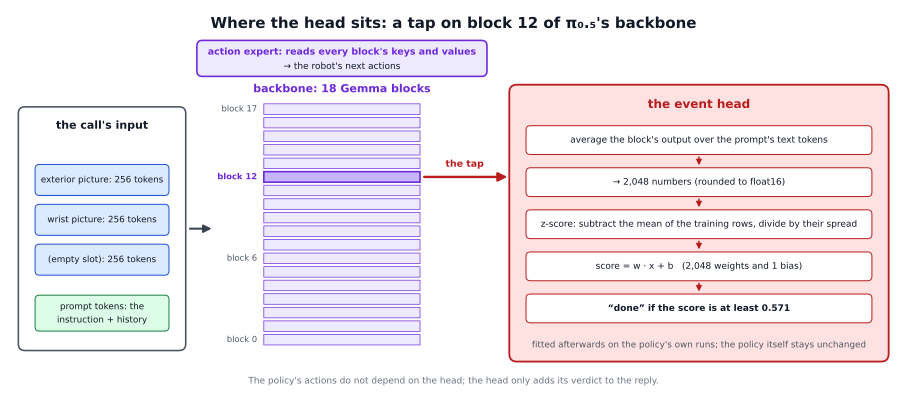
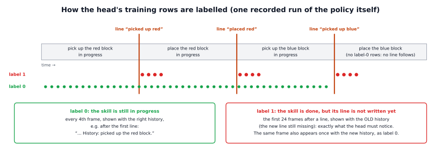

# The head writer in detail

The short page, [docs/writers/head](../README.md), says what the head writer does and what we found. This page explains
where the head sits and how it computes its verdict, why we built it this way and what we tried first, how it is trained,
and how the code works from the recorded runs to the last policy call.

## 1. The question behind it

A memory method needs someone to say when a skill is done. All the other writers watch the robot from the outside:

- the **oracle** asks the simulator, which knows the true state of the world;
- the **rules writer** reads the gripper's own readings and applies hand-written thresholds;
- the **VLM writer** shows the camera pictures to a second, large model and asks it.

But the policy itself already looks at the same pictures and the same prompt at every call. To choose its next movement, it
must in some sense know whether the cube is still on the table, held, or already lifted. So the question is: **is the
progress of the task already written somewhere inside the policy, and can we read it out?** If so, the policy can write its
own memory: no tracker, no extra sensors, no second model.

**What others found.** Several groups have read things out of the inside of VLA policies:

- **UniMem** (Osterberg, Wang and Schwager, 2026, arXiv 2608.22869) is closest to us. It trains an "event head", a small
  multilayer perceptron on π0.5's last-layer representation, *together with* the policy. When the head detects an event, the
  event is appended to the prompt as text ("History: grabbed spoon, ..."). It reported 93.4 % against 68.2 % for a variant
  with frames at fixed intervals in simulation, and 80.0 % against 43.5 % on hardware.
- **A progress probe on π0.5** (Bhardwaj et al., 2026, arXiv 2608.13474): a *linear* read-out of the averaged activations of
  a fine-tuned π0.5 predicts how much of the task is left, with R² of about 0.95 on familiar tasks. It also flags stalls.
- **Failure detectors on VLA internals:** SAFE (Gu et al., 2025, arXiv 2506.09937) reads a VLA's internal features with an
  LSTM or a two-layer perceptron and calibrates its threshold on successful runs; Hide-and-Seek (Park et al., 2026,
  arXiv 2605.30834) reads the action embeddings with an LSTM.
- **Linear probes** as a research tool go back to Alain and Bengio (2016, arXiv 1610.01644): if a simple linear classifier
  can read a property from a layer of a network, the network represents that property there.

**Our choice: a probe on the frozen policy.** UniMem retrains the policy with its head. We tried the cheapest thing first:
leave the policy exactly as it is, record what it computes, and fit a small read-out afterwards. That costs no retraining,
cannot harm the policy's movements, and can be tried and checked in hours. Retraining the policy together with its head
stays the option if a probe is not good enough.

**Why the history policy.** The head works with the [history method](../../../methods/history/README.md), where the prompt
holds the instruction plus one line per finished skill. That matters: the head does not have to judge the scene alone; it
has to notice that the scene and the history no longer agree. "The cube is lifted, but the history does not say 'picked up
the red block' yet" is exactly the moment to write the line.

## 2. Where the head sits and how it computes its verdict

π0.5 has two parts. A language-model **backbone** (18 Gemma blocks) reads the input: 256 tokens for each of its three
image slots (the outside camera, the wrist camera, and a third slot that is empty for this policy), then the tokens of the
prompt. An **action expert** reads the backbone's internal keys and values at every block and produces the next movements.

The head taps the backbone after **block 12** (counting from 0) and does five simple steps:

1. **Pool:** average the block's output over the prompt's text tokens. Inside the backbone, everything is numbers: each
   piece of input, a "token", is a list (a vector) of 2,048 numbers. A picture is cut into 256 small patches, and each patch
   becomes one token; the prompt is cut into words and parts of words, and each becomes one token too. Every block takes
   all these vectors and produces new ones, in which each token has taken in information from the others (that is what the
   attention inside a block does). After block 12 there is still one vector per token: 768 for the three image slots, and
   one per text token of the prompt. "Averaging over the text tokens" means taking only the prompt's vectors and averaging
   them number by number: the first numbers of all of them, then the second numbers, and so on. The padding that fills the
   prompt up to its fixed length is left out. The result is one vector of **2,048 numbers**. Because the text tokens have
   taken in the pictures and the history inside the backbone, their average summarises both.
2. **Round** them to float16, the precision in which the training rows were stored, so that training and use see the same
   numbers.
3. **Standardise** (z-score): subtract the mean of each number over the training rows and divide by its spread (standard
   deviation). This puts all 2,048 numbers on the same scale.
4. **Score:** the logistic regression computes `score = w · x + b`, a weighted sum of the 2,048 numbers (2,048 weights) plus
   one constant (the bias). The score is a "logit": the higher, the more sure the head is that the skill is done; 0 means
   50/50.
5. **Decide:** "done" if the score is at least the **threshold, 0.571** (section 3 says where this number comes from).

The policy's actions do not depend on the head at all: the head only adds its verdict to the reply.

## 3. Why it is built this way

### Trained on the policy's own runs, not on demonstrations

The first heads were trained on the **demonstrations** the policy itself was trained on. We tried 6 layers, 6 ways of
pooling and two kinds of head. All of them told "done" from "not done" almost perfectly on held-out demonstrations, and much
worse on the policy's own runs. They said "done" at the grasp: while the cube was still on the table, squeezed by the
fingers, or after a failed close. In the scripted demonstrations the lift always follows the close within a few frames, so
"a cube between the fingers" almost always means "about to be lifted". In the policy's own runs slow and failed grasps are
common, and from the wrist camera a cube squeezed on the table looks almost the same as a lifted one.

No head, however large, can learn from demonstrations what a slow or failed grasp looks like, because the demonstrations
never show one. This is the mismatch DAgger (Ross, Gordon and Bagnell, 2011) addresses for policies: a model trained only on
an expert's data meets states the expert never visited. So the head is trained on the **policy's own runs**. They contain
the slow and failed grasps, and the rules writer labels them for free: it knows from the gripper readings when a block was
lifted and when it was set down. Trained this way, the false alarms at the grasp disappeared.

One kind of run is left out, for training and testing alike: a run in which the policy picks up the blue block first. The
history's lines follow the task's order (red first), so such a run cannot be labelled with the same lines.

### A logistic regression, not a multilayer perceptron

The second kind of head was a **multilayer perceptron** (MLP: one hidden layer of 256 units). On the policy's own runs it
was no better than the logistic regression: the problem had been the training data, not the size of the head. We kept the
logistic regression:

- **A cleaner answer to the research question.** A linear read-out shows that the policy itself has organised the
  information so that a straight line separates "done" from "not done" (Alain and Bengio's argument for linear probes). An
  MLP could compute part of the answer itself, and we would not know whether the policy or the probe did the work.
- **Less risk of overfitting.** The logistic regression has 2,049 numbers to learn (2,048 weights and a bias). The MLP has
  about 525,000 (2,048 × 256 + 256 + 256 + 1). With 11,791 rows from only 129 runs, rows from one run are very similar to
  each other, so the effective amount of data is small.
- **A fit with one exact answer.** The logistic regression's loss has a single minimum. We find it with Newton's method in
  a few iterations, without a random start, a learning rate or a number of epochs to choose. The same rows always give the
  same head.
- **A meaningful score.** The score is a logit, so a threshold has a clear meaning, and the threshold can be set from the
  false-alarm rate (below).
- **Almost no cost.** At run time the head is one dot product of 2,048 numbers.

### An event, not the progress

The progress probe on π0.5 (section 1) reads out how much of the task is left. We read out an event instead, because the
writer needs a yes-or-no decision at one moment: write the line now. A progress estimate would still need a threshold to
turn it into that decision, and "how much is left" depends on how the episode goes (a failed grasp makes the rest take
longer), while "the skill is done" is one clear moment that matches the policy's training labels. Both are linear read-outs
of the same kind of averaged activations. A progress read-out could still help to spot a robot that is stuck; we have not
tried it.

### Block 12, the text tokens, the threshold and two verdicts in a row

- **Block 12 and the text-token average** were the best of the settings compared with cross-validation on the policy's own
  runs (7 choices of layer and pooling, each trained on the runs alone or on the runs plus the demonstrations).
- **The threshold, 0.571.** A false line is worse than a late one: once written, it stays in the history for the rest of the
  episode and misleads the policy. So the threshold is the score that only **1 % of the "not done" moments** reach in the
  cross-validation.
- **Two "done" verdicts in a row.** Single false alarms are rare, but they happen. Asking for two in a row removes almost all
  of them, at the price of one call of delay, and of missing events that last only one call (a block dropped right after the
  lift).

## 4. How the head is trained, step by step

`training/fit_event_head.py` does the whole fit. It reads one `.npz` file per recorded run of the policy:

| array | content |
|---|---|
| `exterior`, `wrist` | the two camera pictures at every control step |
| `instruction` | the episode's instruction |
| `reference`, or `rows` | the number of finished skills at every step; or the gripper readings, from which the task's rules writer computes it |

1. **The training rows** (`vla_memory/writers/head/rows.py`). Every 4th frame of a run becomes one or two rows, each a
   picture pair shown with a prompt:
   - **label 0** ("not done"): the frame, with the history that is correct at that moment. The current skill is still in
     progress.
   - **label 1** ("done, line missing"): each of the first 24 frames after a skill was finished, shown with the *old*
     history, which still lacks the new line. That is exactly what the head must notice at run time.

   The same frame can appear twice: with the new history as label 0, with the old history as label 1. So the head cannot
   decide from the picture alone; it has to compare the picture with the history in the prompt. No rows are made for the
   last skill, because its completion writes no line (as in the policy's training data).
2. **The features** (`vla_memory/writers/head/features.py`, in the openpi environment, on a GPU). The frozen policy, loaded
   exactly as the server loads it, computes the 2,048 numbers of every row (section 2). They are saved (`--features`), so
   that a second fit can skip this step.
3. **The fit** (`vla_memory/writers/head/fit.py`, on the CPU):
   - the rows are standardised;
   - **balanced class weights**: there are many more label-0 rows than label-1 rows, so each class gets the same total
     weight; otherwise the head could score well by always saying "not done";
   - an **L2 penalty** keeps the weights small, which prevents overfitting. Its strength is chosen from 1e-4, 1e-3, 1e-2 and
     1e-1 by **5-fold cross-validation over runs**: the runs are split into 5 groups, each group is predicted by a head
     trained on the other 4, and the strength with the best average **AUROC** wins (1e-3 for the reference head). The AUROC
     is the chance that a random "done" moment gets a higher score than a random "not done" moment: 0.5 is guessing, 1 is
     perfect. Whole runs stay together in one group, because frames of the same run are so similar that splitting them
     would make the test far too easy;
   - the **threshold** is taken from these out-of-fold scores, the scores of heads that did not see the run (section 3);
   - the final head is fitted on all rows with the chosen strength.
4. **The head files** (`vla_memory/writers/head/file.py`): `head.npz` holds the weights, the bias, the mean and spread of
   the features, the threshold, the number of verdicts in a row, the layer and the pooling; `head.json` notes how it was
   fitted; `head.sha256` holds checksums, checked whenever the head is loaded.

## 5. The code at run time

**The server** (`vla_memory/writers/head/server.py`, in the openpi environment):

1. It loads the policy with openpi as usual, and the head from its folder (checksums checked).
2. `HeadPolicy` wraps the policy's input transform in a function that only keeps a copy of the transformed observation, so
   the policy runs exactly as without the head.
3. After every call it computes the head's features from that copy (`features.LayerFeature`: blocks 0 to 12 of the
   backbone, one at a time, with the checkpoint's weights), scores them and adds
   `reply["event_head"] = {"score", "done", "threshold", "ms"}` to the reply.

**The writer** (`vla_memory/writers/head/writer.py`, `HeadWriter`):

- `start_episode`: the plan is the task's order of skills (of the episode's objects, if the environment names them), the
  position starts at the first skill, the "done" counter at 0.
- `after_call`: it reads the verdict. A "done" raises the counter, a "not done" sets it back to 0. When the counter reaches
  `--consecutive` (default 2), the current skill's line is written, the position moves on and the counter starts again.
  Without a verdict in the reply, it stops with an error that says how to serve the policy.
- `before_call`: a line written after the previous call goes into this call's prompt. Because the head decides *after* a
  call, its decision reaches the policy one call later than with the writers that decide before the call.
- At most `max_lines` lines are written (the task file's `history.max_lines`, 3 here): the last skill has no line.

**Exact numbers and speed.** The GPU library (XLA) chooses its computing kernels per batch size and per process, and
different kernels give slightly different rounding. To get exactly the numbers the head was trained on, the server scores
every call as 8 copies of itself (the batch size of the fit) with the same compiled kernels (a copy of the fit's
compilation cache, `--jax-cache`). Then the features are identical bit for bit. The price: the head pass adds about half a
second per call. With `--head-batch 1` it adds only about 100 ms, but the scores are slightly off (a mean 0.08), which changed
none of the verdicts we checked. Reading block 12 from the policy's own forward pass, instead of computing blocks 0 to 12 a
second time, would make the head almost free; that is not built.

## 6. Does it depend on the policy? Yes, completely

- **The features are the policy's own.** Another model, another fine-tune, even another checkpoint of the same fine-tune
  has a different inner representation. Our head was fitted on checkpoint 28000 of the history policy and belongs to it.
- **The training data are the policy's own runs.** Section 3 shows why: a head trained on someone else's behaviour (the
  scripted demonstrations) fails on the policy's.
- **The prompt is part of the input.** The rows show the history policy's prompts; with another method the policy sees
  other prompts, and the head would have to be fitted for them.
- **The server must reach inside the model.** As shipped it reads the Gemma backbone of an openpi π0.5 policy.

To use the idea with another VLA:

1. record runs of that policy and label them (with the rules writer, a tracker, or by hand);
2. pick a layer and a pooling of that model and extract the features for the rows;
3. fit and check the head on held-out runs: the AUROC, the false-alarm rate at the threshold, and the line timing as a
   writer;
4. serve the policy with the head's verdict in every reply, as `server.py` does for π0.5.

## 7. Limitations

- **Speed:** the exact head pass makes a call about four times slower (716 instead of 170 ms), longer than an 8-step chunk
  of actions lasts at 15 Hz (533 ms). A real robot would need the faster, slightly inexact mode, asynchronous inference, or
  the tap inside the policy's own forward pass.
- **It copies its teacher.** It learned the rules writer's labels; where the rules writer is wrong, the head learns the
  mistake. Where the rules writer and the tracker disagree, for example a cube let go a little too high (the rules writer
  calls it a drop, the tracker a placement), the head has to side with one of them.
- **Narrow testing:** one policy, one instruction, one camera setup, in simulation.
- **Rare events:** drops right after a lift, unusual movements after a release, and events shorter than two calls are where
  it misses.
- **One call of delay**, because it decides after the call.
- **No "task finished":** the last skill has no line, as in the policy's training data.
