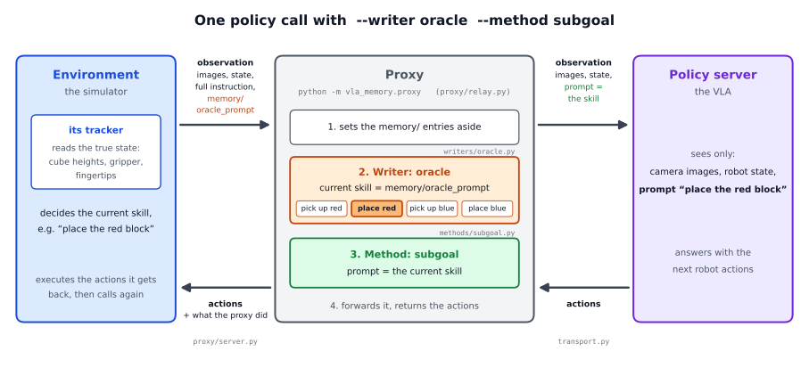

# The oracle writer in detail: a walkthrough of the code

This page follows one run of

```
python -m vla_memory.proxy --writer oracle --method subgoal --task vla_memory/tasks/red_blue_blocks.yaml \
    --listen-port 8001 --upstream-port 8000
```

`--task` names the task file; for the reference task it can be left out.

from the command line to the last policy call, and names the function that does each step. The short page,
[docs/writers/oracle](../README.md), says what the oracle is for; this one says how it works.

## The pieces



| file | what it does in this run |
|---|---|
| `vla_memory/proxy/__main__.py`, `proxy/cli.py` | reads the command line, builds the parts, starts the server |
| `vla_memory/task.py` | reads the task file: the skills and their order |
| `vla_memory/writers/base.py` | the writer interface (`Writer`), what a writer sees of a call (`Call`), the list of writers (`WRITERS`) |
| `vla_memory/writers/oracle.py` | the oracle writer (`OracleWriter`) and the writer `off` (`OffWriter`) |
| `vla_memory/methods/base.py`, `methods/subgoal.py` | the method interface and the sub-goal method |
| `vla_memory/proxy/server.py` | the websocket server the environment connects to |
| `vla_memory/proxy/relay.py` | what happens at every policy call |
| `vla_memory/transport.py` | the connection to the policy server |
| `vla_memory/env_keys.py` | a helper for the environment: builds the `memory/` entries it sends |

The simulator itself, and with it the tracker that knows the current skill, is not part of the framework. The framework only
defines what the environment has to send (section 2).

## 1. Start-up: from the command line to a listening proxy

`python -m vla_memory.proxy` runs `vla_memory/proxy/__main__.py`, which calls `cli.main()`. In order:

1. **The command line is read in two passes** (`parse_command_line`). The first pass reads only `--writer`, `--method` and
   `--with`. `resolve_writer("oracle")` looks the name up in `WRITERS` (`writers/base.py`), where `"oracle"` stands for the
   import path `vla_memory.writers.oracle:OracleWriter`; the module is imported only now, so a writer that is not chosen is
   never loaded. The method `"subgoal"` is found the same way in `METHODS` (`methods/base.py`). The second pass builds the
   full parser, to which each chosen class adds its own options (`add_arguments`). The oracle has none.
2. **The arguments are checked** (`check_arguments`): the default connection to the policy, openpi's websocket protocol,
   needs `--upstream-port`.
3. **The task file is loaded** (`TaskSpec.load_or_default`). Without `--task` it is the packaged reference task,
   `vla_memory/tasks/red_blue_blocks.yaml`. Of all it contains, the oracle needs only the skills in their order:
   - `objects: [red, blue]` and `verbs: ["pick up", "place"]`;
   - `skill_template: "{verb} the {object} block"`, which turns a verb and an object into the exact skill text
     (`TaskSpec.skill`), such as "pick up the red block";
   - the task order (`TaskSpec._task_order`): stage by stage, and within a stage object by object. Without `plan_stages`
     there is one stage with all verbs, so the reference task's order is pick up red, place red, pick up blue, place blue.
4. **The parts are built** (`build_components`):
   - the extensions, none here;
   - the writer: `OracleWriter.build(args, task)` is the default `Writer.build`, which calls `OracleWriter(task)`. Its
     `__init__` keeps the task and calls `start_episode("", None)`, which sets:
     - `plan` = `task.default_plan(None)`, the task order of all objects:
       `["pick up the red block", "place the red block", "pick up the blue block", "place the blue block"]`;
     - `skill_index = 0`, the position of the current skill in the plan;
     - `reported = None` (used only when the environment names the episode's objects, section 5);
     - `passthrough = None` (section 3, step 5);
     - `done_all = False`. The oracle never sets it: its tracker never reports the task as finished, so the last skill
       stays the current one.
   - the method: `SubgoalMethod(task)`;
   - each extension is attached to `writer.monitor`. For the oracle that is `None`: it observes nothing itself, so an
     extension that needs a monitor gets none.
5. **The connection to the policy is opened** (`build_transport`): `OpenPIWebsocketTransport(host, port)` creates openpi's
   `WebsocketClientPolicy`, which connects to the policy server and waits until it answers. The `Relay` is built around it
   and logs the policy server's metadata.
6. **The proxy starts listening** (`serve`). `ProxyServer.run` opens a websocket server on `--listen-host:--listen-port`
   (default host 127.0.0.1); `GET /healthz` answers `OK`, for launchers that wait until the proxy is up. SIGTERM and Ctrl-C
   end the run cleanly (`relay.close()`).

What the environment is told when it connects (`proxy_metadata`):
`{"proxy": "vla_memory.proxy.relay", "mode": "oracle", "method": "subgoal", "task": "red_blue_blocks"}`; a writer with
settings of its own adds them (the VLM writer: its model, its exemplar store and `k`).

## 2. The environment's side: what it sends and how the simulator knows the current skill

The environment connects to the proxy's port with the client it would use for the policy server, first receives the
metadata above, and then sends one observation per policy call. It decides itself when to call; the reference bench calls
every 8 control steps and executes the returned actions in between. An observation holds:

- the policy's own entries, unchanged: in the reference setup `observation/image`, `observation/wrist_image` and
  `observation/state`;
- `prompt`: the full task instruction, for example "Pick up the red block, place it back, and then grasp the blue block.";
- entries for the proxy, whose names start with `memory/`. The oracle reads:
  - `memory/oracle_prompt`: the skill the simulator's tracker considers current, worded exactly as the task file words it;
  - `memory/new_episode` (True at the first call of an episode) and `memory/episode` (the episode's name), which tell the
    proxy where an episode starts;
  - `memory/objects`, only when the episode holds just some of the task's objects (section 5);
  - `memory/step`, which goes into the log.

  Other `memory/` entries, such as the gripper readings or the raw camera frames, are for the other writers and some
  methods (the keyframe method takes its picture from `memory/wrist_raw`); the oracle itself ignores them.

`vla_memory/env_keys.py` builds these entries: `ControlKeys.start_episode(episode_id, objects)` at the start of an episode,
`record(...)` at every control step, and `call(step, oracle_prompt=...)` at every policy call, which returns them as a
dictionary to add to the observation.

**How the simulator knows the current skill.** A simulator knows the true state of the world: where every object is,
what the gripper was told to do, where the fingertips are. The reference simulator's tracker turns that into the current
skill at every policy call with four flags, set in the task's order and never cleared during an episode:

| flag | set when |
|---|---|
| red is lifted | the red cube's centre is more than 9 cm above its resting height (above 0.85 m; the table top is at 0.74 m, a resting cube's centre at 0.76 m) |
| red is placed | red is lifted, the gripper has been told to open, the cube rests within 1 cm of its resting height, and the fingertips have moved at least 6 cm above it or 8 cm away from it |
| blue is lifted | red is placed, and blue's centre is more than 9 cm above its resting height |
| blue is placed | as for red |

The current skill is the first one whose flag is not yet set: "pick up the red block" until red is lifted, then "place the
red block" until red is placed, then "pick up the blue block", then "place the blue block", which stays the current skill to
the end of the episode.

Why "placed" waits for the fingertips to move away: the policy was trained on demonstrations whose labels switch from
"place" to the next skill only after the hand has retreated from the set-down cube. A tracker that switched as soon as the
gripper opened sent the next prompt while the fingers were still around the cube, and the policy grasped the same cube
again. The tracker must switch where the policy's training labels switch.

## 3. One policy call, step by step

`ProxyServer._handle_connection` unpacks each message (msgpack) into a dictionary and runs `Relay.infer(observation)` in a
worker thread. `Relay.infer` then:

1. **Splits the observation** (`split_control_keys`): every `memory/` entry goes into `control_keys` without its prefix
   (`memory/oracle_prompt` becomes `oracle_prompt`), everything else stays in the observation for the policy. The
   instruction is the observation's `prompt` (`text_of` turns a string that arrived as bytes into text).
2. **Starts the record of the call**: `info = {"mode": "oracle", "queried": False, "advanced": False, "vlm_ms": 0.0}`.
   The oracle never changes the last three; they are there for the other writers.
3. **Checks for a new episode** (`_is_new_episode`): the very first call, `memory/new_episode` True, or a `memory/episode`
   different from the current one. Then `_begin_episode`:
   - closes the previous episode for the extensions (none here);
   - names the new one: the `memory/episode` value, else `ep0`, `ep1`, ...;
   - tells the extensions and the method (`SubgoalMethod.start_episode` does nothing);
   - calls `writer.start_episode(instruction, episode)`, with `objects=` only when `memory/objects` was sent.
     `OracleWriter.start_episode` resets the plan, `skill_index = 0` and `passthrough = None` as at start-up. It returns
     no plan record, so the log shows no plan: the oracle has no plan of its own, only the task order.
4. **Builds the writer's view of the call**: `Call(instruction, control_keys, observation, image_keys)`.
5. **The writer decides, before the policy call** (`OracleWriter.before_call`):
   - Without `memory/oracle_prompt` it logs one warning for the whole run and takes the instruction as the report.
   - `reported` = the text of `memory/oracle_prompt`.
   - If `reported` is one of the plan's skills, `_point_at(reported)` sets `skill_index = plan.index(reported)` and
     `passthrough = None`. The oracle believes the tracker completely: it moves to whatever skill is reported, without
     checking.
   - Otherwise `passthrough = reported`: the text goes to the policy unchanged and `skill_index` stays. This is what
     happens when a bench without a tracker sends the full instruction as its "current skill".
   - It returns `{}`: the oracle adds no fields to the log.
6. **The method sets the prompt** (`_decide_prompt`). The oracle drives the prompt (`drives_prompt` is True; only `off`
   has False), so `prompt = method.prompt(instruction, writer)`. `SubgoalMethod.prompt` returns `writer.current_skill`:
   the passthrough text if there is one, else `plan[skill_index]`. The observation's `prompt` is replaced by it, and
   `info` records `prompt` and `oracle_prompt`. `method.before_policy` adds nothing for the sub-goal method. With other
   methods:
   - `--method history`: `HistoryMethod.prompt` returns the instruction followed by one line per completed skill;
     completed means the skills before the current one, `plan[:skill_index]` (`Writer.completed`);
   - `--method keyframe`: the prompt stays the instruction, and `before_policy` adds a third picture
     (`observation/memory_image`): the raw wrist frame of the call at which the last skill was completed; before the first
     completed skill there is none.
7. **Puts the episode markers back** (`episode_markers`): `memory/new_episode` and `memory/episode` go to the policy as the
   environment sent them, so that a policy that keeps its own memory can reset it. Every other `memory/` entry stays with
   the proxy.
8. **Calls the policy** (`_forward`): `transport.infer(observation)` sends the observation over openpi's websocket and waits
   for the reply, a dictionary with the `actions`. The round trip is recorded as `upstream_ms`.
9. **Lets the extensions see the reply** (`_reply_hooks`), none here.
10. **The writer's after-call hook** (`writer.after_call`): the oracle has decided already and does nothing.
11. **Finishes the record**: `total_ms`, then `reply["planner"] = info`, and with `--log FILE` one JSON line per call:
    `{"episode": "seed1001", "step": 96, "mode": "oracle", "queried": false, "advanced": false, "vlm_ms": 0.0,
    "prompt": "place the red block", "oracle_prompt": "place the red block", "upstream_ms": ..., "total_ms": ...}`.
12. The reply, the policy's actions plus `planner`, goes back to the environment, which executes the actions until its next
    call. The environment may ignore `planner`; the reference bench stores it, so that its traces show the prompt of every
    call.

Because the oracle decides in step 5, before the policy is called, a skill switch reaches the policy in the same call in
which the tracker reports it. There is no delay of one call.

## 4. A whole episode of the reference task

| calls | `memory/oracle_prompt` | the oracle | the policy's prompt (sub-goal) |
|---|---|---|---|
| the first call | "pick up the red block", with `memory/new_episode` True | new episode: plan reset, `skill_index = 0` | "pick up the red block" |
| until red is 9 cm up | "pick up the red block" | `skill_index = 0` | "pick up the red block" |
| from the first call after the lift | "place the red block" | `skill_index = 1` | "place the red block" |
| from the first call after the hand has left the set-down red cube | "pick up the blue block" | `skill_index = 2` | "pick up the blue block" |
| from the first call after blue is lifted, to the end | "place the blue block" | `skill_index = 3` | "place the blue block" |

The next episode begins when the environment sends `memory/new_episode` True (or a new `memory/episode`); the oracle
starts again at the first skill. Whether the task succeeded is not the writer's concern: the environment's success
measure decides that.

## 5. Episodes with varying objects

In a task whose episodes hold only some of the task's objects (say two to four cubes out of five colours), the environment
names them in `memory/objects`, and the relay passes them to `start_episode`:

- `plan = task.default_plan(objects)`: the task order, restricted to these objects;
- `reported = []`.

From then on `_point_at` appends every skill the tracker reports for the first time to `reported`, and rebuilds the plan as
the skills reported so far followed by the rest of the task order. The plan therefore follows the order in which the
tracker reports the skills, and "completed" (the skills before the current one) is right even when the task allows any
order. Example with three cubes, where the tracker reports green before red:

| reported so far | plan | current skill |
|---|---|---|
| [] | the task order of red, green and purple | the first skill of that order |
| ["put the green cube into the box"] | that skill first, then the rest of the task order | "put the green cube into the box" |
| ["put the green cube into the box", "put the red cube into the box"] | those two, then the rest | "put the red cube into the box"; the green one counts as completed |

## 6. What the oracle does not do

- It has no model, reads no camera and applies no threshold of its own: everything it knows comes from
  `memory/oracle_prompt`.
- It is not a monitor (`monitor` is `None`): extensions receive `None` when they attach, so those that work through the
  VLM writer's monitor, such as the session store, have nothing to work with.
- It never marks the task as finished (`done_all` stays False).
- It needs a tracker, so it runs only in simulation. On a real robot the rules writer, the VLM writer or the head writer
  takes its place.

## 7. The writer `off`, in the same file

`--writer off` is `OffWriter`: an empty plan, `current_skill` None, nothing ever completed, and `drives_prompt = False`, so
in step 6 the relay leaves the environment's instruction as the prompt. It is the run without a writer, the memoryless
baseline.

## 8. Checking a run

With `--log FILE`, every line of the log is one call. In an oracle run:

- `prompt` equals `oracle_prompt` in every call, unless the tracker sent a text that is not a skill;
- the skill switches are where `oracle_prompt` changes from one line to the next;
- `upstream_ms` is the policy's time per call, `total_ms` the proxy's whole time.

## 9. Using the oracle with your own simulator or task

Nothing changes in the framework. The simulator has to:

1. compute the current skill at every policy call from its ground truth, switching where the policy's training labels
   switch;
2. send it as `memory/oracle_prompt`, worded exactly as the task file words it (`TaskSpec.skill(verb, object)`);
3. mark the start of every episode with `memory/new_episode` (and, if it likes, `memory/episode`);
4. for episodes with varying objects, send `memory/objects`.
