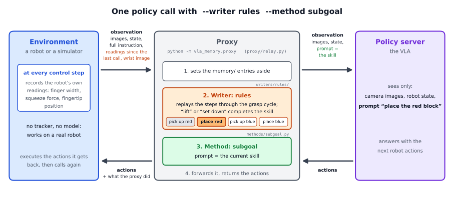
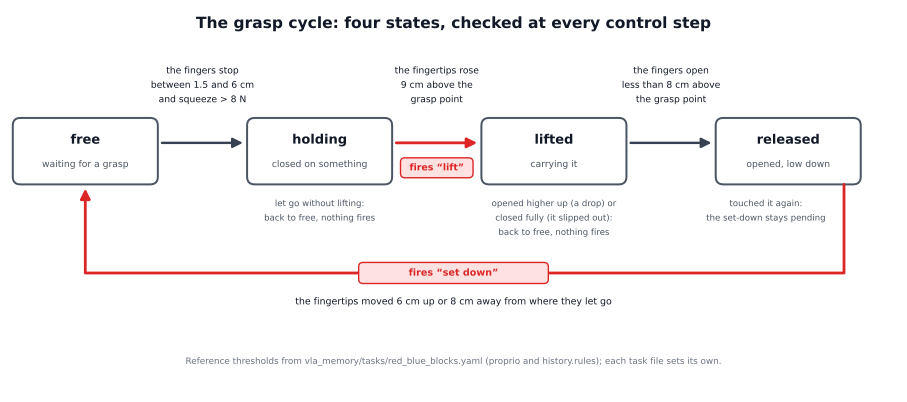

# The rules writer in detail: a walkthrough of the code

This page follows one run of

```
python -m vla_memory.proxy --writer rules --method subgoal --task vla_memory/tasks/red_blue_blocks.yaml \
    --listen-port 8001 --upstream-port 8000
```

from the command line to the last policy call, and names the function that does each step. `--task` names the task file;
for the reference task it can be left out. The short page, [docs/writers/rules](../README.md), says what the rules writer is
for. The parts every writer shares (the server, the relay, the connection to the policy) are explained step by step in the
[oracle walkthrough](../../oracle/detailed/README.md); this page concentrates on what the rules writer adds.



## The pieces

| file | what it does |
|---|---|
| `vla_memory/writers/rules/writer.py` | `RulesWriter`: the writer the proxy talks to; hands each call's readings to the logic below |
| `vla_memory/writers/rules/rule_monitor.py` | `RuleMonitor`: the plan, the position in it, and what a trigger completes |
| `vla_memory/writers/rules/grasp_cycle.py` | `GraspCycle`: the four states of one grasp and the two triggers, `lift` and `set_down` |
| `vla_memory/writers/rules/identify.py` | `ColourIdentifier`: which object is in the gripper, from the wrist image |
| `vla_memory/writers/rules/rule_spec.py` | reads and checks the task file's `history.rules` and the gripper thresholds |
| `vla_memory/writers/rules/signals.py` | turns the environment's per-step arrays into rows |
| `vla_memory/writers/rules/signal_sequence.py` | `SignalSequence`: the trigger `signals`, for skills without a grasp |
| `vla_memory/writers/rules/validate.py` | the offline check of a set of rules against recorded episodes |
| `vla_memory/writers/rules/author*.py` | lets the planning model write a set of rules |
| `vla_memory/env_keys.py` | the environment's helper that records the readings and builds the `memory/` entries |

## 1. Start-up

`cli.main()` reads the command line as for every writer (oracle walkthrough, section 1). For `--writer rules` it then calls
`RulesWriter.build(args, task)`:

1. **The object check is chosen** (`make_identifier`). The task file's `history.object_from` says how a pick learns which
   object it concerns: `plan_order` (the default) assumes the plan's object, `colour` builds a `ColourIdentifier` from the
   task file's colour rules (`fingerprint.colours`). The reference task uses `colour`.
2. **The rules are read and checked** (`parse_rules` in `rule_spec.py`). Every verb of the task must have exactly one rule,
   every rule a known trigger (`lift`, `set_down` or `signals`) and exactly the thresholds that trigger takes. A mistake stops
   the proxy at start-up with a message that names the verb. The reference task has two rules:
   - `pick up: {trigger: lift, rise: 0.09}`
   - `place: {trigger: set_down, release_below: 0.08, up: 0.06, away: 0.08}`
3. **The gripper thresholds are read** (`gripper_thresholds`): `open_width`, `empty_width` and `squeeze_force` from the task
   file's `proprio` section (0.06 m, 0.015 m and 8 N in the reference task). Defaults exist for all three.
4. **The grasp cycle is built** (`GraspCycle`) with the gripper thresholds and the thresholds of the first `lift` rule and the
   first `set_down` rule. A task with a grasp verb must have both.
5. **One `SignalSequence` is built per verb with `trigger: signals`** (none in the reference task).
6. **The plan is set** (`reset`): the task's skills in the task order, `["pick up the red block", "place the red block",
   "pick up the blue block", "place the blue block"]`, the position `skill_index = 0`, no events yet, `done_all = False`, and
   the grasp cycle in the state *free*.

## 2. What the environment sends

The rules writer needs the robot's readings of **every control step**, not just of the steps with a policy call. Between two
calls the robot executes several actions (8 in the reference setup), and a grasp or a release can happen at any of them.

The environment records them with `vla_memory.env_keys.ControlKeys`:

- `start_episode(episode_id, objects)` at the start of an episode;
- `record(finger_width=..., finger_effort=..., tip_xyz=...)` at **every** control step, before the step's action;
- `call(step, wrist_raw=...)` at every policy call: it returns the `memory/` entries to add to the observation and starts an
  empty buffer for the next call.

What reaches the proxy with a call:

| entry | content |
|---|---|
| `memory/proprio_steps` | one row per control step since the previous call: finger width (m, both fingers together), squeeze (N, or 1 and 0 from a gripper that reports a grasped flag), fingertip x, y, z (m) |
| `memory/wrist_raw` | the wrist camera's picture, for the colour check (without it the writer uses the policy's wrist image) |
| `memory/new_episode`, `memory/episode` | where an episode starts |
| `memory/objects` | the episode's objects, for a task whose episodes hold only some of its objects |
| `memory/signal_steps` | further signals the task declares, for `trigger: signals` rules |

At the very first call of an episode no steps have been recorded yet; the writer then reads the current values instead
(`memory/finger_width`, `memory/finger_effort`, `memory/tip_xyz`), see `signal_rows` in `signals.py`.

## 3. One policy call

The relay handles the call as for every writer (oracle walkthrough, section 3): it sets the `memory/` entries aside, starts a
new episode when one begins, and asks the writer before the policy call. A new episode resets the writer (`start_episode`):
the plan for the episode's objects, the position at its first skill, the grasp cycle at *free*. The proxy's log notes the
plan at that call, with the source "task order (rules writer)".

`RulesWriter.before_call` then does this:

1. **The readings become rows** (`signal_rows`): an array with one row per control step since the previous call, five
   columns each (width, squeeze, x, y, z).
2. **Every row goes through the logic, oldest first** (`RuleMonitor.observe_rows`). For each control step:
   1. The grasp cycle takes the thresholds of the **current skill's verb** (`_use_thresholds_of_current_skill`), so that verbs
      sharing a trigger can have different thresholds.
   2. The grasp cycle advances by one step (`GraspCycle.step`, section 4) and returns `"lift"`, `"set_down"` or nothing.
   3. If it returned a trigger, `_grasp_line` decides whether that trigger completes the current skill:
      - at a `lift` with a colour check: which object is held (section 6);
      - the trigger must fit the current skill's verb; a second `lift` while the current skill is "place" completes nothing
        (the block slipped out and was grasped again);
      - a `set_down` completes "place" only for the object that was identified at the last lift.
   4. If the skill is complete (`_complete_current_skill`), it is added to the call's `completed` list and the position moves
      to the next skill. After the last skill `done_all` becomes True: the plan is finished, and later triggers are ignored.
      At most one skill is completed per control step.
   5. For a verb with `trigger: signals`, its sequence of conditions advances by one step instead (section 8).
3. **The writer returns its record for the log**: `advanced` (whether a skill was completed in this call), `skill_index`,
   `completed`, `writer_state` (the grasp cycle's state after the last step) and `identified` (the colour check's answer, at
   a call with a pick).

Then the method sets the prompt from the new position (`SubgoalMethod.prompt` returns the current skill), and the policy is
called. Because all of this happens before the policy call, a skill completed at any step since the previous call shows in
the prompt of this call.

## 4. The grasp cycle



`GraspCycle.step(width, squeeze, fingertip)` runs once per control step. What each state waits for, with the reference
task's thresholds, and why:

**free: waiting for a grasp.** The cycle moves to *holding* when the fingers have stopped on something: the width is between
`empty_width` (1.5 cm) and `open_width` (6 cm), **and** the squeeze is above `squeeze_force` (8 N). The squeeze matters
because a gripper that closes on nothing also stops at a narrow width (3.2 cm in the simulator), but without force; the force
rejects such empty grasps. The fingertip height at this moment is remembered as the grasp point.

**holding: the fingers press on something.** The cycle fires **lift** and moves to *lifted* when the fingertips have risen
`rise` (9 cm) above the grasp point while still squeezing. 9 cm is where the demonstrations' labels switch from "pick up" to
"place". (With the optional `at_top`, the lift fires only once the hand also stops rising, at the top of the lift.) If the
fingers open or close fully before that, the grasp failed and the cycle goes back to *free*.

**lifted: carrying.** When the fingers open (width above 6 cm), the height decides what happened:

- less than `release_below` (8 cm) above the grasp point: the object was set down, or let go just above the table. The
  fingertip position is remembered as the release point, the set-down is pending, and the cycle moves to *released*;
- higher up: the object was dropped. Back to *free*, nothing fires.

If the fingers close fully instead (width below 1.5 cm), the object slipped out: back to *free*, nothing fires.

**released: open, low down.** The cycle fires **set_down** and goes back to *free* when the fingertips have moved `up`
(6 cm) above the release height or `away` (8 cm) from the release point in any direction. The demonstrations' labels switch
from "place" to the next skill only after this retreat; a writer that switched at the moment the fingers opened sent the next
skill while the fingers were still around the block, and the policy grasped the same block again. If the fingers squeeze
something again before the retreat (they touched the block just set down), the cycle returns to *holding*, but the set-down
stays pending: letting go again brings it back to *released*.

## 5. A whole episode of the reference task

| what the robot does | grasp cycle | the writer | the policy's prompt (sub-goal) |
|---|---|---|---|
| moves to the red block, closes the fingers on it | free → holding | | "pick up the red block" |
| lifts it 9 cm | holding → lifted, fires `lift`; the colour check sees red | completes "pick up the red block" | "place the red block" from the next call |
| lowers it and opens the fingers near the table | lifted → released | | "place the red block" |
| moves the hand 6 cm up (or 8 cm away) | released → free, fires `set_down` | completes "place the red block" | "pick up the blue block" |
| the same for the blue block | | completes "pick up the blue block", then "place the blue block"; `done_all` | "place the blue block" to the end |

"From the next call" means: the step at which the trigger fired lies between two policy calls, and the next call is the first
one to show the new skill. That is the earliest any writer can show it, because the policy is only asked at calls.

## 6. Which object: the colour check

The grasp cycle knows *when* a pick happened, not *which* object was picked. With `history.object_from: colour`, at every
`lift` the writer asks the `ColourIdentifier`:

- It looks at the region of the wrist image where a held object appears (`history.held_region`: rows 30-60 % and columns
  33-67 % of the picture in the reference task), counts the pixels of each object's colour (`fingerprint.colours`), and names
  the colour that fills the largest share, if that share reaches `history.held_min_share` (12 %). Otherwise it answers
  "unknown".
- The writer then acts on the answer (`_identify_at_lift`):
  - the expected object, or "unknown": the plan's order holds;
  - another object of the episode that still has a pending pick: that object's skills of the current plan stage move to the
    front of the remaining plan (`_bring_forward`), so the lift completes the pick of the object that is really held;
  - an object without a pending pick (it was already picked and placed): nothing is completed.
- At the next `set_down`, "place" is completed only for the object identified at the last lift. Setting down a different
  object (one was dropped, then another one carried) writes nothing, because a wrong line would mislead the policy for the
  rest of the episode.

The check runs only at lifts, two to four times per episode, and takes about 0.08 ms each time.

## 7. Thresholds per verb, and plans in stages

A task can have several verbs with the same trigger: "put the cube into the box" and "stack the cube" both end with a
`set_down`, but the cube is let go just above where it was grasped in the first case and much higher in the second. Each
verb's rule carries its own thresholds, and before every step the grasp cycle takes those of the current skill's verb.

A task file can also order the plan in stages (`plan_stages`), for example first every cube into the box, then every cube
out and onto the stack. When the colour check brings an object's skills forward, it moves only that object's skills of the
current stage.

## 8. Skills without a grasp: `trigger: signals`

Opening a drawer or pressing a button does not follow the grasp cycle. Such a verb lists phases, each a set of conditions on
the signals that must all hold at one control step; the phases are entered in order, and the skill is complete when the last
one is entered (`SignalSequence` in `signal_sequence.py`). An example for opening a drawer:

```yaml
open:
  trigger: signals
  phases:
    - when: {finger_effort: {above: 8.0}, finger_width: {above: 0.01, below: 0.06}}   # the fingers squeeze the handle
      hold: {finger_effort: {above: 8.0}}                                             # ... and keep squeezing
    - when: {tip_x: {below: 0.47}}                                                    # pulled out
    - when: {finger_width: {above: 0.06}}                                             # let go
    - when: {tip: {away: 0.03}}                                                       # moved 3 cm away from there
```

A condition is a value `above` or `below` a threshold, or a change since an earlier phase (`rise`, `fall`, `away`, `near`).
If a `hold` condition stops holding before the next phase is entered, the sequence starts over. Only the current skill's
sequence runs, and it starts afresh whenever the writer moves to the next skill. Besides the five readings, a rule may use
signals the task declares (`signals` in the task file), sent as `memory/signal_steps`.

## 9. Before a robot: checking and writing rules

- **Checking** (`python -m vla_memory.writers.rules.validate`): replays recorded episodes through the rules. Each episode
  file holds the readings per step (`rows`) and a reference (`reference`: the number of completed skills at every step, from
  a ground-truth tracker, the training labels or a person). At every policy call it compares the writer's completed skills
  with the reference and reports, per skill, how often the writer switches in the same call, earlier, later, not at all, or
  without a reason. It checks *when* skills switch, not *which* object they name.
- **Writing** (`python -m vla_memory.writers.rules.author`): the planning model writes `history.rules`, from the task's
  completion criteria (`--variant easy`) or from statistics of the signals in labelled demonstrations (`--variant hard`), into
  a copy of the task file. Its rules are a draft: check them with the validator first.

## 10. Limitations

- **It only knows what the gripper feels.** It cannot see where an object ended up. A block that was set down but fell over,
  rolled away or landed in the wrong place still counts as placed.
- **Which object, only by colour.** Without the colour check it assumes the plan's object. The colour check needs objects of
  clearly different colours and a wrist camera that sees the held object; similar colours, bad light or a hidden object give
  "unknown", and the plan's order holds.
- **No planning.** It follows the task file's order, apart from picks the colour check moves forward. A new instruction
  ("blue first, then red") needs the VLM writer, which turns the instruction into a plan.
- **No going back.** It never takes a completed skill back. If a person puts a placed block back where it was, or a placed
  block falls off a stack, the writer still counts the skill as done.
- **The thresholds must match the training labels.** They must reproduce the moments at which the policy's training labels
  switch. Thresholds measured on a different robot, gripper or task make the policy fail even when the writer detects the
  event correctly.
- **Every control step is needed.** It sees only the readings it receives; if the environment sends only the readings at
  policy calls, a short grasp or release between two calls is missed.
- **One object at a time.** The grasp cycle follows one gripper and one held object; a task with two arms or with objects
  pushed instead of grasped needs `trigger: signals` or another writer.

## 11. Checking a run

With `--log FILE`, every line of the proxy's log is one call. In a run of the rules writer:

- `advanced` is true at the calls where a skill was completed, and `completed` names it;
- `writer_state` shows the grasp cycle's state after the call's last step (*free*, *holding*, *lifted*, *released*);
- `identified` shows, at a call with a pick, the held object, the expected one, and whether the plan was reordered;
- the first call of an episode also carries the plan (`plan`, `plan_source`).
