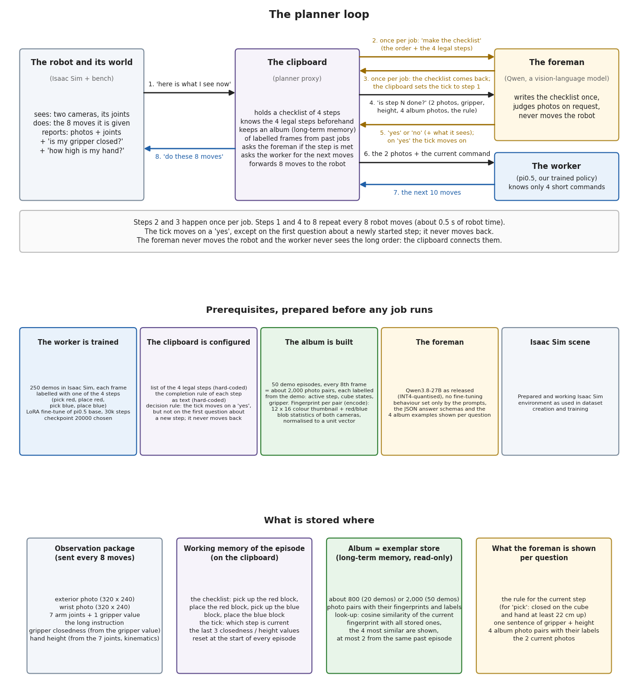

# The VLM writer: a planner that watches the robot

## The idea

A vision-language model (VLM) acts as the planner. Once per episode it turns the user's instruction into an ordered list of
the skills the policy was trained on, and at every policy call it judges from the camera images and the robot's
proprioception whether the current skill is complete. When it says "done", its pointer moves to the next skill before the
policy call, so the method shows the decision in the same call. With the sub-goal method, which hands the policy the
current skill, this is the planner loop:



([planner_loop.pdf](planner_loop.pdf): the loop, the prerequisites, and what is stored where.)

Three kinds of memory are involved:

- **Working memory** of the running episode: the plan, the current step and the last few proprioception values (gripper
  closedness, hand height). It is reset at the start of every episode.
- **Long-term memory**: the exemplar store. Frames of recorded episodes are labelled with the active skill and the object
  states, each frame gets a compact colour fingerprint, and at every question the most similar stored frames are shown to
  the planner as labelled examples. Six nearest stored moments also vote: when none of them says the skill is done, the
  model is not asked (the memory-vote gate). The store is read-only during an episode.
- **Symbolic state**: the task file. It lists the skills, the completion rule of each skill as text, the answer schemas and
  how the proprioception is summarised.

The decision rule: one "done" answer moves the plan pointer, never before the second question about a skill, and the pointer
never moves back. The writer draws on SayCan (a language model plans over a fixed library of trained skills), Inner Monologue
(success detection fed back to the planner after every step), SuccessVQA (a VLM judges completion from images) and RAP
(retrieved past experience as in-context examples).

## Prerequisites

- A vision-language model behind an OpenAI-compatible chat API with JSON-schema structured output; `scripts/serve_vlm_vllm.sh`
  serves one with vLLM (the reference setup: Qwen3.8-27B-INT4 on two RTX 3090).
- A task file; `vla_memory/tasks/red_blue_blocks.yaml` is the reference: objects, verbs, skill template, completion criteria,
  the system texts that describe the cameras.
- Optional: an exemplar store built from recorded demonstrations (`scripts/build_exemplar_store.py`); no store is
  distributed with the repository.
- An environment that sends the full instruction as `prompt` and the control keys under `memory/`: step, episode, the raw
  camera frames, gripper closedness and hand height. `vla_memory.env_keys.ControlKeys` builds them.

## How to use it in the framework

```
python -m vla_memory.proxy --writer vlm --method subgoal --listen-port <port> --upstream-port <policy port> \
    [--task task.yaml] [--memory store.npz]
```

`--method history` or another method instead of `subgoal`; `--writer vlm --method subgoal` is the default. The defaults of
the writer are the settled configuration of the evaluation: the memory-vote gate, a verdict-only answer, 4 examples per
question, one "done" answer to advance, no switch before the second question; `--no-gate`, `--no-verdict-only`, `--k`,
`--votes`, `--min-calls` change them, `--vlm-url` and `--vlm-model` name the model. `scripts/run_proxy.sh` wraps the command.
The proxy's log record of a call holds `queried`, `advanced`, `vlm_ms`, `skill_index`, `vlm` (the answer) and `recovery`;
the planner's own log (`<log>.planner.jsonl`) holds the plan and every monitor call. Other memories of the planner plug in
as extensions (`--with NAME`, `vla_memory/proxy/extensions.py`).

## Our findings

Reference task: pick up and put back a red and then a blue cube with a Franka arm in Isaac Sim, pi0.5 policies; 100 fresh
seeds of 500 control steps, a policy call every 8 steps:

| method | store | full tasks of 100 | median episode |
|---|---|---|---|
| sub-goal | none | 94 | 84 s |
| sub-goal | 20 recorded episodes | 87 | 133 s |
| history | 20 recorded episodes, states without reason | 77 | |

- The planner reaches the simulator's ground truth (92 with the sub-goal method) without a store once the task file
  describes the wrist camera correctly. With a misleading description it completed 69 and needed the store to reach 91: the
  examples compensated for the text.
- The store adds nothing to the result and costs 49 s per episode, because every question carries four example pairs
  (2.9 s per question against 0.7 s without). The policy is not the bottleneck, the question is: a policy call takes 0.17 s.
- The planner's "done" answers were right in 99.4 % of the cases (98.3 % with the store), and no failed plan was declared
  complete. The remaining failures are grasps, not the memory.
- With the history method the planner's history equalled the simulator's in 94 % of the calls (77 full tasks against 79
  with the rules writer and 82 with the ground truth), at 1.6 s per policy call against 0.17 s with the rules writer.
- For a task whose skill order is known, the rules writer replaces the planner at no cost (94 with the sub-goal method, 55 s
  per episode); the planner is needed to turn a new instruction into a plan.
