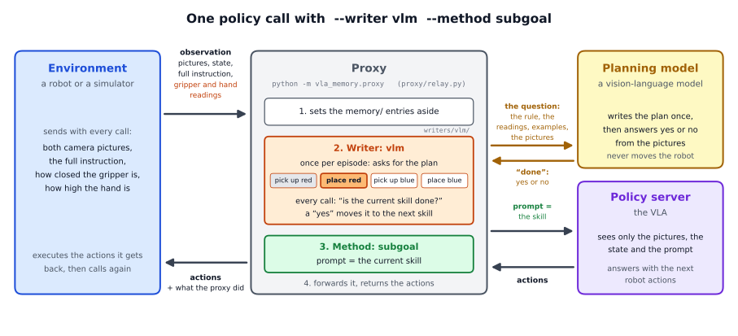
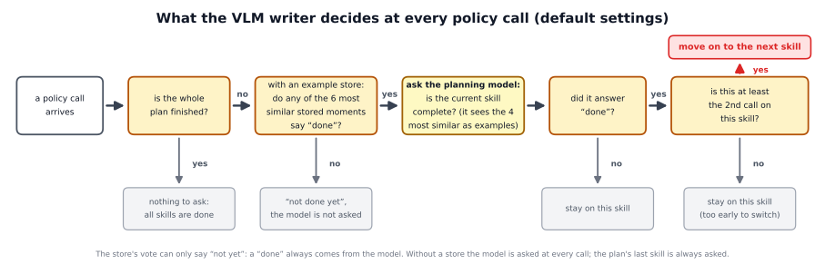

# The VLM writer in detail: a walkthrough of the code

This page follows one run of

```
python -m vla_memory.proxy --writer vlm --method subgoal --task vla_memory/tasks/red_blue_blocks.yaml \
    --vlm-url http://127.0.0.1:8100/v1 --vlm-model Qwen3.8-27B-INT4 --memory store.npz \
    --listen-port 8001 --upstream-port 8000
```

from the moment you press Enter to the last policy call, and names the function that does each step. You can leave out
`--task` for the reference task, the two `--vlm-` options when the model runs at these defaults, and `--memory` to run
without an example store. The short page, [docs/writers/vlm](../README.md), says what the VLM writer is for. The parts
every writer shares (the server, the relay, the connection to the policy) are explained step by step in the
[oracle walkthrough](../../oracle/detailed/README.md); this page concentrates on what the VLM writer adds. Section 10 lists
the steps to set it up and run it.



## The pieces

| file | what it does |
|---|---|
| `vla_memory/writers/vlm/writer.py` | `VlmWriter`: the writer the proxy talks to; hands each call's pictures and readings to the planner |
| `vla_memory/writers/vlm/planner.py` | `Planner`: writes the plan once, asks the question at every call, applies the decision rule, keeps the working memory and the decision log |
| `vla_memory/writers/vlm/plan.py` | the plan request, the fallback to the task's order, and the recovery step |
| `vla_memory/writers/vlm/question.py` | the exact texts that go to the model |
| `vla_memory/writers/vlm/gate.py` | the vote of the example store (the gate) |
| `vla_memory/writers/vlm/exemplar.py` | `ExemplarStore`, the example store: building, saving, loading, finding similar moments, showing them as examples |
| `vla_memory/writers/vlm/labels.py` | `PhaseLabeller`: labels for the frames of recorded demonstrations, to build a store |
| `vla_memory/writers/vlm/proprio.py` | `ProprioSummary`: turns the last readings into one sentence |
| `vla_memory/writers/vlm/options.py` | the command-line options and their defaults; builds the model client and loads the store |
| `vla_memory/vlm.py` | `OpenAICompatibleVLM`: the client that talks to the model's server |
| `vla_memory/fingerprint.py` | `ColourBlobFingerprint`: the colour summary that finds similar moments |
| `scripts/serve_vlm_vllm.sh`, `scripts/build_exemplar_store.py`, `scripts/run_proxy.sh` | start the model, build a store, start the proxy |

## 1. Start-up

`cli.main()` reads the command line as for every writer (oracle walkthrough, section 1). The VLM writer adds two groups of
options (`options.py`; section 8 lists them). Then `VlmWriter.build(args, task, extensions)`:

1. **Checks the options.** `--recovery` needs the object states in the answer, so it does not work together with the
   default yes/no answer (`--verdict-only`). An unknown model client (`--vlm-backend`) stops the proxy with a message.
2. **Loads the long-term memory** (`build_memory`). If an extension brings its own store (the session store does), that
   one is used. Otherwise `--memory` names an example store, one `.npz` file, which is loaded as `ExemplarStore` together
   with the task's colour summary (section 6); the log says `exemplar memory: N entries from store.npz`. A folder is
   refused with a message: the store's old folder format is gone, and the store that grows between episodes is the session
   store. Without either, the writer runs without a store.
3. **Builds the model client** (`build_vlm`): `OpenAICompatibleVLM` with the server's address (`--vlm-url`), the model's
   name (`--vlm-model`) and, if given, an API key (`--vlm-api-key`, or the environment variable `VLM_API_KEY`). It asks
   with temperature 0, so that the same question gets the same answer, allows at most 512 tokens per answer (256 for the
   plan), and waits up to 300 s. The model's reasoning mode is off unless you pass `--thinking`.
4. **Builds the planner** (`Planner.__init__`) with the decision rule. The defaults:
   - the gate is on: at every call the 6 stored moments most similar to the current pictures are looked up and vote
     (`--k-vote 6`), and the model is asked only if at least 1 of them votes "done" (`--gate-min-done 1`);
   - the model is shown the 4 most similar of those same 6 moments as examples (`--k 4`);
   - it answers yes or no only (`--verdict-only`);
   - one "yes" from the model is enough to move on (`--votes 1`);
   - a skill lasts at least 2 calls (`--min-calls 2`);
   - a question at every call (`--call-every 1`).

   It also prepares:
   - the answer format the server must enforce (`task.monitor_schema`). For a yes/no answer this is
     `{"current_skill_done": true or false}` and nothing else;
   - the readings summary (`ProprioSummary.from_task`): the gripper counts as closed from a closedness of 0.30 on, the last
     12 readings are kept, and the task file's note about heights is added;
   - the decision log, `<log>.planner.jsonl`, if `--log` was given.
5. **Writes the rule in effect to the log**, in one line (`log_planner_configuration`), for example
   `planner: gate on (the 6 nearest stored moments vote; asked from 1 'done' vote(s); last skill always asked); answer:
   verdict only; 4 example(s) per question, votes 1, min-calls 2, call-every 1`.

When the environment connects, the proxy's description of itself (its metadata) also names the model (`vlm`), the store
file (`memory`) and `k`, the number of examples per question.

## 2. What the environment sends

With every policy call, besides the policy's usual entries:

| entry | what the VLM writer does with it |
|---|---|
| `prompt` | the full instruction; the plan is written from it at the first call of an episode |
| `memory/exterior_raw`, `memory/wrist_raw` | the camera pictures at full size, shown to the model (without them, the policy's own smaller images are used) |
| `memory/gripper_closedness` | how closed the gripper is, from 0 (fully open) to 1 |
| `memory/hand_height` | how high the hand is above the table, in metres |
| `memory/step` | goes into the logs |
| `memory/new_episode`, `memory/episode` | where an episode begins |
| `memory/objects` | the episode's objects, for a task whose episodes hold only some of its objects |

The two readings are things every real robot knows about itself: the finger opening comes from the gripper's sensor, the
hand height from the joint angles. They tell the model what pictures show poorly, for example whether the fingers have
stopped on something.

## 3. The plan, once per episode

At the first call of an episode the relay calls `writer.start_episode(instruction, episode, objects)`, which is
`Planner.start_episode`:

1. **Fresh working memory** (`_reset`): no plan yet, position 0, all counters at 0, no readings.
2. **The episode's objects** (`_set_objects`). If the environment named them, the answer format is rebuilt so that only
   their skills are allowed.
3. **What the extensions add** (`extension_plan_input`): a line of text for the request, or a changed setting (an
   extension may, for example, ask for two "yes" answers in a row for this episode).
4. **The request** (`plan_messages`, sent by `ask_for_plan`). It is text only, without pictures:
   - the system text, from the task file's `plan_system`: "You decompose a natural-language instruction for a single robot
     arm into an ordered list of skills. The arm knows exactly these skills and nothing else: ...", followed by the list
     of skills and rules such as "a cube that was picked up must be placed before another cube is picked up";
   - the user text: `Instruction: "..."`, then the objects in the scene if they were named, then "Return the ordered skill
     list as JSON.";
   - the answer format (`task.plan_schema`): a list called `plan` with between 1 and `max_plan_len` entries, each of which
     must be one of the allowed skills. The server enforces it, so the model cannot invent a skill.
5. **The plan that is used** (`chosen_plan`). If the request worked and every skill is allowed, the model's plan is used,
   with the source "vlm". If the request failed (the server was down, it timed out, the answer was broken), the task
   file's order is used instead, with the source "fallback_skill_order".
6. **The record** (the instruction, the plan, its source, the time, the tokens and the settings) goes into the decision
   log. The proxy's log notes `plan`, `plan_source` and `plan_ms` at this call.

## 4. Every policy call



`VlmWriter.before_call` collects the call's pictures (`call.images()`: the raw pictures if they were sent) and the two
readings, and hands them to `Planner.observe`; the extensions' `before_decision` and `after_decision` hooks run around it.
With the default settings, this happens:

1. **Counting and remembering.** The call counters go up (`calls`, and `calls_in_skill` for the current skill), and the
   readings go into the summary (`ProprioSummary.push`). The extensions' `begin_call` hook runs.
2. **Is there anything to ask?** If the plan is finished (`done_all`), or this is not a call on which to ask
   (`--call-every` above 1 asks only every N-th call), the call is recorded and nothing else happens.
3. **The vote of the example store** (`retrieve_with_gate`), only with a store. The writer looks up the 6 stored moments
   most similar to the current pictures (section 6), and all 6 vote. A moment votes "done" if the skill that was active in
   it comes later in the task's order than the current skill. If none of the 6 votes "done", the call is settled as "not
   done yet" without asking the model, and the count of the model's "yes" answers (step 6) goes back to 0. If at least
   one votes "done", the model is asked, and the 4 most similar of these 6 moments become its examples. The gate can only
   ever say "not yet"; a "done" always comes from the model. The last skill of the plan is always asked, because no stored
   moment can come later than the task's last skill.
4. **The question** (`monitor_messages`), sent to the model (`Planner._ask`, `vlm.chat`). Section 5 shows it in full.
5. **The answer.** The server forces it into the answer format: `{"current_skill_done": true}` or `false`. If the request
   fails, the error is recorded and the call counts as "not done". (With `--recovery`, section 7, the answer is first
   checked for a wrongly held object.)
6. **Counting the model's "yes" answers** (`_count_vote`). This has nothing to do with the store's vote in step 3: here
   the writer counts how many times *in a row* the model has answered "yes" for the current skill. A "yes" raises the
   count, a "no" sets it back to 0. With the default `--votes 1`, a single "yes" is enough; with `--votes 2` the model would
   have to say "yes" at two calls in a row.
7. **Move on?** (`_advance_if_ready`). The writer moves to the next skill if:
   - there are enough "yes" answers in a row (`--votes`, default 1);
   - this is at least the 2nd call on the current skill (`--min-calls`, default 2);
   - and no extension objects (`allow_switch`).

   After the last skill, `done_all` becomes True and the writer stops asking.
8. **The record.** Everything about the call goes into the decision log. The proxy's log gets a short version: `queried`,
   `advanced`, `vlm_ms`, `skill_index`, `vlm` (the answer) and `recovery`.

Then the method sets the prompt from the new position (`SubgoalMethod.prompt` returns the current skill), and the policy is
called. Because all of this happens before the policy call, a "yes" reaches the policy in the same call.

## 5. What exactly the model sees

A question has a system text and a user message.

**The system text** comes from the task file (`task.system_text`): `system_head`, which explains the robot and asks the
model to be careful ("when in doubt, the skill is not yet complete"), plus `system_both`, which explains the two cameras
(`system_ext` instead with `--no-wrist`). That second part describes in detail how the wrist camera's picture looks when a
cube is held, when the fingers missed it, and when a cube merely lies under an open gripper. This wording matters a lot
(short page, findings).

**The user message** holds, in this order:

1. with an example store: a header and the four examples (section 6), each a short text and its two pictures;
2. the text of the question;
3. the two current pictures.

Here is the text of a real question, for the skill "place the red block", without examples:

```
Plan:
  1. pick up the red block  (done)
  2. place the red block  <- CURRENT
  3. pick up the blue block
  4. place the blue block

Current skill: "place the red block".
Completion criterion: Complete only when ALL THREE hold: (1) the gripper has opened again (closedness < 0.30) after having
been closed on the red cube, (2) the red cube rests on the table (it is no longer between the fingers), AND (3) the hand
has moved back UP away from the cube: hand at least 19 cm above the table (it is only 11-13 cm above the table while it
releases a cube resting on the table). NOT complete while the cube is still held, while it is being lowered, or while the
open hand is still down at the cube.

Robot proprioception (its own joint sensors, reliable): gripper open, closedness 0.04 (0 = fully open); open for the last
2 calls, after having been closed earlier; hand (gripper) height above the table 14.2 cm, descending (-9.8 cm); the hand is
11-13 cm above the table when it grasps or releases a cube resting on the table.

Picture 1 (external camera) and Picture 2 (wrist camera) show the scene NOW. Combine the proprioception with what you see:
the cameras tell you where the objects are, the sensors tell you whether the gripper is closed on something and how high
the hand is. Decide whether the current skill is complete.
```

- The plan is listed with the finished skills marked "(done)" and the current one "<- CURRENT".
- The completion criterion is the task file's rule for the verb ("place"), with the object filled in (`task.criterion`).
- The readings sentence comes from `ProprioSummary.text`. It says whether the gripper is closed and for how many calls,
  how high the hand is, and whether it is rising or descending.
- The model answers `{"current_skill_done": false}`: the gripper is open, but the hand is still low.

With examples, the text starts with "Now the CURRENT observation." and the current pictures get the next free numbers, for
example Picture 9 and Picture 10 after four examples of two pictures each.

## 6. The example store: the long-term memory

**What an entry is.** One moment of a past episode: its two camera pictures, its colour summary, and labels that were
known when it was recorded: which skill was active (as its position in the task's order), the state of every object
(`on_table`, `held_lifted`, `held_at_table`), and the gripper.

**How a store is built.** `scripts/build_exemplar_store.py` takes recorded demonstrations and keeps every 8th frame
(`--stride 8`). The labels come from the demonstrations' own phases: the script that recorded them noted at every frame
what the robot was doing (approach, close, lift, lower, open, retreat), and the task file's `demo_phases` turns these into
skills and object states (`labels.PhaseLabeller`). The store is saved as one `.npz` file (`ExemplarStore.save`). No store
comes with the repository.

**The colour summary** (`ColourBlobFingerprint` in `fingerprint.py`). For each of the two pictures:

- a tiny 12 x 16 colour thumbnail, which captures the layout of the scene;
- for each object colour (the task file's `fingerprint.colours`): how many pixels have that colour, where their centre
  is, how far they spread, and whether they touch the picture's edge. This says where the objects are and how large they
  look.

The parts are weighted (the thumbnail 1, the colour parts 6) and the whole is scaled to length 1. It runs on the CPU and
needs no GPU.

**How similar moments are found** (`ExemplarStore.retrieve`). The current pictures get a colour summary too, and the store
compares it with every entry (cosine similarity, a single matrix product). The most similar entries are taken, at most two
from the same past episode, so that the examples are not near-copies of each other. With the gate on, the writer takes 6
(`--k-vote`): all 6 vote, and the 4 most similar of them (`--k`) are shown to the model. Without the gate it takes 4 and
shows them.

**How they are shown** (`fewshot_content`). A header says how many examples follow and in which order their pictures
come. Then each example gets one line, for example:

```
Example 1 (Picture 1: exterior, Picture 2: wrist): red cube = held_lifted, blue cube = on_table, gripper = closed,
gripper high above table = true; for the skill "place the red block": current_skill_done = false.
```

followed by its two pictures. The right answer for the current skill comes from the entry's label: "done" if the skill
that was active in the stored moment comes later than the current skill. The same rule decides the votes of the gate.

**Read only.** During an episode the store is never changed. The store that grows by itself is the
[session store](../../../methods/session_store/README.md): with `--with session_store` it takes the place of `--memory`,
fills itself from the robot's own episodes, and the planner reads it in exactly the same way (section 9).

## 7. Recovery (`--recovery`)

Sometimes the robot still holds one block when the plan already says "pick up" the next one. With `--recovery`, which
needs answers with object states (`--no-verdict-only`), the writer checks the model's report of the object states. If
another object is still held, it inserts the put-down skill for that object before the pick (`recovery_fix`), for example
"place the red block" before "pick up the blue block". The task file's `recovery` section says which verb puts an object
down before which other verb.

## 8. The options

| option | default | what it does |
|---|---|---|
| `--vlm-url` | `http://127.0.0.1:8100/v1` | where the model's server is |
| `--vlm-model` | `Qwen3.8-27B-INT4` | the model's name on that server |
| `--vlm-backend`, `--vlm-arg KEY=VALUE` | `openai` | another kind of client, and its own settings |
| `--vlm-api-key` | the variable `VLM_API_KEY` | an API key, sent as a bearer token |
| `--thinking` | off | turn on the model's reasoning mode |
| `--no-chat-template-kwargs` | off | for servers that reject the reasoning switch |
| `--memory FILE` | none | the example store, one `.npz` file |
| `--k` | 4 | how many of the looked-up moments are shown to the model as examples (the most similar ones) |
| `--gate` / `--no-gate` | on | the vote of the store (only with a store) |
| `--k-vote` | 6 | how many stored moments are looked up and vote in the gate |
| `--gate-min-done` | 1 | how many of them must vote "done" for the model to be asked |
| `--verdict-only` / `--no-verdict-only` | on | a yes/no answer only, or also the object states, the gripper and a reason |
| `--brief` | off | with `--no-verdict-only`: leave out the reason |
| `--votes` | 1 | how many "yes" answers in a row from the model are needed to move on (not related to the gate's vote) |
| `--min-calls` | 2 | the earliest call on a skill at which it may end |
| `--call-every` | 1 | ask only every N-th policy call |
| `--recovery` | off | put down a wrongly held object first (section 7) |
| `--no-wrist` | off | show the model only the outside camera |
| `--upscale` | 1 | enlarge the pictures by this factor before sending them |

## 9. Extensions

Other memories can join the planner as extensions (`--with NAME`), for example the preference notebook and the session
store. An extension can add a line to the plan request and to every question, show its own examples, add fields to the
records, change a setting for an episode, and refuse a switch (`allow_switch`). The planner calls them at fixed points:
before the plan, at the start of a call, before and after the decision, and at the end of a call.

The session store goes one step further: it does not add to the example store, it replaces it. `build_memory` takes an
extension's store before the file of `--memory`, and the planner reads either through the same interface (`MemoryStore` in
`vla_memory/memory.py`: `retrieve`, `describe_hit`, `fewshot_content`). So the vote and the examples of section 4 work
unchanged; only the source of the moments differs.

## 10. Setting it up and running it, step by step

1. **Start the model server.** `scripts/serve_vlm_vllm.sh` serves a model with vLLM on port 8100 (`PORT`), under the name
   `NAME`; on one 24 GB GPU, for example:

   ```
   MODEL=RedHatAI/Qwen3.8-27B-INT4 GPUS=0 TP=1 NAME=Qwen3.8-27B-INT4 ./scripts/serve_vlm_vllm.sh
   ```

   Any server with an OpenAI-compatible chat API that takes pictures and enforces a JSON schema works. Give its address
   with `--vlm-url`, the model's name with `--vlm-model`, and an API key in the environment variable `VLM_API_KEY`.
2. **Check the task file's texts** ([Creating a new task](../../../tasks/README.md)): the completion rule of every verb
   (`criteria`), the description of the robot and the cameras (`system_head`, `system_both`), the plan request
   (`plan_system`) and the readings sentence (`proprio`). The model judges by these words, so try them on recorded pictures
   of your robot.
3. **Optional: build an example store** from recorded demonstrations:

   ```
   python scripts/build_exemplar_store.py --demos <demo folder> --episodes 0-19 --stride 8 --out stores/ep0-19_s8.npz
   ```

   The folder holds one `episode_NNNN.npz` per demonstration: the camera pictures (named by `--cameras`, default
   `exterior wrist`), a `state` array whose column `--gripper-column` (default 7) is the gripper's closedness, and a
   `phase` per frame, which the task file's `demo_phases` turns into labels (`--task` for another task file). The script
   prints how many entries it built and how the labels are spread over the object states, the gripper and the skills.
4. **Start the policy server**, trained for your method, and then the proxy:

   ```
   python -m vla_memory.proxy --writer vlm --method subgoal --task task.yaml --memory stores/ep0-19_s8.npz \
       --log vlm_run.jsonl --listen-port 8001 --upstream-port 8000
   ```

   The log shows, in this order: the store's size (`exemplar memory: ...`), the decision rule (`planner: ...`, section 1),
   the policy server's metadata, and `proxy listening on 127.0.0.1:8001 (writer vlm, method subgoal)`.
   `scripts/run_proxy.sh` starts the same command from environment variables (`UPSTREAM_PORT`, `LISTEN_PORT`, `MEMORY`,
   `VLM_URL`, ...).
5. **Run the environment** against the proxy's port instead of the policy's. At the first call of every episode the log
   shows the plan and where it came from, for example `episode seed1001 plan (vlm): ['pick up the red block', ...]`;
   `fallback_skill_order` instead of `vlm` means that the plan request failed.
6. **Check the run** in the two logs:
   - **the proxy's log** (`vlm_run.jsonl`, one line per call) holds `queried` (whether the model was asked), `advanced`
     (whether a skill was completed), `vlm_ms`, `skill_index`, `vlm` (the answer) and `recovery`. The first call of an
     episode also carries the plan (`plan`, `plan_source`, `plan_ms`);
   - **the decision log** (`vlm_run.jsonl.planner.jsonl`) holds one record for the plan (the instruction, the plan, its
     source, the settings) and one for every call: the step, the skill, the readings, whether the gate settled it
     (`gated`) and its vote (`vote`), the examples shown (`exemplars`), the answer (`vlm`), the time, the tokens, the "yes"
     count (`consecutive_done`) and whether the writer moved on (`advanced`).
7. **Stop the proxy** with Ctrl-C or SIGTERM. It closes the open connections, lets the extensions save the last episode,
   and closes its log.

## 11. Limitations

- **Speed.** Every question is a request to a large model, and the robot waits for the answer at every call.
  `--call-every` and the gate reduce the number of questions.
- **Hardware.** It needs a model server with a GPU.
- **It depends on the wording.** The model judges from pictures, guided by the task file's description of the cameras. A
  misleading description of the wrist camera makes it judge wrongly, and the policy then fails more often.
- **No going back.** A wrong "yes" moves the plan forward for good, and the skill in between is skipped.
- **The plan is written once.** If the model misreads the instruction, the whole episode follows the wrong plan. The
  fallback to the task's order protects only against a broken answer, not against a wrong one.
- **Hidden things stay hidden.** It sees only what the two cameras show at that moment, plus the readings; an object
  hidden from both cameras is invisible to it.
- **The vote assumes a fixed order.** The gate decides by the task's order of skills. For a task whose objects can be
  handled in any order, that order is arbitrary between objects of the same stage; use `--no-gate` there.
- **The examples must match the scene.** The colour summary works for clearly coloured objects. For other scenes, the
  session store can find moments by a learned image summary (`--store-key dinov2` or `siglip`), or you write your own
  `Fingerprint` (`vla_memory/fingerprint.py`).
